# Manual de Operação — Sistema PCP

> Guia para quem opera o sistema no dia a dia: gestores e administradores que
> cadastram fornecedores, partes/peças e produtos acabados. Não cobre a API
> nem detalhes de implementação — para isso, veja
> [3_ESPECIFICACAO_APIS.md](3_ESPECIFICACAO_APIS.md) e
> [5_GUIA_IMPLEMENTACAO.md](5_GUIA_IMPLEMENTACAO.md).

## Índice

1. [Acesso ao sistema](#1-acesso-ao-sistema)
2. [Navegação geral](#2-navegação-geral)
3. [Painel](#3-painel)
4. [Fornecedores](#4-fornecedores)
5. [Partes e peças](#5-partes-e-peças)
6. [Produtos acabados](#6-produtos-acabados)
7. [Estrutura de produtos (BOM)](#7-estrutura-de-produtos-bom)
8. [Cotações](#8-cotações)
9. [Pedidos de compra](#9-pedidos-de-compra)
10. [Estoque e recebimento](#10-estoque-e-recebimento)
11. [Necessidade de compra e relatórios](#11-necessidade-de-compra-e-relatórios)
12. [Aparência e preferências](#12-aparência-e-preferências)
13. [Dados da empresa](#13-dados-da-empresa)
14. [Auditoria](#14-auditoria)
15. [Parâmetros regionais](#15-parâmetros-regionais)
16. [Banco de dados e segurança](#16-banco-de-dados-e-segurança)
17. [Parâmetros de negócio](#17-parâmetros-de-negócio)
18. [Integrações](#18-integrações)
19. [Perfis e permissões](#19-perfis-e-permissões)
20. [Usuários](#20-usuários)
21. [Clientes](#21-clientes)
22. [Centros de trabalho](#22-centros-de-trabalho)
23. [Pedidos de venda](#23-pedidos-de-venda)
24. [Produção: Kanban e ordens de produção](#24-produção-kanban-e-ordens-de-produção)
25. [Rastreabilidade e metrologia](#25-rastreabilidade-e-metrologia)
26. [Recebimento por nota fiscal](#26-recebimento-por-nota-fiscal)
27. [Lotes, séries e rastreabilidade de componentes](#27-lotes-séries-e-rastreabilidade-de-componentes)
28. [Documentos e anexos](#28-documentos-e-anexos)
29. [Painéis por setor](#29-painéis-por-setor)
30. [Ajuda contextual](#30-ajuda-contextual)
31. [Perguntas frequentes](#31-perguntas-frequentes)

---

## 1. Acesso ao sistema

Abra o sistema no navegador e entre com o usuário e a senha fornecidos pelo
administrador.

- O ícone de olho ao lado do campo Senha mostra o que foi digitado, para
  conferir antes de enviar.
- No rodapé do formulário aparece a **versão do sistema em execução** e a
  data e a hora em que ela foi publicada (por exemplo, "Versão 1.1.0
  (a125f59) · publicada em 29/10/2026, 08:38"). Informe esse texto ao
  suporte ao relatar um problema; ele também mostra se o servidor já está
  com a atualização mais recente.
- Se o usuário ou a senha estiverem errados, uma mensagem explica o problema
  logo abaixo do formulário.
- Se a sessão cair por inatividade (o sistema encerra a sessão automaticamente
  depois de um tempo sem uso) ou expirar, o sistema volta para esta tela e
  avisa o motivo. Basta entrar de novo — nada do que já foi salvo se perde.
- No primeiro acesso (ou depois que o administrador redefinir a sua senha),
  o sistema pede que você crie a sua própria senha antes de continuar. Para
  trocá-la quando quiser, use **Preferências › Alterar senha**. A senha
  precisa ter **ao menos 10 caracteres**, não pode conter o seu login nem ser
  uma senha óbvia (como `1234567890` ou `senha12345`).
- Depois de **5 senhas erradas seguidas**, a sua conta fica bloqueada por
  15 minutos (30 e depois 60 se continuar errando), mesmo que a senha certa
  seja digitada. O administrador libera na hora redefinindo a sua senha.
- Trocar a senha (ou ter a senha redefinida, ou o acesso bloqueado) encerra
  as sessões abertas em outros computadores: elas voltam para esta tela com
  o aviso "Sua sessão foi encerrada".
- Todas as telas, inclusive esta, têm um botão **Ajuda** no canto superior
  direito. Veja a seção [30](#30-ajuda-contextual).

---

## 2. Navegação geral

Depois de entrar, o sistema mostra a moldura padrão de todas as telas
internas: cabeçalho no topo, navegação lateral à esquerda e o conteúdo da
tela atual à direita.

- **Cabeçalho**: nome e perfil de quem está operando, o botão **Ajuda** e o
  botão **Sair**.
- **Navegação lateral**: acesso ao Painel, aos cadastros (Fornecedores,
  Partes e peças, Produtos acabados), à Estrutura de produtos e a Compras
  (Cotações, Pedidos de compra, Necessidade de compra). O item em cinza, com
  "Próxima sprint" (Produção), ainda não foi implementado.
- **Sair**: encerra a sessão imediatamente e volta para o login.

### Imprimir ou salvar em PDF

Toda tela tem o botão **Imprimir / PDF** no cabeçalho (e os diálogos, um
ícone de impressora ao lado do X). Ele abre a impressão do navegador: escolha
a impressora ou, em **Destino**, **Salvar como PDF**. O **Ctrl+P** do
navegador faz o mesmo.

No papel/PDF sai o que está na tela -- tabelas, filtros aplicados, gráficos e
detalhes -- sem o menu e sem os botões, com um cabeçalho de impressão (tela,
empresa, quem imprimiu, data e hora), em folha clara mesmo no tema escuro. O
nome sugerido do arquivo é o da tela com a data e a hora. Com um diálogo
aberto (por exemplo, o kardex), sai só o diálogo. Em listas paginadas, sai a
página que está na tela; para o histórico inteiro, use o **Exportar CSV**
onde houver.

---

## 3. Painel

O Painel é a tela inicial: um resumo do que pede atenção agora, atualizado
sozinho a cada minuto ("Atualizado às …" mostra a última leitura; **Atualizar
agora** força uma nova).

Cada pessoa vê só os cartões dos módulos que pode consultar:

- **Produção**: OPs em atraso, metrologia vencendo em 30 dias e o gráfico
  **OPs por etapa** (aguardando liberação e em cada etapa do Kanban).
- **Compras**: pedidos de compra a receber e em atraso.
- **Estoque**: insumos em nível crítico e lotes vencendo em 30 dias.
- **Recebimento**: notas fiscais aguardando efetivação (rascunho ou
  conferida).
- **Vendas**: pedidos em produção, prontos para envio e entregues hoje.

Os cartões com problema (atraso, vencimento, crítico) aparecem com um ícone de
alerta e a borda colorida. Clicar no cartão abre a tela correspondente. O
cartão **Conexão com o servidor** avisa se a API está fora do ar.

Os painéis completos de cada setor estão na seção
[29](#29-painéis-por-setor).

---

## 4. Fornecedores

Tela de cadastro de quem abastece as partes e peças usadas na produção.

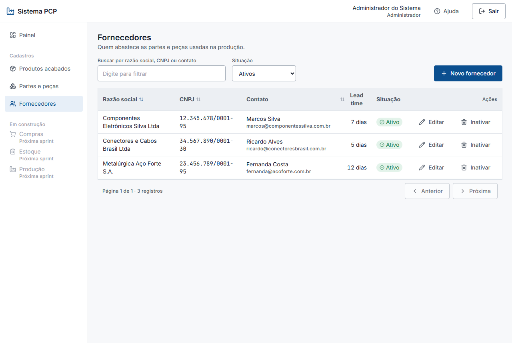

### 4.1 Buscar, filtrar e ordenar

- O campo **Buscar por razão social, CNPJ ou contato** filtra a lista
  conforme você digita (não precisa apertar Enter).
- O seletor **Situação** troca entre Ativos (padrão), Inativos e Todos.
- Clique no cabeçalho de **Razão social**, **CNPJ** ou **Lead time** para
  ordenar a lista por essa coluna; clique de novo para inverter a ordem.

### 4.2 Cadastrar um fornecedor

Clique em **Novo fornecedor**.

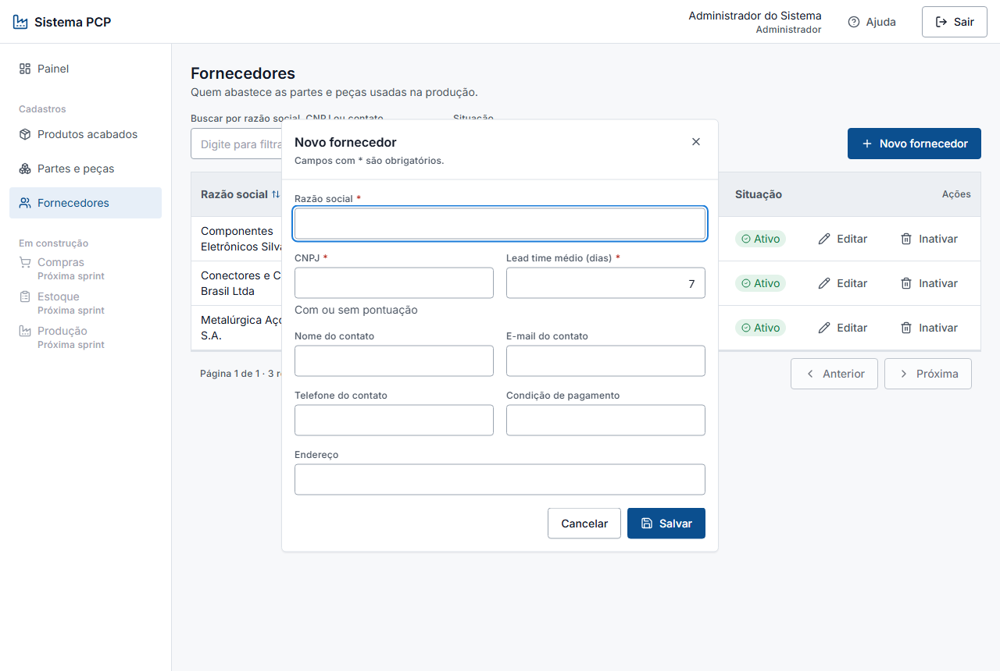

Campos marcados com `*` são obrigatórios: **Razão social**, **CNPJ** e
**Lead time médio**. O CNPJ pode ser digitado com ou sem pontuação — o
sistema aceita os dois formatos e exibe sempre pontuado na lista. Os demais
campos (contato, endereço, condição de pagamento) são opcionais.

Se o CNPJ já pertencer a outro fornecedor cadastrado (mesmo que ele esteja
inativo), o sistema recusa o cadastro e explica o motivo no topo do
formulário, sem fechar a janela — corrija o CNPJ e tente de novo.

### 4.3 Editar e reativar

Clique em **Editar** na linha do fornecedor.

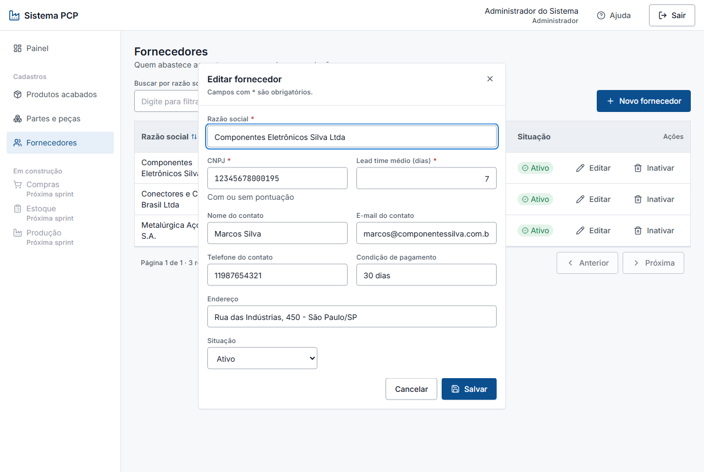

O formulário abre preenchido com os dados atuais. Ao editar (só ao editar,
não ao cadastrar um novo) aparece também o campo **Situação** — é a única
forma de reativar um fornecedor que foi inativado antes: mude a situação
para "Ativo" e salve.

### 4.4 Inativar

Clique em **Inativar** na linha do fornecedor. O sistema pergunta antes de
agir:

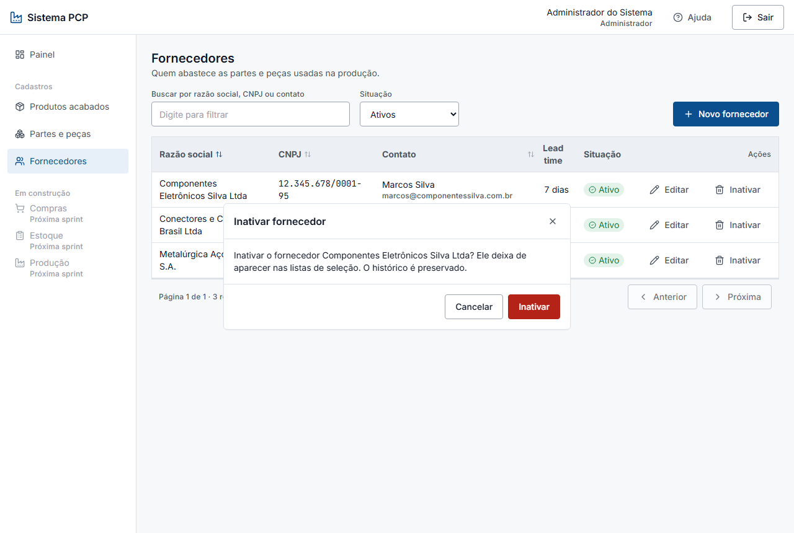

Inativar **preserva o histórico** — o registro não é apagado, apenas some da
lista de fornecedores ativos e das listas de seleção usadas em outras telas
(por exemplo, o "Fornecedor padrão" de uma peça). Para ver fornecedores
inativos, mude o filtro Situação para "Inativos" ou "Todos".

---

## 5. Partes e peças

Tela de cadastro de componentes comprados e consumidos na montagem.

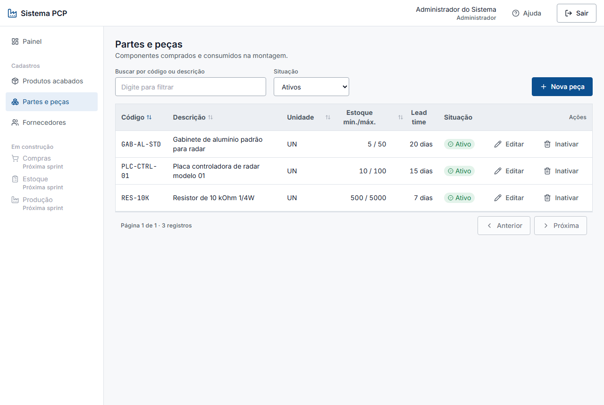

Funciona como a tela de Fornecedores (busca, filtro de situação, ordenação
por coluna, editar e inativar/reativar — veja a seção [4](#4-fornecedores)
para o passo a passo). O que muda é o formulário de cadastro:

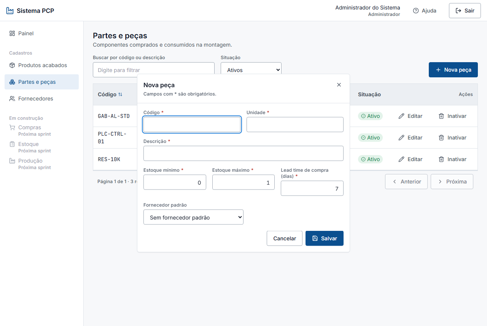

- **Código**, **Unidade** e **Descrição** são obrigatórios.
- **Estoque mínimo** e **Estoque máximo** definem a faixa de reposição usada
  pelo módulo de Estoque (seção [10](#10-estoque-e-recebimento)) para decidir
  quando repor.
- **Lead time de compra** é o prazo esperado, em dias, entre pedir e receber
  a peça do fornecedor.
- **Fornecedor padrão** é opcional — só lista fornecedores ativos, e é usado
  pela tela de [Necessidade de compra](#11-necessidade-de-compra-e-relatórios)
  para agrupar sugestões de compra.

---

## 6. Produtos acabados

Tela de cadastro do que é vendido ao cliente.

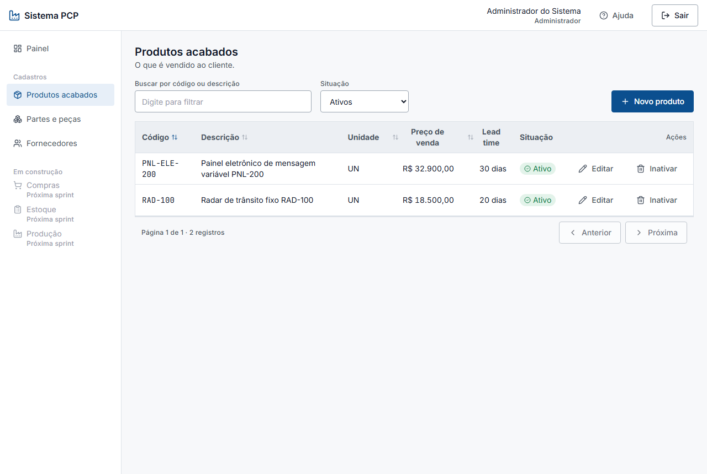

Também segue o mesmo padrão de busca, filtro, ordenação, editar e
inativar/reativar da seção [4](#4-fornecedores). O formulário de cadastro:

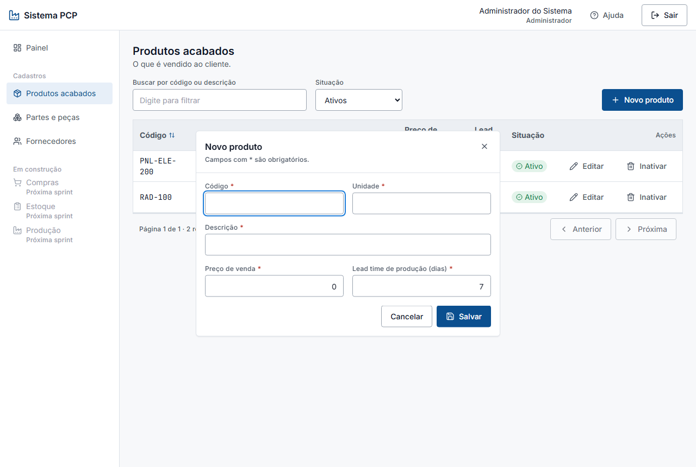

- **Código**, **Unidade**, **Descrição** e **Preço de venda** são
  obrigatórios.
- **Lead time de produção** é o prazo esperado, em dias, para produzir uma
  unidade — informação que o módulo de produção (Sprint 6) vai usar para
  planejar ordens.

---

## 7. Estrutura de produtos (BOM)

Tela que define do que é feito cada produto acabado: a lista de partes/peças
e a quantidade de cada uma necessárias para montar **1 unidade**. É a "receita"
que o módulo de produção (Sprint 6) vai seguir para calcular o consumo de
insumos de uma ordem de produção.

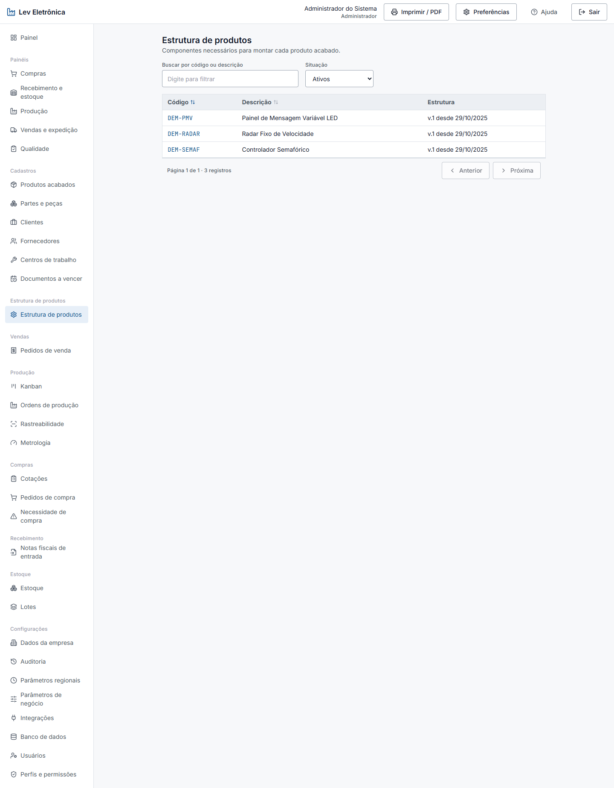

A lista mostra todos os produtos acabados; a coluna **Estrutura** indica
"Sem estrutura ativa" para quem ainda não tem BOM cadastrada, ou a versão
**vigente** e a data de início da vigência de quem já tem (por exemplo,
"v.2 desde 01/09/2026").

### 7.1 Criar a primeira versão

Clique no código de um produto sem estrutura para abrir o detalhe, e em
**Criar estrutura**. **Vigência a partir de** (já preenchida com a data de
hoje) e ao menos **um item** (peça e quantidade) são obrigatórios. Use
**Adicionar item** para incluir mais peças. Ao salvar, você volta para o
detalhe do produto, já mostrando a versão recém-criada.

### 7.2 Nova versão

Uma estrutura de produto **nunca é editada nem apagada** — RF1.3 exige
preservar o que cada ordem de produção passada realmente usou. Para mudar a
composição, use **Nova versão**, no detalhe do produto.

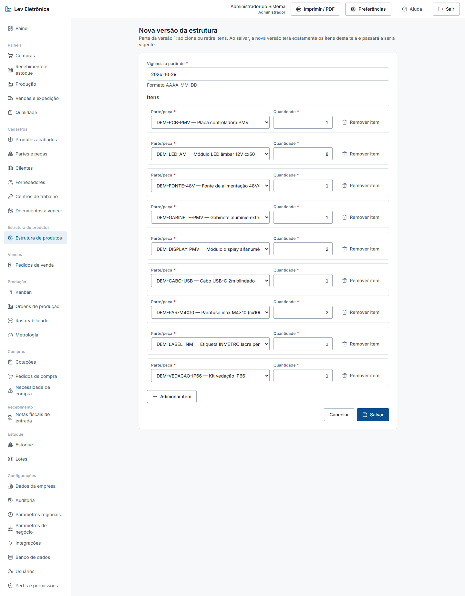

O botão abre uma tela que **replica a estrutura da versão que está sendo
exibida**, com todos os itens já preenchidos. Nessa tela você:

- **troca** a peça ou ajusta a quantidade de um item;
- **retira** um item com **Remover item**;
- **adiciona** peças com **Adicionar item**.

Ao confirmar com **Salvar**, a nova versão é composta por **todos os itens
que estiverem na tela** — nem mais, nem menos. Ela recebe o próximo número
(v.3, por exemplo) e passa a ser a **vigente**; a versão que valia até então é
encerrada (ganha data de fim de vigência) e continua guardada. A nova
vigência pode começar em qualquer data; se for anterior à da versão
encerrada, o fim dela é ajustado para não ficar menor que o início.

### 7.3 Ver todas as versões e definir a vigente

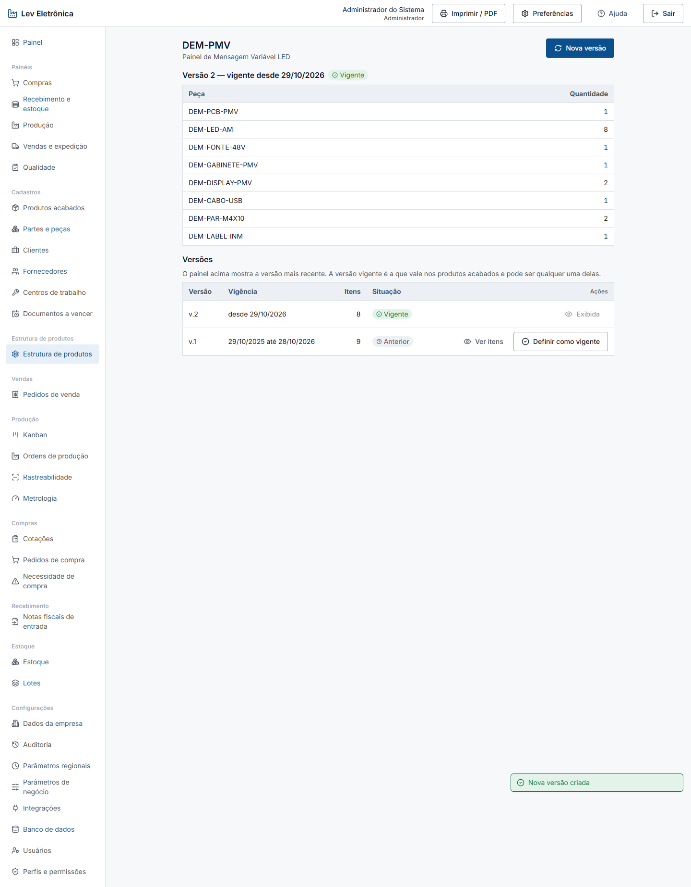

O painel do detalhe mostra sempre a **versão mais recente**. Logo abaixo, a
lista **Versões** traz todas elas, com vigência, quantidade de itens e a
situação: **Vigente** (a que vale hoje) ou **Anterior**.

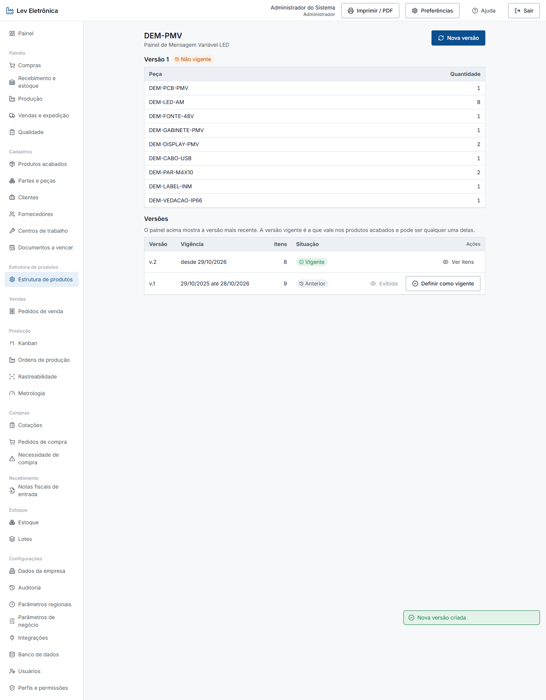

- **Ver itens** exibe no painel os itens da versão escolhida. Se ela não for a
  vigente, o painel mostra o selo **Não vigente**.
- **Definir como vigente** (para quem pode incluir estruturas) torna a versão
  escolhida a vigente, **seja ela qual for** — inclusive uma mais antiga, para
  desfazer uma troca. A vigente anterior é encerrada hoje e a escolhida volta a
  valer sem data de fim.
- **Nova versão** parte da versão exibida no painel.

A versão **vigente** é a que aparece em **Produtos acabados** e a que as
ordens de produção usam. Só existe **uma vigente por produto de cada vez**.

---

## 8. Cotações

Tela de pedido de preço a um fornecedor, antes de qualquer compromisso de
compra.

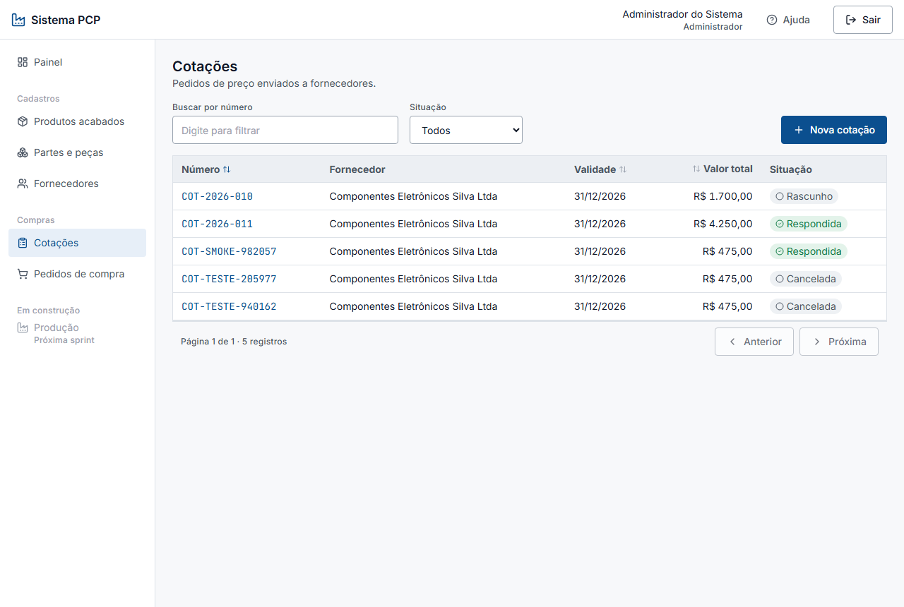

### 8.1 Buscar, filtrar e ordenar

Segue o mesmo padrão das telas de cadastro (seção [4.1](#41-buscar-filtrar-e-ordenar)),
trocando "Situação" por status da cotação: Rascunho, Enviada, Respondida ou
Cancelada.

### 8.2 Cadastrar uma cotação

Clique em **Nova cotação**. Diferente dos cadastros, esta tela abre uma
página inteira, não uma janela — uma cotação tem uma lista de itens que não
cabe bem num espaço pequeno.

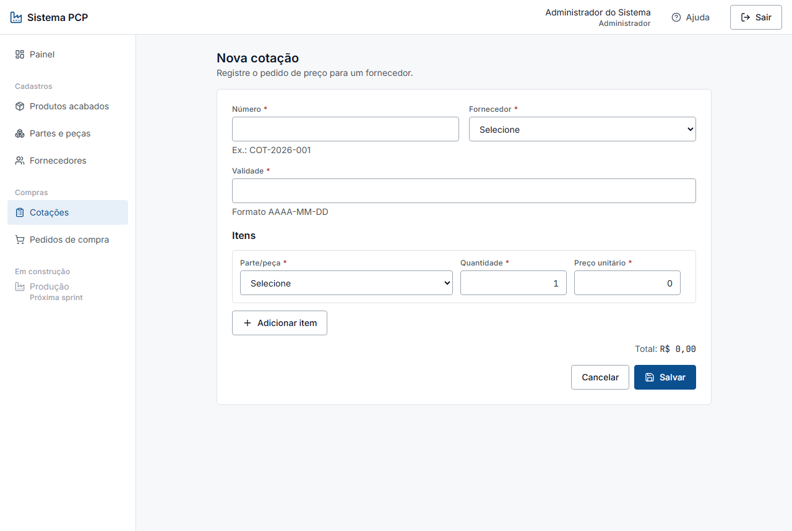

**Número**, **Fornecedor**, **Validade** e ao menos **um item** (peça,
quantidade e preço unitário) são obrigatórios. Use **Adicionar item** para
incluir mais peças; o total é recalculado a cada alteração. Ao salvar, você
vai para a tela de detalhe da cotação recém-criada.

Uma cotação também pode chegar já parcialmente preenchida, vinda da tela de
[Necessidade de compra](#11-necessidade-de-compra-e-relatórios) — nesse caso,
fornecedor e itens (peça e quantidade sugerida) já vêm prontos, faltando só o
preço negociado.

### 8.3 O ciclo de vida de uma cotação

A cotação nasce em **Rascunho** e segue uma trilha de três etapas, mostrada
na tela de detalhe:

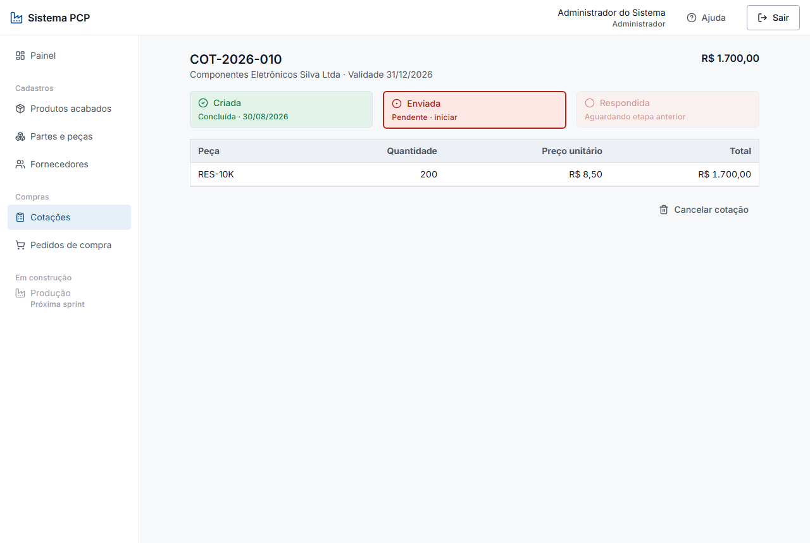

- **Criada** — sempre concluída, é o momento do cadastro.
- **Enviada** — clique na etapa para confirmar que a cotação foi encaminhada
  ao fornecedor. Muda o status para Enviada.
- **Respondida** — clique na etapa para registrar o preço que o fornecedor
  respondeu, item por item, e a data da resposta. O valor total é
  recalculado com os preços negociados.

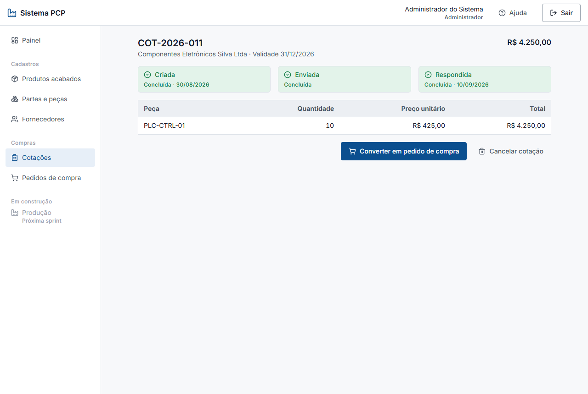

Com a cotação **Respondida**, aparece o botão **Converter em pedido de
compra**: informe o número do novo PC, a data de entrega prevista e a
condição de pagamento, e o sistema cria um pedido de compra com o
fornecedor, as peças e os **preços já negociados** — sem digitar tudo de
novo. Veja a seção [9](#9-pedidos-de-compra).

**Cancelar cotação** fica disponível em qualquer ponto antes do
cancelamento; preserva o histórico e substitui a trilha por um aviso — uma
cotação cancelada não volta a nenhum status anterior.

---

## 9. Pedidos de compra

Tela do pedido de compra propriamente dito — o compromisso formal com o
fornecedor.

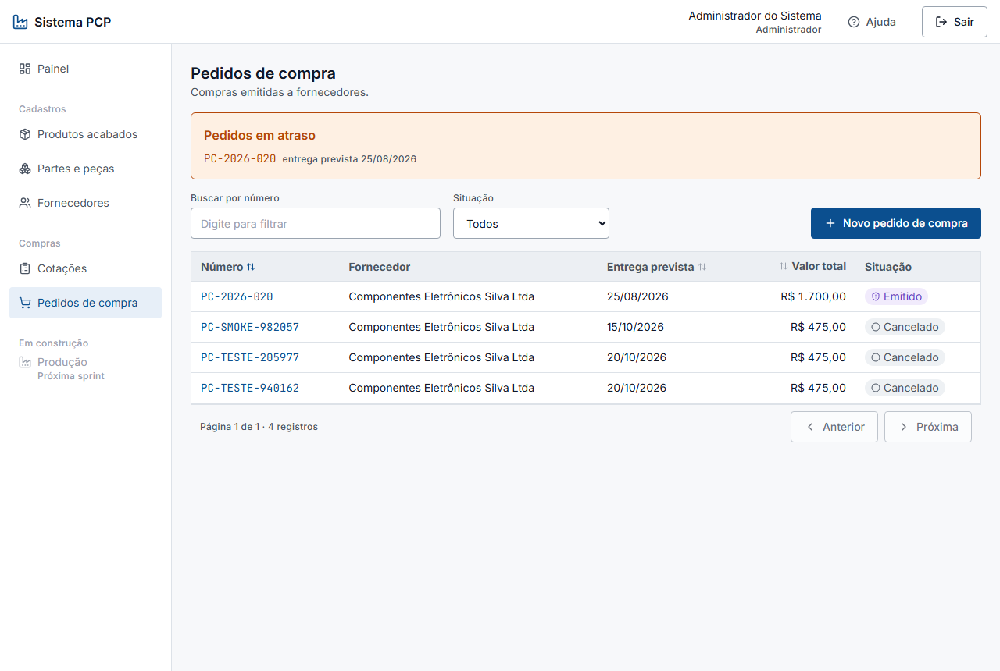

Segue o mesmo padrão de busca, filtro por status e ordenação da tela de
Cotações. Quando existe algum pedido com a entrega vencida, um bloco
**Pedidos em atraso** aparece no topo da lista (é o mesmo indicador do
Painel — veja a seção [3](#3-painel)). O botão **Exportar CSV** baixa a
lista completa de pedidos, sem filtro — veja a seção
[11](#11-necessidade-de-compra-e-relatórios).

### 9.1 Cadastrar um pedido de compra

Clique em **Novo pedido de compra**.

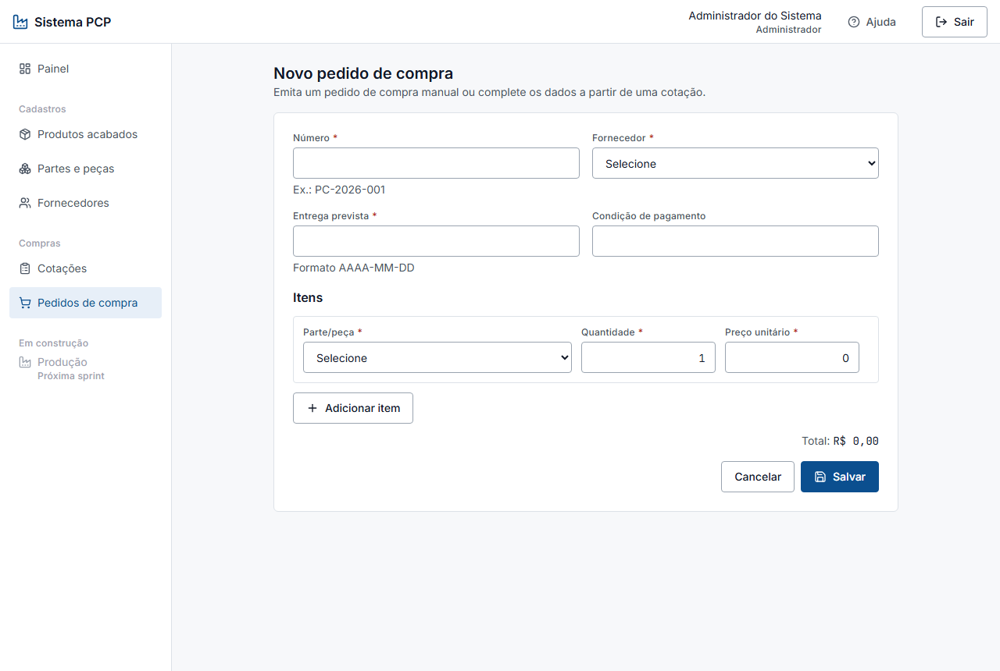

Assim como a cotação, é uma página inteira com uma lista de itens.
**Número**, **Fornecedor**, **Entrega prevista** e ao menos um item são
obrigatórios; **Condição de pagamento** é opcional. Um pedido também pode
nascer de uma cotação respondida, pelo botão "Converter em pedido de
compra" da seção [8.3](#83-o-ciclo-de-vida-de-uma-cotação) — nesse caso, o
pedido já sai vinculado à cotação de origem.

### 9.2 O ciclo de vida de um pedido de compra

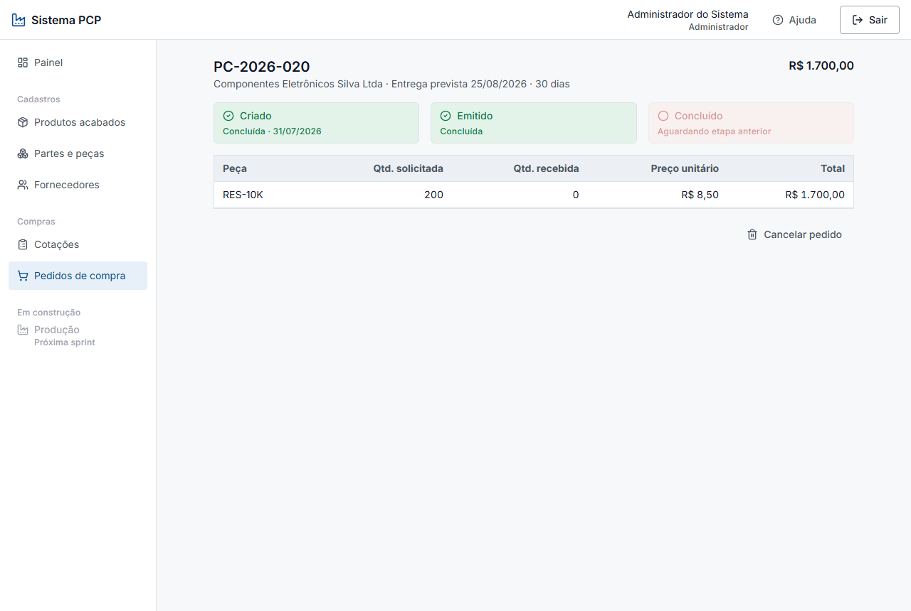

A trilha aqui tem três etapas: **Criado** (sempre concluída), **Emitido**
(clique para confirmar o envio ao fornecedor) e **Concluído** — esta última
fica acionável assim que o pedido é emitido e é onde se registra o
recebimento da mercadoria (seção [10.3](#103-receber-mercadoria-de-um-pedido-de-compra)).
Se o pedido veio de uma cotação, um link **Ver cotação de origem** aparece
abaixo do número.

**Cancelar pedido** fica disponível enquanto o pedido não estiver
Concluído nem já Cancelado; preserva o histórico.

---

## 10. Estoque e recebimento

Tela que mostra o saldo de cada parte/peça em armazém e permite corrigir esse
saldo manualmente. É também o destino do recebimento de mercadoria: cada
pedido de compra emitido dá entrada em estoque conforme o fornecedor entrega.

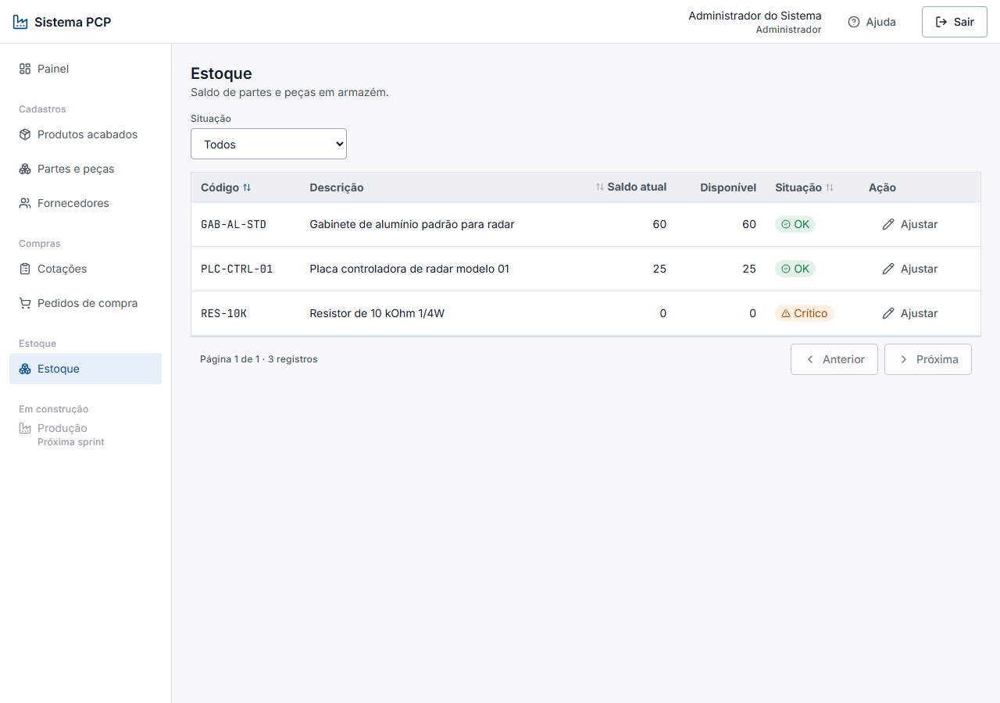

O botão **Exportar CSV** baixa o saldo completo, sem filtro — veja a seção
[11](#11-necessidade-de-compra-e-relatórios).

### 10.1 Consultar o saldo

- O seletor **Situação** filtra por OK, Crítico ou Bloqueado (o padrão mostra
  todos).
- Clique no cabeçalho de **Código** ou **Saldo atual** para ordenar por essa
  coluna; clique de novo para inverter a ordem.
- **Disponível** é o saldo que já desconta o que estiver reservado para uma
  ordem de produção — a reserva por OP só chega no módulo de produção
  (Sprint 6), então hoje é sempre igual ao Saldo atual.
- **Situação** resume o saldo num selo: **Crítico** quando o saldo está no
  ou abaixo do estoque mínimo cadastrado na peça (seção [5](#5-partes-e-peças)),
  **OK** quando está acima, ou **Bloqueado**. Uma peça recém-cadastrada nasce
  com saldo zero e por isso sempre começa em Crítico, mesmo que o estoque
  mínimo cadastrado seja zero (veja a seção [31](#31-perguntas-frequentes)).

### 10.2 Ajustar o saldo manualmente

Clique em **Ajustar** na linha da peça.

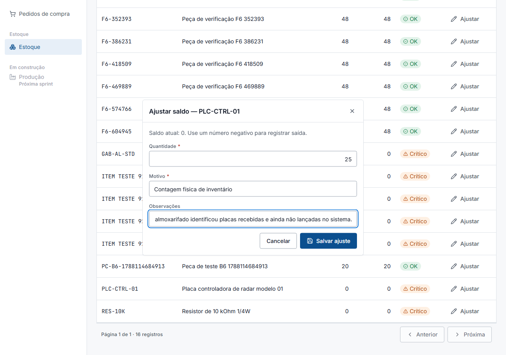

**Quantidade** e **Motivo** são obrigatórios; **Observações** é opcional. Use
um número positivo para registrar entrada (por exemplo, uma contagem de
inventário que encontrou mais peças do que o sistema registrava) e um número
negativo para registrar saída (perda, avaria, consumo não rastreado). O
sistema recusa um ajuste negativo maior que o saldo disponível — a mensagem
de erro aparece no topo do formulário e o modal continua aberto para
correção. Todo ajuste fica registrado no histórico de movimentação de
estoque, com o motivo informado.

### 10.3 Receber mercadoria de um pedido de compra

A partir da versão 1.2 a mercadoria entra no estoque **pela nota fiscal do
fornecedor**, não mais por um registro direto no pedido. No detalhe de um
pedido **Aguardando Entrega** ou **Recebido Parcial**, o botão **Lançar nota
fiscal** (e a etapa **Concluído** da trilha) abre uma nota nova já ligada ao
pedido — o passo a passo está na seção [26](#26-recebimento-por-nota-fiscal).
O detalhe do pedido lista as notas lançadas contra ele.

Quando o fornecedor não vai entregar o restante, **Encerrar com saldo
pendente** fecha o pedido (exige a permissão de encerrar e um motivo de 10 a
255 caracteres); o motivo e quem encerrou aparecem no detalhe.

### 10.4 Kardex e origem do saldo

Em cada linha do estoque:

- **Kardex** abre o extrato da peça — cada entrada e saída com data, motivo,
  quantidade, saldo após, lote e o documento que a originou (nota fiscal,
  ordem de produção, pedido de venda), com link para ele.
- **Origem do saldo** mostra quais notas fiscais cobrem o saldo atual e, para
  peças com lote, os lotes com saldo.

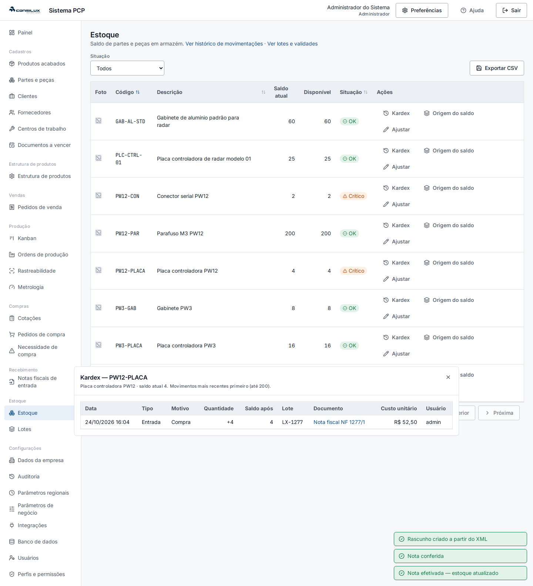

O custo unitário só aparece para quem tem a permissão de ver custos.

---

## 11. Necessidade de compra e relatórios

Tela que cruza o estoque mínimo de cada peça com o saldo atual e sugere o que
precisa ser comprado — a base do planejamento de compras, antes de existir
Ordem de Produção (a fórmula completa, que também considera OPs pendentes,
só entra no módulo de Produção).

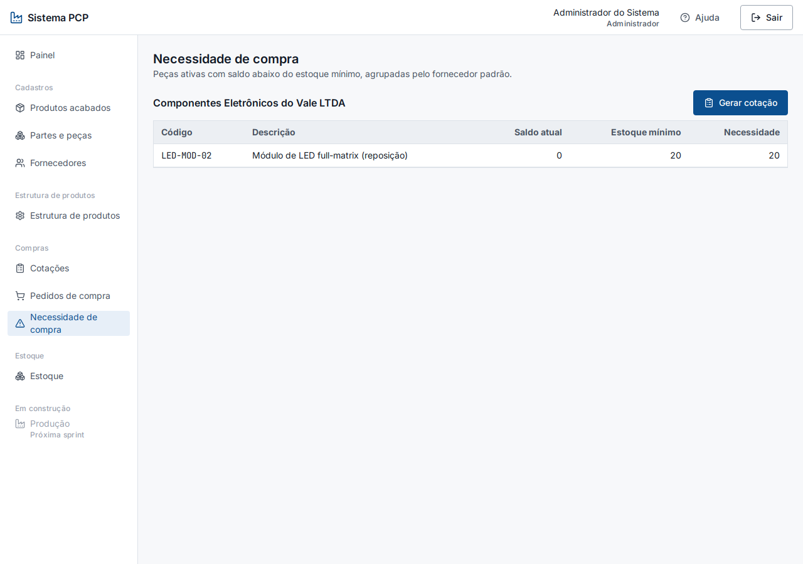

- Só aparecem peças **ativas** com saldo **abaixo** do estoque mínimo
  cadastrado (seção [5](#5-partes-e-peças)).
- **Necessidade** é a quantidade sugerida: estoque mínimo menos o saldo
  atual.
- A lista é agrupada pelo **fornecedor padrão** de cada peça. Peças sem
  fornecedor padrão aparecem à parte, sem a opção de gerar cotação — cadastre
  um fornecedor padrão na peça primeiro (seção [5](#5-partes-e-peças)).

### 11.1 Gerar uma cotação a partir da necessidade

Clique em **Gerar cotação** no grupo de um fornecedor.

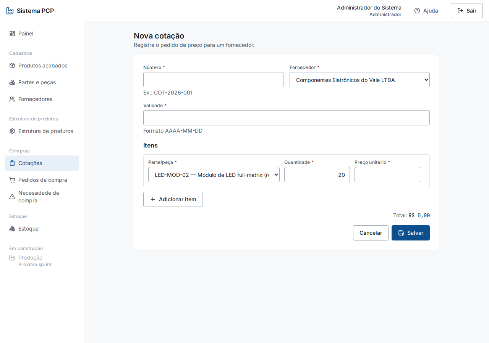

O sistema abre o formulário de [Nova cotação](#82-cadastrar-uma-cotação) já
com o fornecedor selecionado e um item por peça, com a quantidade sugerida —
falta só **Número**, **Validade** e o **preço unitário** de cada item (o
preço é exatamente o que a cotação existe para descobrir, então nunca vem
preenchido). Se algum item não puder ser pré-preenchido (por exemplo, um
fornecedor que foi inativado entre a lista carregar e o clique), um aviso
aparece pedindo para conferir o formulário antes de salvar.

### 11.2 Exportar relatórios em CSV

As telas de [Estoque](#10-estoque-e-recebimento) e
[Pedidos de compra](#9-pedidos-de-compra) têm um botão **Exportar CSV** que
baixa a lista completa (sem filtro, sem paginação) num arquivo pronto para
abrir no Excel. Só CSV por enquanto — PDF pode vir depois, se for pedido.

---

## 12. Aparência e preferências

Clique em **Preferências** no cabeçalho, ao lado do seu nome, para ajustar
como o sistema aparece na sua tela. A preferência é salva na sua conta —
vale em qualquer computador que você usar para entrar, não só na estação
atual.

- **Idioma**: Português (Brasil) ou Español. A escolha vale para tudo: os
  textos das telas, os menus, a **Ajuda** de cada tela e as mensagens de erro
  e de validação que o sistema devolve. Ao trocar, a tela inteira muda na hora
  e a escolha fica salva na sua conta, valendo em qualquer computador. Na
  primeira visita a um computador, a tela de entrada segue o idioma do
  navegador (espanhol se o navegador estiver em espanhol, senão português);
  depois do login, vale o idioma da sua conta. Datas, números e moeda
  continuam seguindo os **Parâmetros regionais** da empresa (seção 15): o
  idioma muda os textos, não os formatos.

  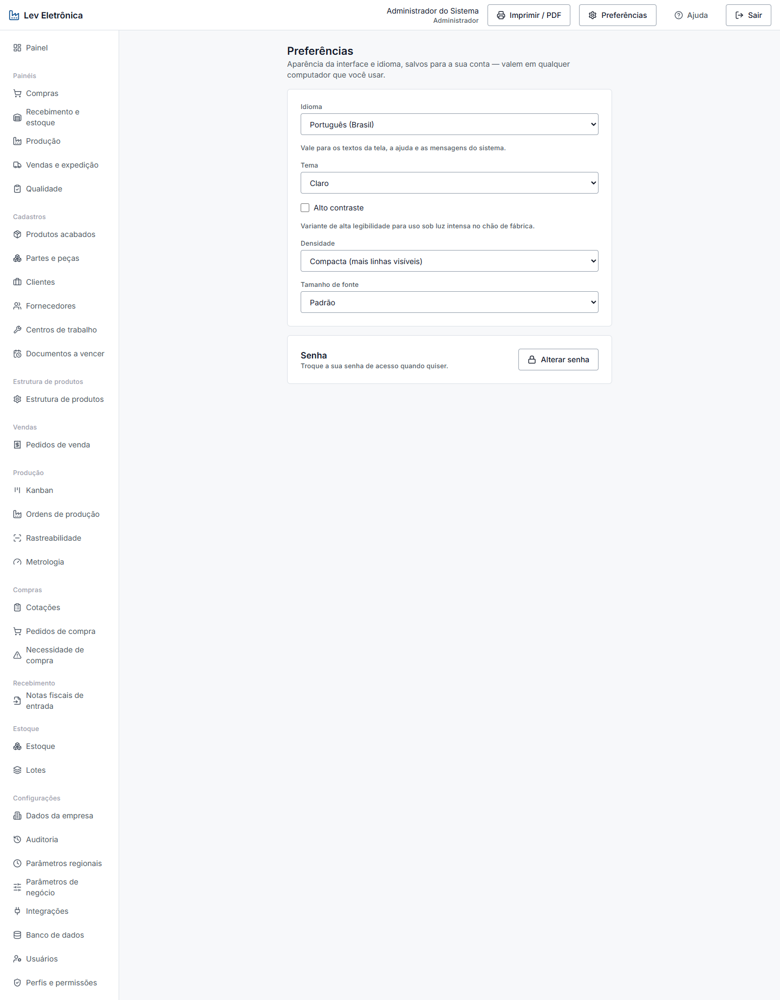

- **Tema**: Claro, Escuro ou Automático (segue o sistema operacional e muda
  sozinho se o computador alternar entre claro e escuro, por exemplo ao
  anoitecer).

  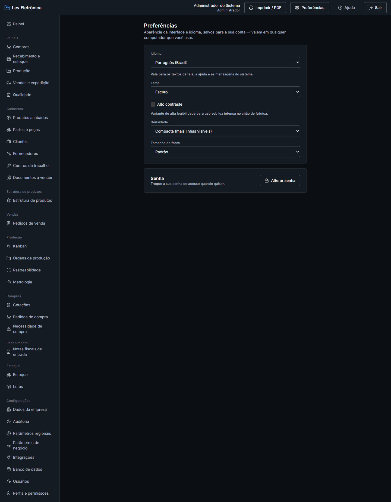

- **Alto contraste**: variante de alta legibilidade para uso sob luz intensa
  no chão de fábrica.

  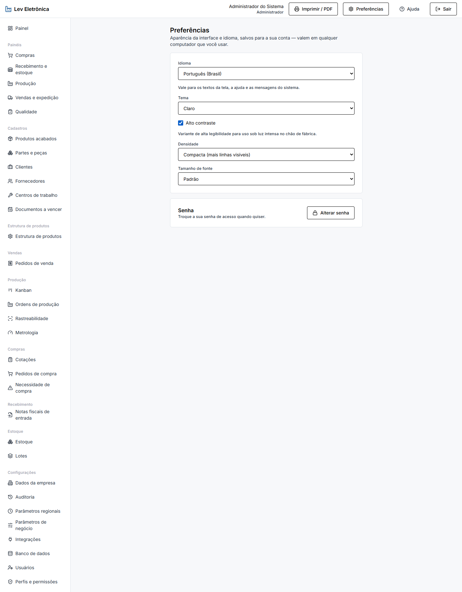

- **Densidade**: Compacta mostra mais linhas por tela (padrão, ideal para
  telas de gestão); Confortável usa linhas mais altas, melhor para uso em
  tablet.
- **Tamanho de fonte**: Padrão, Grande ou Extra grande, para quem prefere
  texto maior.

  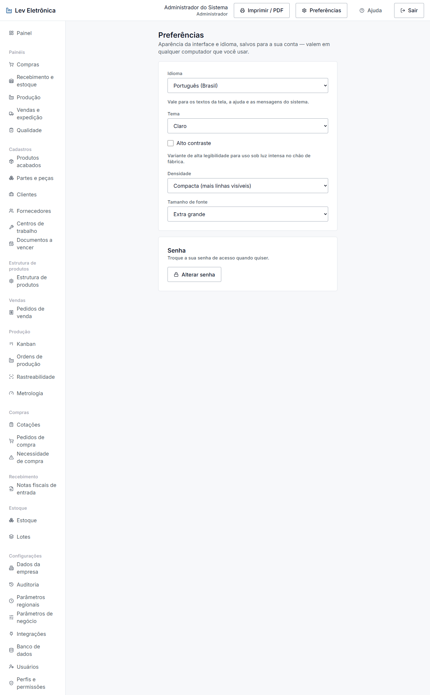

Cada mudança é aplicada na hora, antes mesmo de confirmar — se a gravação
falhar, o sistema volta para o valor anterior e avisa por quê.

---

## 13. Dados da empresa

Clique em **Dados da empresa**, na seção "Configurações" da navegação
lateral (só aparece para o perfil Administrador), para cadastrar a
identificação, o endereço, o contato e o logotipo da empresa. Esses dados
aparecem no cabeçalho e na tela de login de todo mundo que usa o sistema —
inclusive antes de entrar, já que o nome e o logotipo precisam aparecer na
tela de login.

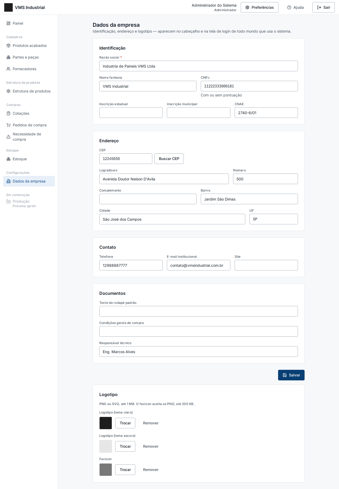

- **Identificação**: só a Razão social é obrigatória. CNPJ é opcional, mas
  quando informado precisa ter um dígito verificador válido.
- **Endereço**: informe o CEP e clique em **Buscar CEP** para preencher
  logradouro, bairro, cidade e UF automaticamente; se a consulta falhar (ex.:
  sem conexão), preencha manualmente.
- **Contato**: telefone, e-mail institucional e site, todos opcionais.
- **Documentos**: texto de rodapé padrão, condições gerais de compra e
  responsável técnico — usados em documentos impressos quando esses modelos
  existirem.
- **Logotipo**: envie uma variante para o tema claro e outra para o tema
  escuro (PNG ou SVG, até 1 MB), e um favicon (só PNG, até 200 KB). Cada
  logotipo pode ser trocado ou removido a qualquer momento; a mudança aparece
  no cabeçalho imediatamente, sem precisar recarregar a página.

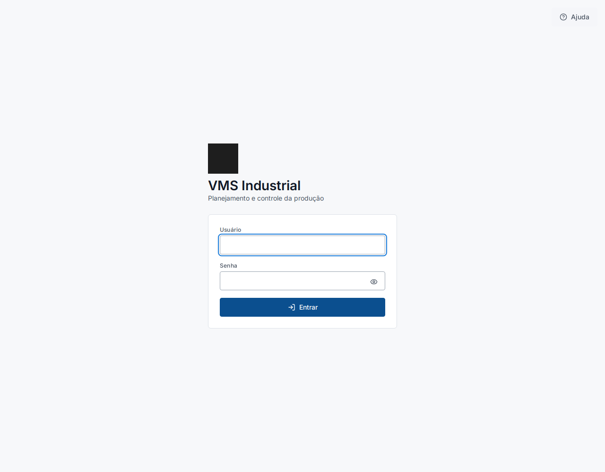

Quem não é Administrador não vê o link "Dados da empresa" na navegação e não
consegue salvar alterações aqui — a tela mostra "Acesso restrito a
administradores" para quem tentar abri-la diretamente pela URL.

---

## 14. Auditoria

Clique em **Auditoria**, na seção "Configurações" da navegação lateral (só
aparece para o perfil Administrador), para consultar a trilha de alterações
do sistema — quem mudou o quê, quando e de onde.

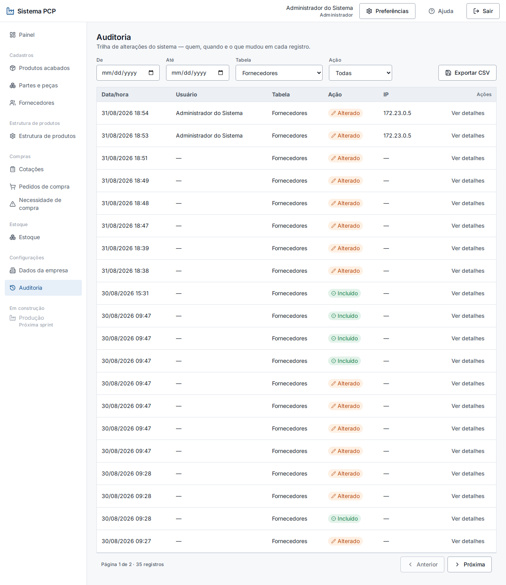

- **Filtros**: período (De/Até), Tabela e Ação (Incluído, Alterado,
  Excluído). Combine quantos quiser; a lista atualiza sozinha a cada
  mudança.
- **Ver detalhes** abre o que mudou campo a campo, não o registro bruto: o
  valor anterior aparece riscado e o novo em destaque, para uma alteração
  ("Alterado") ambos aparecem lado a lado; para uma inclusão só existe o
  valor novo, e para uma exclusão só o valor anterior.

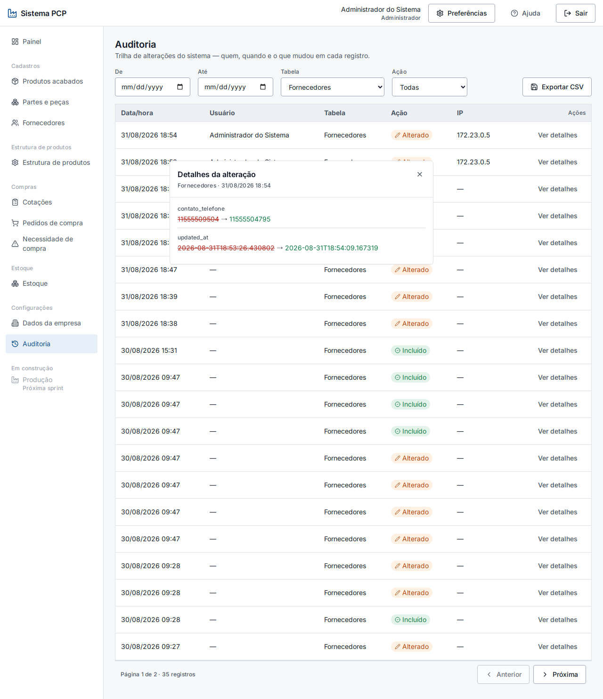

- **Exportar CSV** baixa exatamente os registros que os filtros aplicados
  na tela mostram.
- **Usuário** e **IP** ficam em branco (—) para linhas gravadas antes desta
  funcionalidade existir, ou para ações sem uma sessão de usuário associada
  (ex.: rotina interna do sistema).

Quem não é Administrador não vê o link "Auditoria" na navegação e recebe
"Acesso restrito a administradores" ao tentar abrir a tela diretamente pela
URL.

---

## 15. Parâmetros regionais

Clique em **Parâmetros regionais**, na seção "Configurações" da navegação
lateral (só aparece para o perfil Administrador), para escolher como datas e
horas aparecem em todas as telas do sistema.

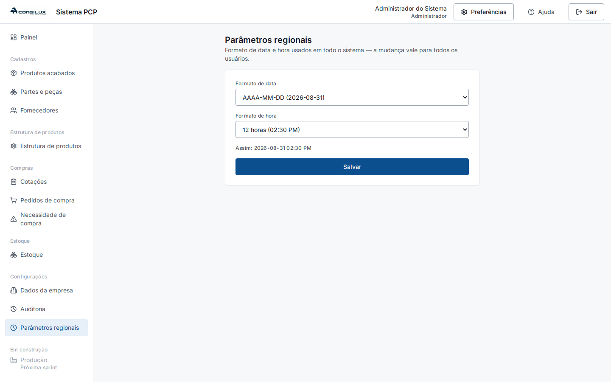

- **Formato de data**: DD/MM/AAAA (padrão), DD-MM-AAAA ou AAAA-MM-DD.
- **Formato de hora**: 24 horas (padrão) ou 12 horas (AM/PM).
- A linha **"Assim:"** mostra o efeito da escolha antes de salvar.
- Ao **Salvar**, a mudança vale para todos os usuários, não só para quem
  editou. Quem está com o sistema aberto passa a ver o novo formato ao
  trocar de tela; quem entrar depois já recebe o formato novo.

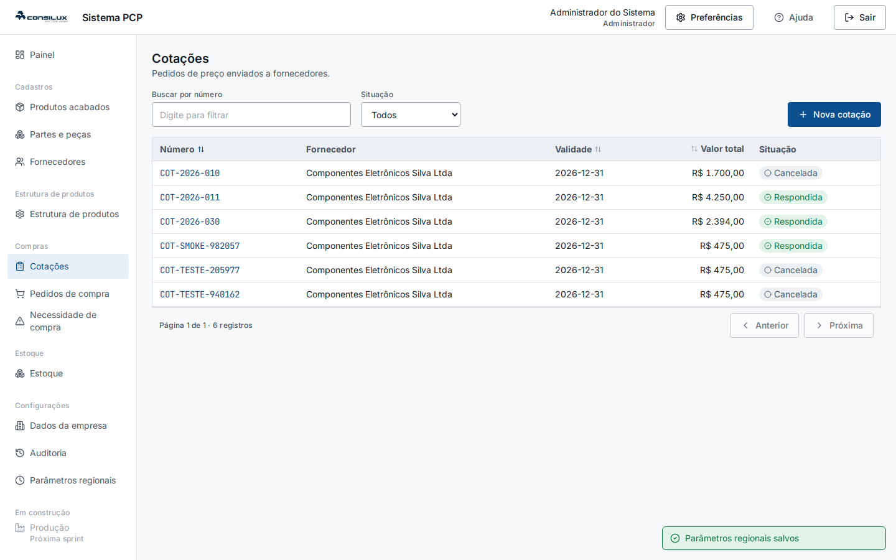

Quem não é Administrador não vê o link "Parâmetros regionais" na navegação e
recebe "Acesso restrito a administradores" ao tentar abrir a tela
diretamente pela URL — mas todas as telas seguem o formato escolhido pelo
Administrador.

---

## 16. Banco de dados e segurança

Clique em **Banco de dados**, na seção "Configurações" da navegação lateral
(só aparece para o perfil Administrador), para ver um diagnóstico do banco
de dados do sistema. A tela é **somente leitura**: nada nela altera o banco,
e usuário, senha e string de conexão nunca são exibidos.

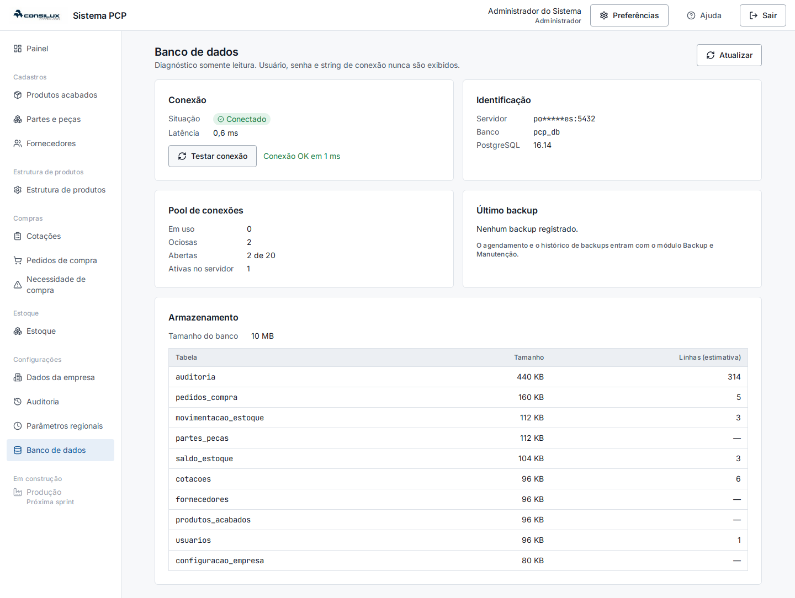

- **Conexão**: situação e tempo de resposta. **Testar conexão** faz uma
  consulta mínima e mostra o tempo na hora.
- **Identificação**: servidor (com o nome parcialmente oculto), nome do
  banco e versão do PostgreSQL.
- **Pool de conexões**: quantas conexões o sistema está usando agora, quantas
  estão ociosas e o máximo permitido. Muitas conexões "em uso" por muito
  tempo, ou latência alta, indicam carga ou problema de rede — avise o
  responsável pela infraestrutura.
- **Armazenamento**: tamanho total e as 10 maiores tabelas. A contagem de
  linhas é uma estimativa do próprio PostgreSQL; "—" significa que ele ainda
  não calculou a estimativa daquela tabela.
- **Último backup**: fica como "Nenhum backup registrado" até o módulo de
  Backup e Manutenção existir.
- **Atualizar** refaz o diagnóstico.

**Proteções automáticas** (não há o que configurar na tela):

- Depois de **5 tentativas de login com senha errada** a partir do mesmo
  computador em um minuto, a tela de login mostra "Muitas tentativas de
  login. Aguarde um minuto e tente de novo." Logins com a senha certa não
  contam para esse limite.
- Independente do computador, **5 senhas erradas seguidas para a mesma
  conta** a bloqueiam por 15 minutos (depois 30 e 60). Para liberar antes,
  redefina a senha da pessoa em **Usuários** (seção [20](#20-usuários)).
- Uso muito intenso do sistema por um mesmo usuário em um mesmo computador
  (dezenas de ações por segundo) é freado temporariamente com a mensagem
  "Muitas requisições em pouco tempo".

---

## 17. Parâmetros de negócio

Clique em **Parâmetros de negócio**, na seção "Configurações" da navegação
lateral (só aparece para o perfil Administrador), para ajustar regras de
estoque, recebimento e compras. As regras valem para todos os usuários.

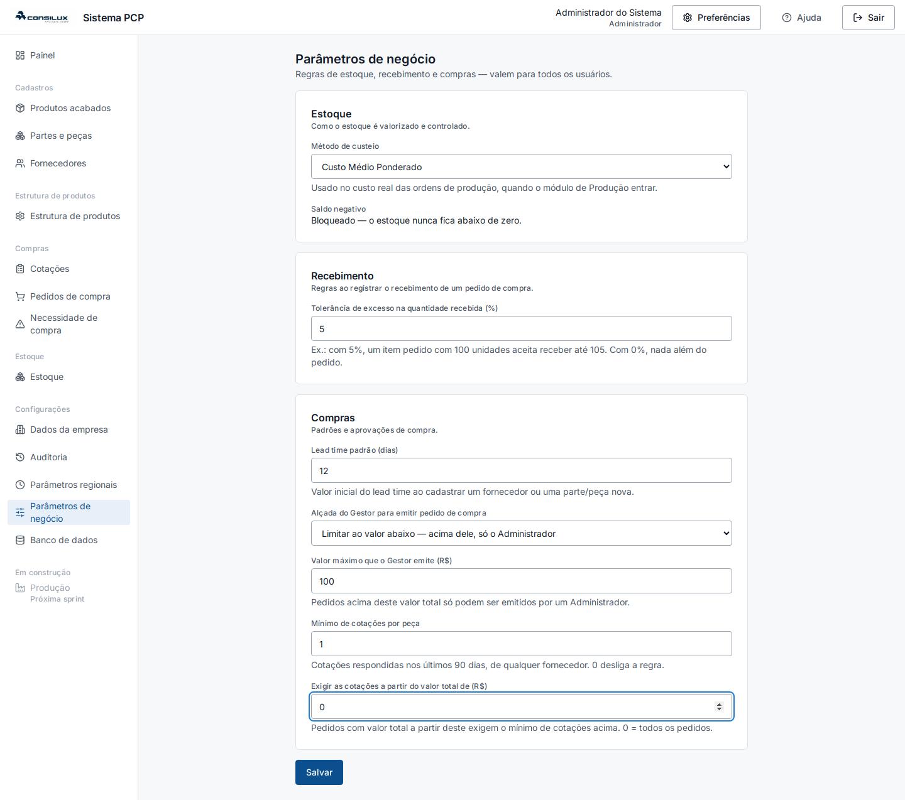

**Estoque**

- **Método de custeio** (Custo Médio Ponderado, PEPS ou Último Preço de
  Compra): fica gravado agora e passa a ser usado no custo real das ordens de
  produção, quando o módulo de Produção entrar.
- **Saldo negativo**: sempre bloqueado — o estoque nunca fica abaixo de zero.

**Recebimento**

- **Tolerância de excesso na quantidade recebida (%)**: quanto a mais do que
  foi pedido pode ser recebido em cada item, somando todas as notas fiscais
  do pedido. Com 5%, um item pedido com 100 unidades aceita até 105; acima
  disso, a conferência da nota acusa um bloqueio. Com 0% (padrão), nada além
  do pedido.
- **Tolerância de divergência de preço (%)** e **ação**: quanto o preço da
  nota pode se afastar do preço do pedido. Acima disso, a conferência da nota
  **bloqueia** ou **exige aprovação** de quem tem a permissão de aprovar
  divergência (seção [26.3](#263-conferir-e-efetivar)).

**Compras**

- **Lead time padrão (dias)**: valor que já vem preenchido ao cadastrar um
  fornecedor ou uma parte/peça **nova**. Não muda os cadastros existentes.
- **Alçada do Gestor**: com um limite definido, pedidos de compra com valor
  total acima dele só podem ser emitidos por um Administrador. O Gestor vê
  a mensagem "o valor do pedido está acima da alçada do Gestor" ao tentar
  emitir.
- **Mínimo de cotações por peça** e **valor a partir do qual exigir**: a
  partir desse valor total, cada peça do pedido precisa ter cotação
  **respondida** de um número mínimo de **fornecedores diferentes**, emitida nos
  últimos 90 dias, para o pedido poder ser emitido (várias cotações do mesmo
  fornecedor contam como uma). A mensagem de recusa lista as peças que faltam,
  por exemplo "RES-10K (1 de 3)". Com 0 (padrão), a regra fica desligada.

---

## 18. Integrações

Clique em **Integrações**, na seção "Configurações" da navegação lateral (só
aparece para o perfil Administrador), para configurar os serviços externos
usados pelo sistema. Hoje: o **servidor de e-mail (SMTP)**.

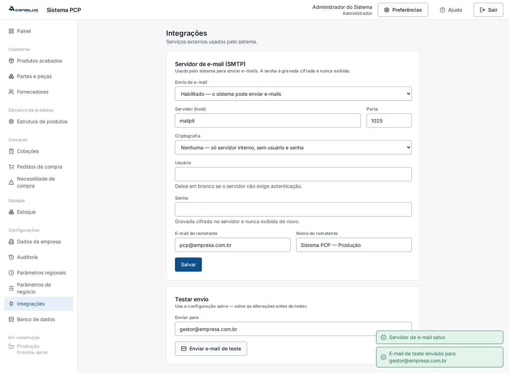

- **Envio de e-mail**: "Habilitado" exige servidor e e-mail do remetente
  preenchidos. Desabilitado, dá para salvar a configuração e terminar depois.
- **Servidor (host)**, **Porta** e **Criptografia**: informados pelo setor de
  TI ou pelo provedor de e-mail. O comum é STARTTLS na porta 587 ou TLS/SSL na
  465. "Nenhuma" só serve para servidor interno sem usuário e senha.
- **Usuário** e **Senha**: a senha é gravada **cifrada** e nunca aparece de
  novo na tela. Com uma senha gravada, deixe o campo em branco para mantê-la,
  digite outra para trocar, ou use **Remover senha gravada**. Por segurança,
  ao trocar **servidor, porta ou usuário** é preciso digitar a senha de novo —
  a senha gravada só vale para o servidor em que foi cadastrada.
- Com criptografia **Nenhuma**, usuário e senha não são aceitos.
- **Testar envio**: manda um e-mail de teste para o endereço informado,
  usando a configuração **salva**. Salve antes de testar. Se falhar, a tela
  mostra a resposta do servidor de e-mail (ex.: "o servidor não oferece
  STARTTLS — escolha outra criptografia").

> Para gravar a senha, o servidor do sistema precisa da chave mestra de
> segredos (`CHAVE_MESTRA_SEGREDOS`) configurada pela equipe de
> infraestrutura. Sem ela, a tela avisa ao salvar, e só servidores sem
> autenticação funcionam.

---

## 19. Perfis e permissões

Cada usuário tem um **perfil**, e o perfil diz o que ele pode fazer em cada
módulo: o menu, os botões e as telas mostram só o que o perfil permite (e o
servidor recusa o resto, mesmo por uma URL digitada). Clique em **Perfis e
permissões**, na seção "Configurações", para ver e ajustar os perfis — a
tela só aparece para quem tem a permissão "Perfis e permissões" (de início,
apenas o Administrador).

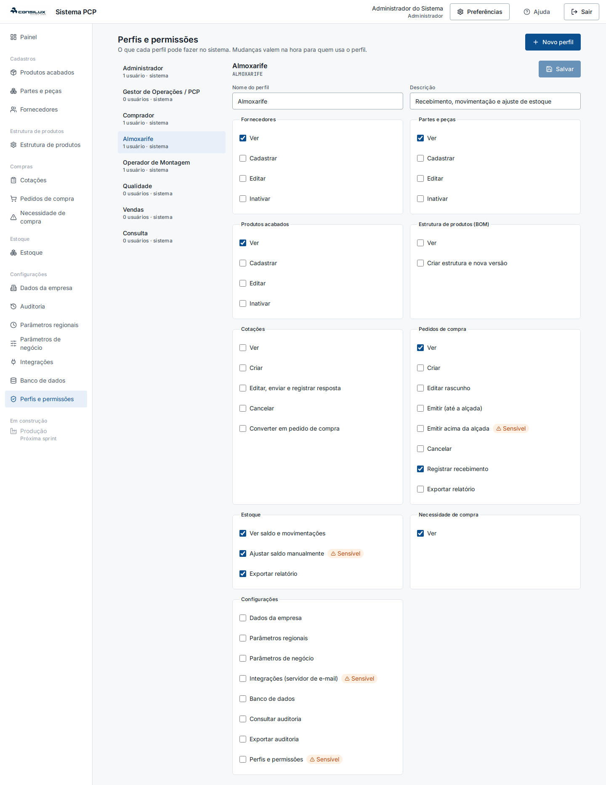

**Perfis que já vêm com o sistema** (matriz inicial, a validar com o Gestor
de Operações):

| Perfil | O que pode, de início |
|---|---|
| Administrador | Tudo, sempre (não pode ser alterado). |
| Gestor de Operações / PCP | Todos os módulos operacionais, inclusive ajuste de estoque e auditoria; emite pedido de compra até a alçada. Sem integrações, banco de dados nem perfis. |
| Comprador | Fornecedores, cotações e pedidos de compra (até a alçada); consulta peças, produtos e estoque. |
| Almoxarife | Recebimento de pedidos e estoque (inclusive ajuste e exportação); consulta fornecedores, peças, produtos e pedidos. |
| Operador de Montagem | Consulta produtos, peças, estrutura (BOM) e estoque. |
| Qualidade | Consulta produtos, peças, estrutura, fornecedores e estoque. |
| Vendas | Consulta produtos, peças, estrutura e estoque. |
| Consulta | Vê tudo que é operacional e exporta relatórios; não altera nada. |

**Ajustar um perfil**: escolha o perfil à esquerda, marque ou desmarque as
permissões de cada módulo e clique em **Salvar**. A mudança vale na hora para
quem usa o perfil. Permissões marcadas como **Sensível** (ajustar estoque,
emitir acima da alçada, integrações, perfis) pedem cuidado redobrado.

**Novo perfil**: dê um código (ex.: `COMPRADOR_JUNIOR`) e um nome, e
opcionalmente copie as permissões de um perfil existente para começar.
Perfis do sistema não podem ser excluídos; os criados por você, só quando
nenhum usuário os usa.

**Regras de segurança**: ninguém edita o próprio perfil, e só é possível
conceder permissões que o seu próprio perfil tem. Toda mudança de perfil fica
na **Auditoria** (filtre por "Perfis de acesso" ou "Permissões dos perfis").

---

## 20. Usuários

Clique em **Usuários**, na seção "Configurações", para cadastrar quem acessa o
sistema, bloquear ou desligar um acesso, entregar uma nova senha e dar
exceções de permissão a uma pessoa. A tela só aparece para quem tem a
permissão "Usuários e permissões individuais" (de início, apenas o
Administrador). Tudo o que se faz aqui vale **na hora**, mesmo para quem está
com o sistema aberto, e fica registrado na **Auditoria**.

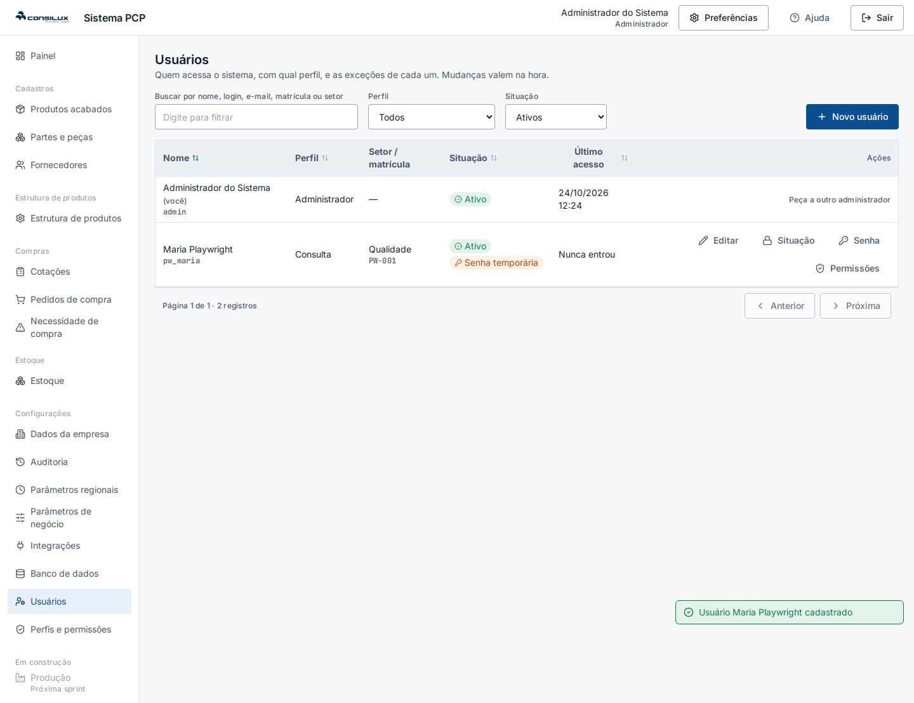

A lista mostra nome e login, perfil, setor e matrícula, situação e último
acesso. Busque por nome, login, e-mail, matrícula ou setor, e filtre por perfil
e situação (de início, só os **ativos**). O selo **Senha temporária** indica
quem ainda não criou a própria senha.

**Novo usuário**: preencha login (não muda depois; letras minúsculas,
números, ponto, hífen ou sublinhado), nome, e-mail e perfil — matrícula,
telefone, setor e data de admissão são opcionais. O sistema já sugere uma
**senha temporária**: entregue-a à pessoa. No primeiro acesso, antes de
qualquer outra tela, ela cria a própria senha:

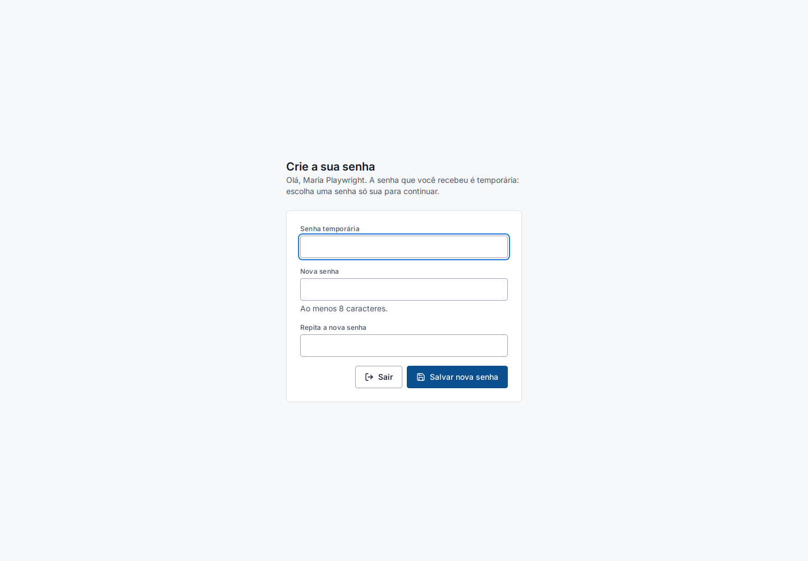

**Ações de cada linha:**

- **Editar**: dados do cadastro e perfil.
- **Situação**: *Bloqueado* (suspensão temporária) ou *Inativo* (desligamento,
  com a data). A pessoa perde o acesso imediatamente — se estiver com o
  sistema aberto, volta para a tela de entrada com o aviso. *Ativo* devolve o
  acesso. Usuário nunca é excluído: o histórico dele é preservado.
- **Senha**: define uma nova senha temporária (para quem esqueceu a sua). A
  senha antiga deixa de valer, e a pessoa cria uma nova no próximo acesso.
- **Permissões**: concede ou retira uma permissão **só para esta pessoa**,
  acima do perfil — por exemplo, para cobrir as férias de um colega. Cada
  exceção exige uma justificativa (ao menos 10 caracteres), que aparece na
  lista e na Auditoria. **Desfazer** volta ao que o perfil define.

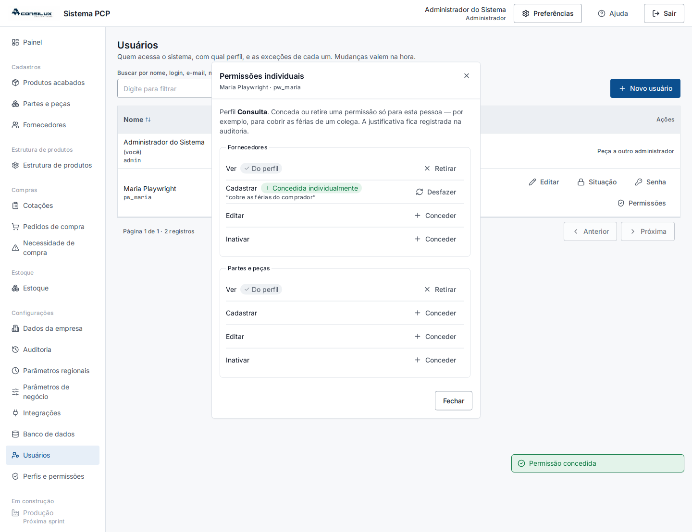

**Regras de segurança** (para que esta tela não vire atalho para mais acesso):

- Ninguém altera o próprio cadastro aqui — a sua linha mostra "Peça a outro
  administrador".
- Só é possível atribuir um perfil, ou conceder uma permissão, que você mesmo
  tem; e só é possível alterar quem não tem permissões além das suas.
- Só um Administrador altera outro Administrador, e o sistema nunca fica sem
  um Administrador ativo.
- Se duas pessoas alterarem o mesmo usuário ao mesmo tempo, a segunda recebe
  um aviso para recarregar a tela e conferir antes de salvar de novo.

**Trocar a própria senha**: em **Preferências**, clique em **Alterar senha**.

---

## 21. Clientes

Clique em **Clientes**, na seção "Cadastros", para registrar quem compra os
painéis: órgãos públicos, concessionárias, integradores e outros. O cadastro
segue o mesmo jeito de Fornecedores (busca, situação, ordenação, inativar em vez
de excluir), com um filtro a mais por **tipo**.

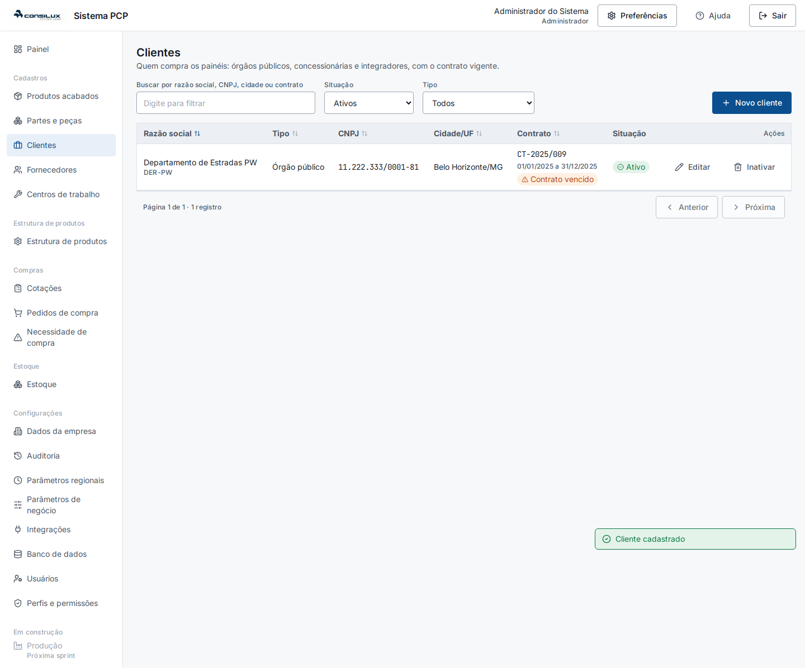

- **Obrigatórios**: tipo, razão social e CNPJ (validado; o mesmo CNPJ não pode
  ser cadastrado duas vezes).
- **Contato e endereço**: nome, e-mail e telefone do contato, endereço, cidade e
  UF — todos opcionais.
- **Contrato**: número do contrato (ou da ata) e vigência. Quando o fim da
  vigência já passou, a lista mostra o selo **Contrato vencido** — é só um
  aviso, o cliente continua utilizável.
- De início, só o Gestor de Operações e Vendas cadastram e editam clientes; o
  perfil Consulta apenas vê.

---

## 22. Centros de trabalho

Clique em **Centros de trabalho**, na seção "Cadastros", para registrar as
bancadas e postos onde cada etapa da produção acontece. Eles serão usados pelas
Ordens de Produção e pelo Kanban (próxima fase).

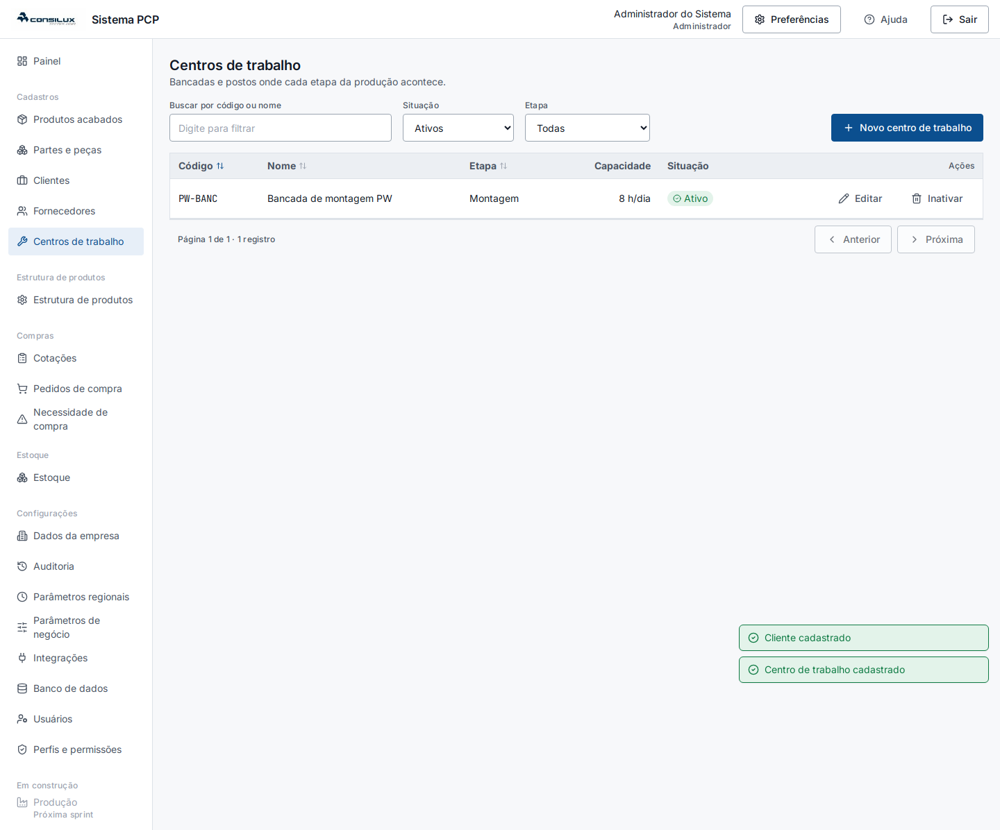

- **Código**: de 2 a 20 caracteres (letras, números, hífen ou sublinhado),
  sempre em maiúsculas; não muda depois de criado.
- **Etapa**: Separação, Montagem, Testes ou Expedição — as etapas fixas do
  fluxo de produção. A lista pode ser filtrada e ordenada pela etapa, na ordem
  do fluxo.
- **Capacidade (horas/dia)**: opcional, de mais de 0 até 24.
- De início, o Gestor de Operações cadastra e edita; Operador, Qualidade, Vendas
  e Consulta apenas veem.

---

## 23. Pedidos de venda

Clique em **Pedidos de venda**, na seção "Vendas". Cada pedido registra o que um
cliente comprou e quando foi prometido; **cada item vira uma ordem de produção
(OP)**.

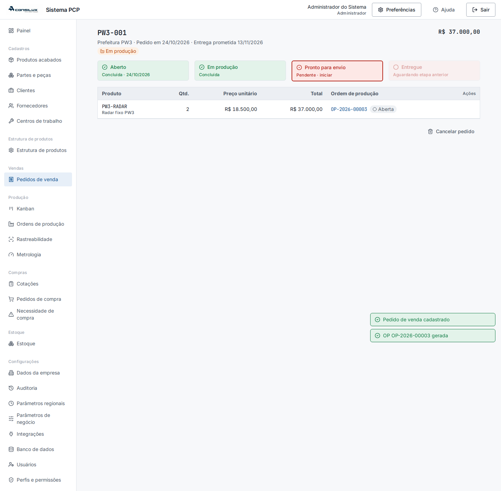

- **Novo pedido de venda**: número do pedido, cliente (só clientes ativos),
  data do pedido, entrega prometida (posterior à data do pedido) e os itens —
  produto acabado, quantidade e preço (já vem o preço de venda do produto).
- **Situação**: *Aberto* → *Em produção* (ao gerar a primeira OP) → *Pronto para
  envio* (quando todas as OPs concluem) → *Entregue*. A lista sinaliza pedido
  com a entrega prometida vencida.
- No detalhe do pedido, **Gerar OP** cria a ordem de produção de cada item. O
  produto precisa ter uma estrutura (BOM) ativa.
- **Editar** só enquanto o pedido está Aberto e sem OP em andamento.
  **Cancelar** só sem OP liberada (cancele as OPs antes).
- **Registrar entrega** (pedido Pronto para envio) dá baixa do produto acabado
  no estoque e marca as unidades como expedidas.

---

## 24. Produção: Kanban e ordens de produção

Clique em **Kanban**, na seção "Produção", para ver as OPs liberadas em quatro
colunas — **Separação, Montagem, Testes e Expedição**, sempre nessa ordem. O
quadro se atualiza sozinho a cada 30 segundos e mostra quem está trabalhando em
cada OP agora.

Clique numa OP (no Kanban ou em **Ordens de produção**) para abrir o detalhe:

1. **Liberar OP** — reserva todo o material da BOM. É tudo ou nada: se faltar
   alguma peça, nada é reservado e o sistema lista o que falta (necessário x
   disponível). Ao liberar, cada unidade recebe um **número de série**
   (ex.: `RAD-200-2026-00001`) e a OP entra na Separação.
2. **Iniciar apontamento** — escolha o centro de trabalho da etapa atual. O
   operador é sempre quem está com a sessão aberta. **Encerrar apontamento**
   registra a duração (só quem iniciou encerra; o Gestor pode destravar um
   apontamento esquecido).
3. **Avançar etapa** — exige ao menos um apontamento encerrado na etapa.
   - Ao sair da **Separação**, o material reservado sai do estoque.
   - Em **Testes**, registre **Aprovar** ou **Reprovar** (com o motivo) para cada
     unidade. Só avança com todas aprovadas.
   - Se o produto **exige metrologia** (radares, Inmetro), registre também a
     metrologia de cada unidade (aprovação de modelo, lacre, verificação e
     validade). Verificação vencida não libera a etapa.
   - Na **Expedição**, **Concluir OP** coloca as unidades no estoque de produto
     acabado.
4. **Cancelar** — só antes do consumo do material (OP Aberta ou ainda na
   Separação); a reserva volta ao estoque.

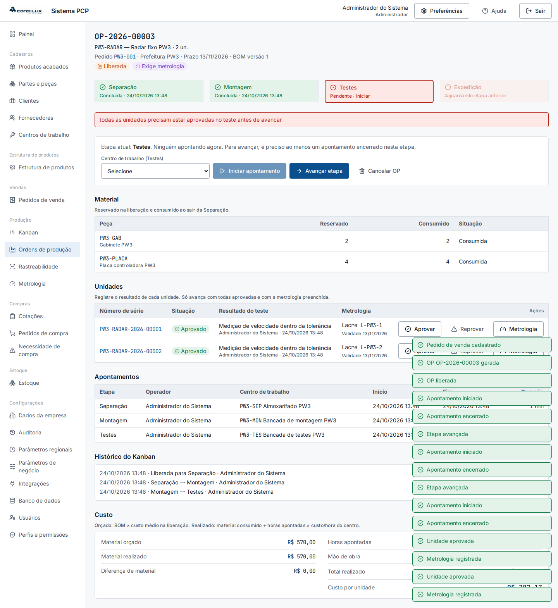

**Custo real** (só para quem tem a permissão "Ver custo real das OPs"): material
orçado (BOM × custo médio na liberação) × realizado (material consumido + horas
apontadas × custo/hora do centro de trabalho), total e custo por unidade. O custo
médio de cada peça é atualizado a cada recebimento de pedido de compra. Avisos
apontam peça sem custo de compra ou centro sem custo por hora.

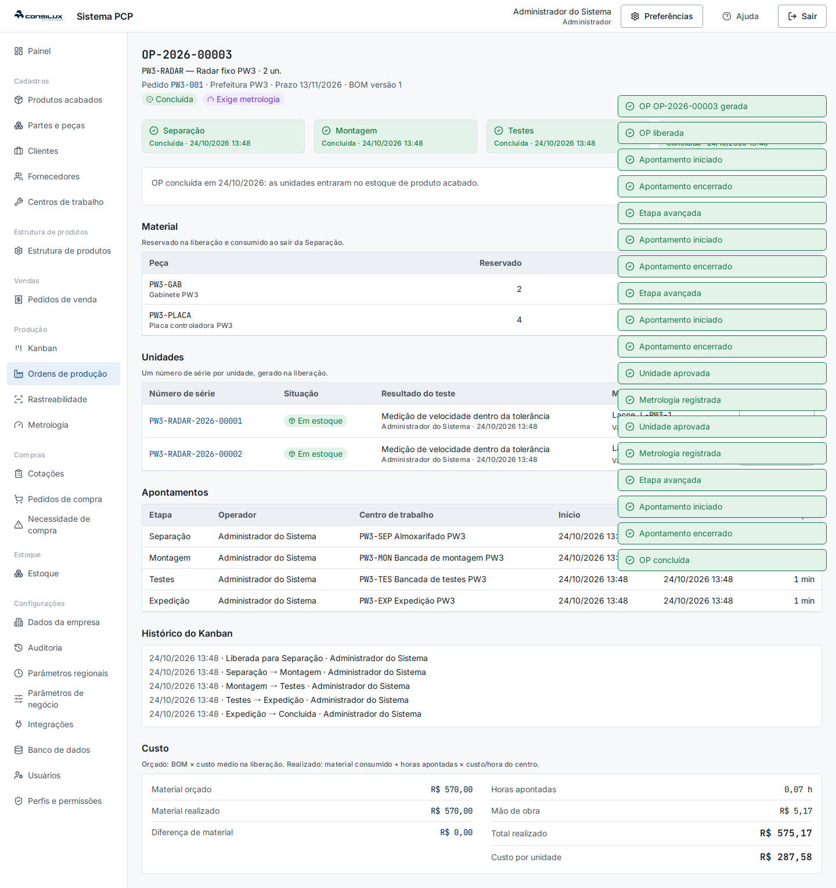

O cadastro de **Produtos acabados** ganhou a opção **Exige metrologia (Inmetro)**;
o de **Centros de trabalho**, o **Custo por hora**.

---

## 25. Rastreabilidade e metrologia

**Rastreabilidade**: digite (ou bipe) o número de série para abrir a **ficha
as-built** da unidade — OP, pedido e cliente, componentes da BOM usada, cada
apontamento (etapa, operador, centro, horários), resultado de teste e metrologia.
O **QR Code** da ficha pode ser impresso e colado no equipamento: lido pelo
celular, abre a ficha.

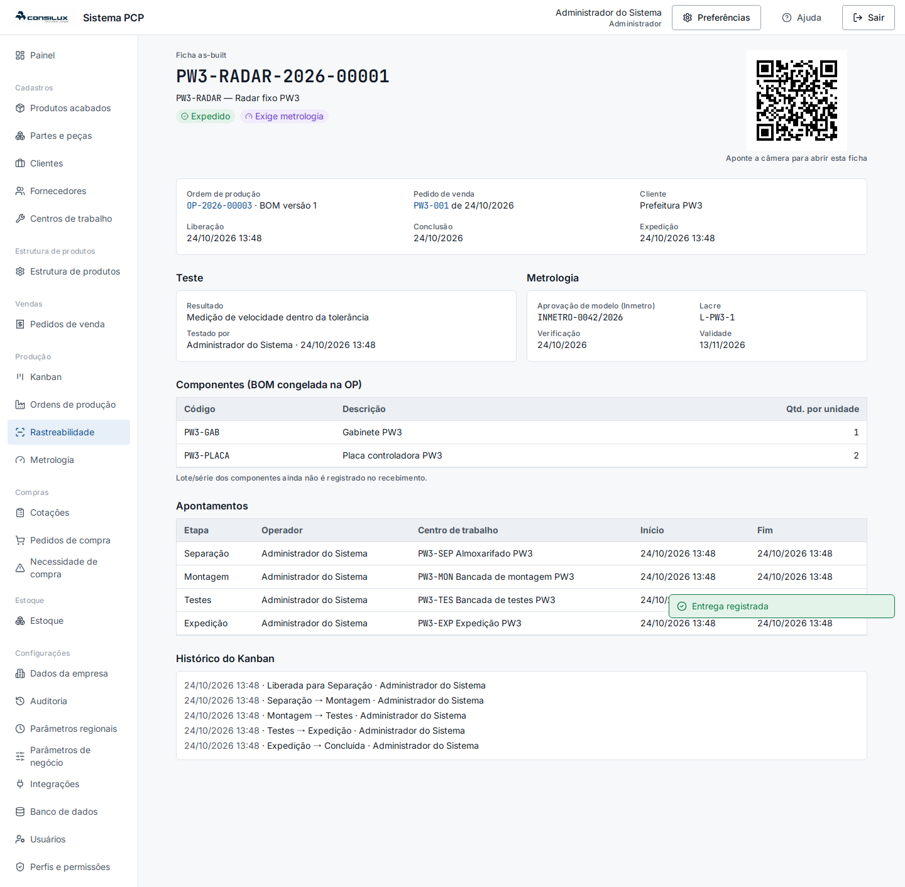

**Metrologia**: lista as verificações metrológicas vencidas ou que vencem nos
próximos 30, 60 ou 90 dias, com o lacre e o cliente — para programar a
reverificação.

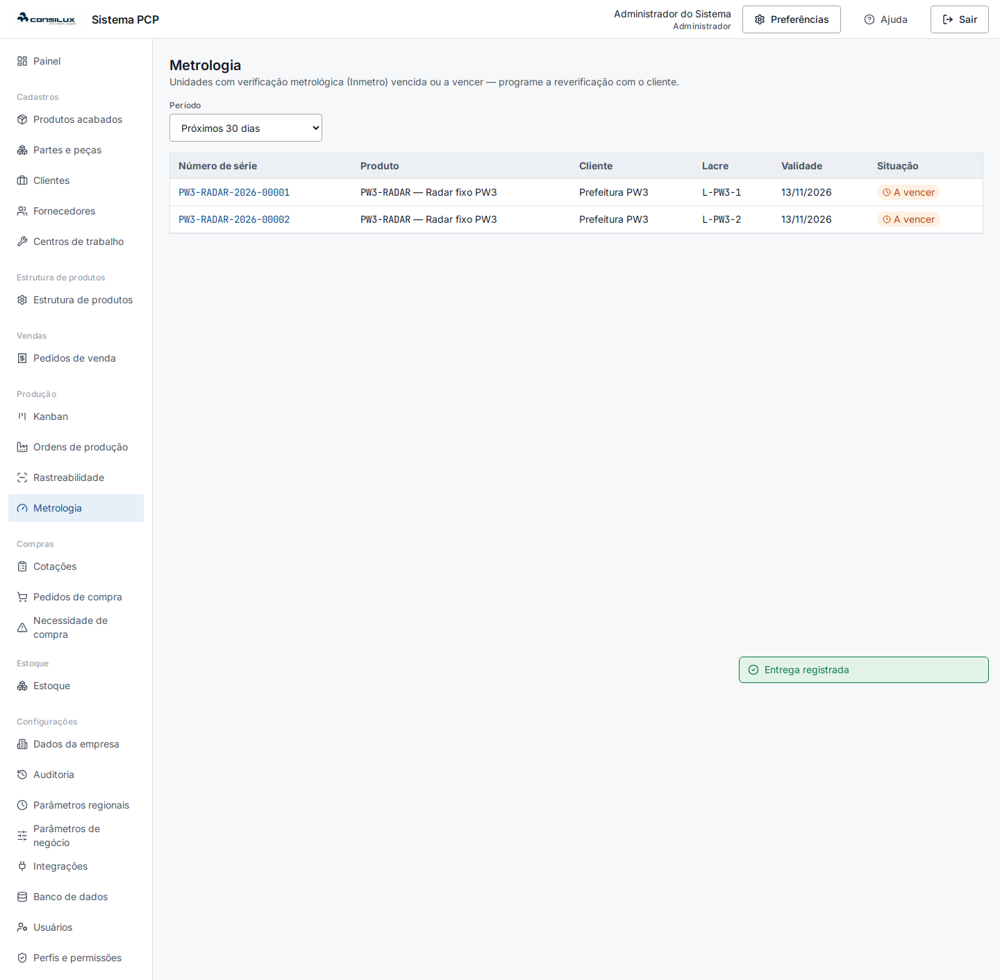

> O lote e a série dos componentes ainda não aparecem na ficha: eles passam a ser
> capturados no recebimento fiscal (próxima fase).

---

## 26. Recebimento por nota fiscal

Menu **Recebimento → Notas fiscais de entrada**. A nota passa por três
situações:

- **Rascunho**: editável, nada entra no estoque;
- **Conferida**: sem bloqueios, pronta para efetivar;
- **Efetivada**: o estoque, o custo médio e o saldo do pedido de compra foram
  atualizados.

Uma nota efetivada pode ser **estornada** com motivo (se o material ainda não
foi reservado nem consumido). Um rascunho pode ser **cancelado**.

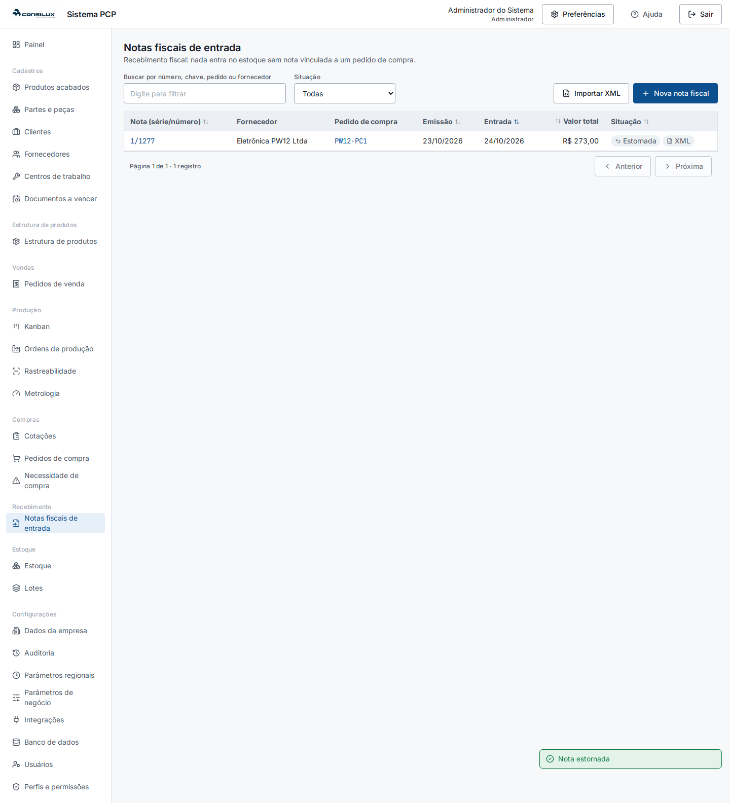

### 26.1 Importar o XML da NF-e

O caminho mais rápido. Clique em **Importar XML**, escolha o pedido de compra
que a nota atende e o arquivo XML (modelo 55, até 2 MB) e clique em **Ler
XML**. A prévia mostra emitente, série/número, chave e totais, e cada item:

- **reconhecido** (verde): o código do fornecedor já tem vínculo com uma
  peça (o *de-para*), com o fator de conversão (ex.: 1 caixa = 100 unidades);
- **não reconhecido** (laranja): escolha a peça e o fator e clique em
  **Vincular e memorizar** — da próxima vez o item vem reconhecido.

Com todos os itens reconhecidos, **Criar rascunho** grava a nota já com o
XML anexado. O CFOP de saída do fornecedor (5xxx/6xxx) vira o de entrada
(1xxx/2xxx) automaticamente. Os vínculos do fornecedor ficam em
**Fornecedores → De-para** (ação na linha do fornecedor).

### 26.2 Lançar à mão

**Nova nota fiscal** abre o formulário vazio: cabeçalho (pedido, modelo,
série, número, chave de acesso de 44 dígitos, CFOP, datas), valores (produtos,
frete, seguro, desconto, IPI, ICMS-ST) e os itens. Itens vêm do pedido; um
item fora do pedido só entra como **bonificação**, com justificativa (o custo
de entrada dele é zero).

Para cada item informe a **quantidade recebida (contada)** — que pode diferir
da nota — e, conforme a peça:

- **lote e validade**: um ou mais lotes cuja soma é a quantidade recebida,
  com fabricação, validade e certificado opcional;
- **número de série**: bipe ou digite cada série (Enter adiciona), cole uma
  lista ou gere uma faixa; o contador mostra "N de M".

### 26.3 Conferir e efetivar

**Conferir** salva e confere a nota. As pendências aparecem agrupadas:

- **Bloqueios** impedem seguir. Exemplos: chave ou CNPJ que não batem, CFOP
  fora da lista, soma dos itens diferente do total, séries faltando ou fora do
  formato, validade abaixo do mínimo, pedido encerrado.
- **Aprovação**: divergência de preço acima da tolerância, quando os parâmetros
  de negócio mandam pedir aprovação em vez de bloquear (seção
  [17](#17-parâmetros-de-negócio)). Só quem tem a permissão de aprovar
  divergência efetiva.
- **Avisos** não impedem nada.

**Efetivar nota** dá a entrada no estoque, rateia frete, seguro, IPI e ST
(menos o desconto) no custo de cada item e atualiza o pedido de compra. Se
alguém alterar a nota enquanto você confere, a ação é recusada e a nota é
recarregada — confira de novo.

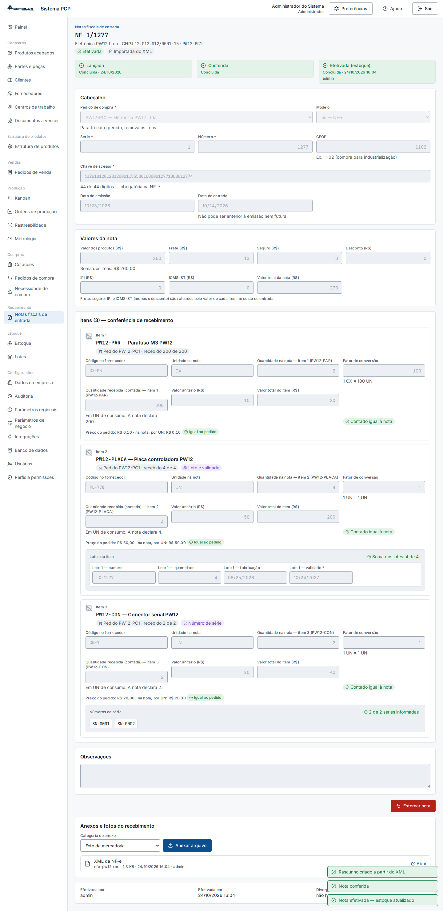

**Anexos e fotos do recebimento** guardam DANFE, certificados e fotos da
mercadoria, do lacre ou de avarias. Depois de efetivada, a nota não perde
anexos.

---

## 27. Lotes, séries e rastreabilidade de componentes

Menu **Estoque → Lotes** lista os lotes com fornecedor, validade e saldo, com
filtros por vencimento.

Clicar no lote abre o rastreio **do lote ao campo**: as notas que o trouxeram,
as ordens de produção que o consumiram e as unidades produzidas com ele, com
pedido de venda e cliente.

Na produção:

- a liberação da OP reserva os lotes pela **validade mais próxima** (FEFO);
- lote vencido não conta como disponível;
- séries de componente são reservadas e, na conclusão, instaladas nas unidades.

A ficha *as-built* (seção [25](#25-rastreabilidade-e-metrologia)) mostra os
componentes com série e os lotes consumidos, com a nota e o fornecedor de
origem.

Um ajuste manual de estoque de peça com lote ou série pede o lote (e a
validade, se a peça controla validade) ou as séries.

---

## 28. Documentos e anexos

Arquivos ficam guardados no próprio sistema e só são abertos por links
temporários (5 minutos) para quem tem permissão.

### 28.1 Mídia de produtos e peças

Em **Partes e peças** e **Produtos acabados**, **Mídia e documentos** reúne:

- a **foto principal** (aparece como miniatura na separação, no estoque e no
  recebimento) e uma galeria de até 10 fotos;
- os **documentos técnicos** em PDF por categoria (datasheet, desenho,
  esquema elétrico, manual, certificado, laudo, instrução, ficha de
  segurança), com versão, emissão e validade. Uma versão nova substitui a
  vigente e guarda o histórico.

### 28.2 Documentos dos registros

OPs, pedidos de compra, pedidos de venda, fornecedores e clientes têm uma
seção **Documentos** (em fornecedores e clientes, a ação **Documentos** na
linha). Cada documento tem uma categoria da lista do registro. Exemplos: laudo
de teste na OP, proposta no pedido de compra, termo de aceite no pedido de
venda, certificado de qualidade no fornecedor, contrato no cliente.

- **Registro encerrado** (OP concluída ou cancelada, pedido de compra
  concluído ou cancelado, pedido de venda entregue ou cancelado): ainda aceita
  documentos novos, mas nenhum pode ser removido — eles ficam como registro.
- Os **laudos de teste e relatórios de inspeção** da OP aparecem na ficha
  *as-built* de cada unidade.

### 28.3 Documentos a vencer

Menu **Cadastros → Documentos a vencer** lista os documentos vigentes vencidos
ou que vencem no prazo escolhido. Entram documentos de produtos, peças,
fornecedores e clientes, cada um só para quem pode ver aquele cadastro.

---

## 29. Painéis por setor

Menu **Painéis**: um painel de indicadores e gráficos para cada setor. Cada
painel tem a sua permissão (seção [19](#19-perfis-e-permissões)), e o menu só
mostra os que a pessoa pode ver. Para liberar um painel a uma pessoa sem mudar
o perfil dela, conceda a permissão individual em **Usuários** (seção
[20](#20-usuários)).

| Painel | Perfis com acesso por padrão |
|---|---|
| Compras | Gestor, Comprador, Consulta |
| Recebimento e estoque | Gestor, Comprador, Almoxarife, Consulta |
| Produção | Gestor, Operador, Qualidade, Consulta |
| Vendas e expedição | Gestor, Vendas, Consulta |
| Qualidade | Gestor, Qualidade, Consulta |

### 29.1 Controles

No alto de cada painel:

- **Período**: últimos 30, 90, 180 ou 365 dias. Vale para os indicadores de
  fluxo (comprado, entregue, concluído, testado, lead time). Os de "agora"
  (em aberto, em atraso, críticos, a vencer) não dependem do período. Os
  gráficos mensais mostram sempre pelo menos 6 meses.
- **Atualização automática**: desligada, 30 s, 1, 2, 5 ou 10 minutos
  (padrão: 1 minuto). "Atualizado às …" mostra a última leitura.
- **Modo TV**: tela cheia, sem menu, com letra maior — para deixar o painel
  numa TV do chão de fábrica. Os indicadores e **todos os gráficos se ajustam
  ao tamanho da tela**, sem rolagem: os gráficos dividem a altura que sobra, e
  o tamanho da letra acompanha a altura do monitor (maior em Full HD, normal
  em telas menores). Enquanto ele estiver ligado e a tela visível, a
  sessão não cai por inatividade. **Esc** ou **Sair do modo TV** voltam ao
  normal.

O período, a atualização e o modo TV ficam no endereço da página (por exemplo
`/paineis/producao?dias=90&atualizar=60&tv=1`). Salve esse endereço como
favorito na TV para ela abrir sempre do mesmo jeito.

Em todo gráfico, **Ver dados** mostra a mesma informação em tabela — para
conferir números e para leitores de tela.

Os gráficos usam uma **paleta de cores** para distinguir as categorias: num
gráfico de uma série só (por exemplo, OPs por etapa), cada barra tem a sua cor;
quando há várias séries, a cor identifica a série e a legenda a explica. As
cores são de categoria, não de situação — verde e vermelho nos gráficos não
significam "bom" ou "ruim". A paleta tem versão para o tema escuro.

### 29.2 Compras

Pedidos em aberto (quantidade e valor), em atraso, lead time real médio (do
pedido à última nota fiscal) e percentual recebido no prazo; gráficos de
pedidos por situação, comprado por mês, atrasos e lead time por fornecedor.

### 29.3 Recebimento e estoque

Valor em estoque pelo custo médio (só para quem pode ver custos), itens
críticos, notas aguardando efetivação e lotes vencidos e a vencer; gráficos
de entradas por mês, notas por situação, lotes por faixa de vencimento e os
itens de maior valor em estoque.

### 29.4 Produção

OPs abertas, liberadas, concluídas no período e em atraso, lead time médio
(da liberação à conclusão, em dias de calendário) e horas apontadas; gráficos
de OPs por etapa, concluídas por semana, horas por centro de trabalho e
atrasos por produto.

### 29.5 Vendas e expedição

Carteira (valor dos pedidos ainda não entregues), pedidos em atraso, valor
entregue no período e entregas no prazo (OTD); gráficos de pedidos por
situação, entregue por mês, OTD por mês e principais clientes.

### 29.6 Qualidade

Unidades testadas, aprovadas e reprovadas, taxa de aprovação e metrologia
vencida e a vencer; gráficos de aprovação por semana, reprovações por produto
e metrologia por faixa de vencimento.

---

## 30. Ajuda contextual

Toda tela do sistema, inclusive o login, tem um botão **Ajuda** no
cabeçalho. Ele abre uma janela com um lembrete rápido do que dá para fazer
**naquela tela especificamente** — não é o manual inteiro, é a dica do
momento.

Use a Ajuda quando tiver uma dúvida pontual durante a operação; volte a este
manual quando precisar do passo a passo completo ou de contexto sobre como as
telas se relacionam.

---

## 31. Perguntas frequentes

**Inativei um cadastro por engano. Como desfaço?**
Mude o filtro Situação para "Inativos" ou "Todos", clique em Editar no
registro e mude a Situação de volta para "Ativo".

**Cadastrei um fornecedor e ele não some da tela de Fornecedores, mas some da
lista de "Fornecedor padrão" ao cadastrar uma peça — por quê?**
Provavelmente ele foi inativado. Fornecedores inativos continuam na tela de
Fornecedores (filtre por "Inativos" ou "Todos" para vê-los), mas não aparecem
mais como opção para novos vínculos, como o fornecedor padrão de uma peça.

**Por que o sistema recusou o CNPJ que eu digitei?**
Duas causas comuns: o CNPJ não é válido (dígito verificador não confere), ou
já existe um fornecedor cadastrado com esse CNPJ — mesmo que ele esteja
inativo. A mensagem no topo do formulário diz qual dos dois casos é.

**A lista está vazia mas eu sei que existem registros.**
Confira o filtro Situação: o padrão é "Ativos". Se o registro que você
procura foi inativado, mude o filtro para "Inativos" ou "Todos".

**O sistema me devolveu para o login sozinho.**
A sessão expira depois de um tempo de inatividade, por segurança. Entre de
novo — nenhum dado é perdido.

**Não consigo editar uma cotação ou um pedido de compra depois de enviado.**
Por enquanto não há edição livre depois do Rascunho — o fluxo passa por
"Registrar resposta" (cotação) ou segue até a emissão (pedido). Se os dados
estiverem errados, cancele e cadastre de novo.

**Converti uma cotação em pedido de compra, mas o preço não é o que eu
esperava.**
O preço do pedido é sempre o preço **negociado na cotação** (o que foi
registrado em "Registrar resposta"), nunca um novo valor digitado na
conversão — isso evita que o pedido saia com um preço diferente do que foi
combinado com o fornecedor.

**Cadastrei uma peça agora mesmo e ela já aparece em situação Crítica na
tela de Estoque — é um bug?**
Não. Toda peça nasce com saldo zero, porque ainda não houve nenhuma entrada.
A regra de classificação (seção [10.1](#101-consultar-o-saldo)) considera
crítico todo saldo **menor ou igual** ao estoque mínimo cadastrado, e isso
vale mesmo quando o mínimo é zero (zero é menor ou igual a zero). Registre um
ajuste de entrada (seção [10.2](#102-ajustar-o-saldo-manualmente)) ou receba um
pedido de compra (seção [10.3](#103-receber-mercadoria-de-um-pedido-de-compra))
para a peça sair dessa situação.

**Por que não dá para editar uma estrutura de produto existente?**
Por design (RF1.3): uma BOM não pode ser deletada nem editada, só
**versionada**. Isso preserva exatamente o que cada ordem de produção
passada consumiu — se fosse possível editar a versão 1 depois que ela já foi
usada para produzir, o histórico de produção ficaria mentindo sobre o que
realmente foi montado. Para mudar a composição, use "Nova versão" (seção
[7.2](#72-nova-versão)); para voltar a uma composição antiga, defina-a como
vigente (seção [7.3](#73-ver-todas-as-versões-e-definir-a-vigente)).

**Uma peça que eu sei que está crítica não aparece em Necessidade de
compra.**
Duas causas possíveis: o saldo está **exatamente igual** ao estoque mínimo
(a tela de Estoque considera isso Crítico, mas a necessidade de compra exige
saldo **abaixo** do mínimo — sugerir comprar zero unidades não ajudaria); ou
a peça foi inativada (a necessidade de compra só considera peças ativas).

**Uma linha da Auditoria mostra Usuário e IP em branco (—) — é um bug?**
Só se a data for recente. Antes da correção que acompanha esta funcionalidade,
o sistema não registrava usuário nem IP em nenhuma alteração — linhas
gravadas antes disso ficam permanentemente em branco nesses dois campos.
De resto, um branco também é normal para ações sem uma sessão de usuário
associada (ex.: uma rotina interna do sistema).

---

**Última atualização**: Agosto 2026 · Fase 4 (auditoria).
