# Manual de Operación — Sistema PCP

> Guía para quienes operan el sistema en el día a día: gestores y
> administradores que registran proveedores, partes/piezas y productos
> terminados. No cubre la API ni los detalles de implementación; para eso,
> consulte [3_ESPECIFICACAO_APIS.md](../3_ESPECIFICACAO_APIS.md) y
> [5_GUIA_IMPLEMENTACAO.md](../5_GUIA_IMPLEMENTACAO.md) (en portugués).

> **Nota sobre las capturas de pantalla**: este manual usa capturas de la
> interfaz en español siempre que existen. Algunas capturas (las que muestran
> flujos específicos, ventanas modales y formularios con estado) todavía
> aparecen con la interfaz en portugués; el contenido es el mismo y los
> nombres en español de menús, botones y campos son los indicados en el texto.

## Índice

1. [Acceso al sistema](#1-acceso-al-sistema)
2. [Navegación general](#2-navegación-general)
3. [Panel](#3-panel)
4. [Proveedores](#4-proveedores)
5. [Partes y piezas](#5-partes-y-piezas)
6. [Productos terminados](#6-productos-terminados)
7. [Estructura de productos (BOM)](#7-estructura-de-productos-bom)
8. [Cotizaciones](#8-cotizaciones)
9. [Órdenes de compra](#9-órdenes-de-compra)
10. [Inventario y recepción](#10-inventario-y-recepción)
11. [Necesidad de compra e informes](#11-necesidad-de-compra-e-informes)
12. [Apariencia y preferencias](#12-apariencia-y-preferencias)
13. [Datos de la empresa](#13-datos-de-la-empresa)
14. [Auditoría](#14-auditoría)
15. [Parámetros regionales](#15-parámetros-regionales)
16. [Base de datos y seguridad](#16-base-de-datos-y-seguridad)
17. [Parámetros de negocio](#17-parámetros-de-negocio)
18. [Integraciones](#18-integraciones)
19. [Perfiles y permisos](#19-perfiles-y-permisos)
20. [Usuarios](#20-usuarios)
21. [Clientes](#21-clientes)
22. [Centros de trabajo](#22-centros-de-trabajo)
23. [Pedidos de venta](#23-pedidos-de-venta)
24. [Producción: Kanban y órdenes de producción](#24-producción-kanban-y-órdenes-de-producción)
25. [Trazabilidad y metrología](#25-trazabilidad-y-metrología)
26. [Recepción por nota fiscal](#26-recepción-por-nota-fiscal)
27. [Lotes, series y trazabilidad de componentes](#27-lotes-series-y-trazabilidad-de-componentes)
28. [Documentos y adjuntos](#28-documentos-y-adjuntos)
29. [Paneles por sector](#29-paneles-por-sector)
30. [Ayuda contextual](#30-ayuda-contextual)
31. [Preguntas frecuentes](#31-preguntas-frecuentes)

---

## 1. Acceso al sistema

Abra el sistema en el navegador e ingrese con el usuario y la contraseña
proporcionados por el administrador.

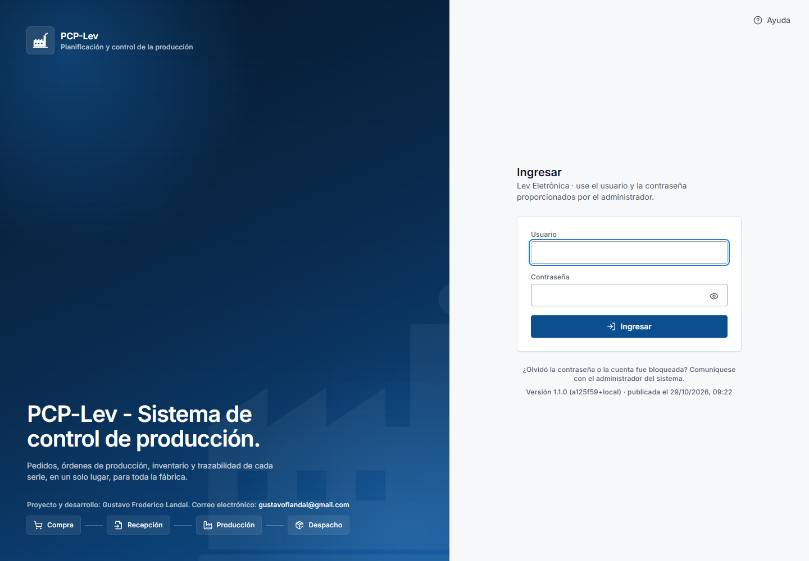

- El ícono de ojo junto al campo Contraseña muestra lo que se escribió, para
  verificarlo antes de enviar.
- La pantalla de ingreso **sigue el idioma del navegador**: en la primera visita
  a una computadora aparece en español si el navegador está en español, y en
  portugués en los demás casos. Después de ingresar, rige el idioma guardado en
  su cuenta (vea la sección [12](#12-apariencia-y-preferencias)).
- Al pie del formulario aparece la **versión del sistema en ejecución** y la
  fecha y la hora en que fue publicada (por ejemplo, "Versión 1.1.0
  (a125f59) · publicada el 29/10/2026, 08:38"). Informe ese texto al soporte
  al reportar un problema; también muestra si el servidor ya tiene la
  actualización más reciente.
- Si el usuario o la contraseña son incorrectos, un mensaje explica el problema
  justo debajo del formulario.
- Si la sesión se cierra por inactividad (el sistema finaliza la sesión
  automáticamente después de un tiempo sin uso) o expira, el sistema vuelve a
  esta pantalla y avisa el motivo. Basta con ingresar de nuevo: nada de lo que
  ya se guardó se pierde.
- En el primer acceso (o después de que el administrador restablezca su
  contraseña), el sistema le pide que cree su propia contraseña antes de
  continuar. Para cambiarla cuando quiera, use **Preferencias › Cambiar
  contraseña**. La contraseña debe tener **al menos 10 caracteres**, no puede
  contener su usuario ni ser una contraseña obvia (como `1234567890` o
  `senha12345`).
- Después de **5 contraseñas incorrectas seguidas**, su cuenta queda bloqueada
  por 15 minutos (30 y luego 60 si sigue equivocándose), aunque se escriba la
  contraseña correcta. El administrador la libera de inmediato restableciendo
  su contraseña.
- Cambiar la contraseña (o que se la restablezcan, o que se bloquee el acceso)
  cierra las sesiones abiertas en otras computadoras: vuelven a esta pantalla
  con el aviso "Su sesión fue cerrada".
- Todas las pantallas, incluida esta, tienen un botón **Ayuda** en la esquina
  superior derecha. Vea la sección [30](#30-ayuda-contextual).

---

## 2. Navegación general

Después de ingresar, el sistema muestra el marco estándar de todas las
pantallas internas: encabezado arriba, navegación lateral a la izquierda y el
contenido de la pantalla actual a la derecha.

- **Encabezado**: nombre y perfil de quien está operando, el botón **Ayuda** y
  el botón **Salir**.
- **Navegación lateral**: acceso al Panel, a los registros maestros
  (Proveedores, Partes y piezas, Productos terminados), a la Estructura de
  productos y a Compras (Cotizaciones, Órdenes de compra, Necesidad de
  compra). El elemento en gris, con "Próximo sprint" (Producción), todavía no
  fue implementado.
- **Salir**: cierra la sesión de inmediato y vuelve al inicio de sesión.

### Imprimir o guardar en PDF

Toda pantalla tiene el botón **Imprimir / PDF** en el encabezado (y los
diálogos, un ícono de impresora junto a la X). Abre la impresión del
navegador: elija la impresora o, en **Destino**, **Guardar como PDF**. El
**Ctrl+P** del navegador hace lo mismo.

En el papel/PDF sale lo que está en la pantalla (tablas, filtros aplicados,
gráficos y detalles), sin el menú y sin los botones, con un encabezado de
impresión (pantalla, empresa, quién imprimió, fecha y hora), en hoja clara
incluso en el tema oscuro. El nombre sugerido del archivo es el de la pantalla
con la fecha y la hora. Con un diálogo abierto (por ejemplo, el kardex), sale
solo el diálogo. En las listas paginadas, sale la página que está en la
pantalla; para el historial completo, use **Exportar CSV** donde exista.

---

## 3. Panel

El Panel es la pantalla inicial: un resumen de lo que requiere atención ahora,
que se actualiza solo cada minuto ("Actualizado a las …" muestra la última
lectura; **Actualizar ahora** fuerza una nueva).

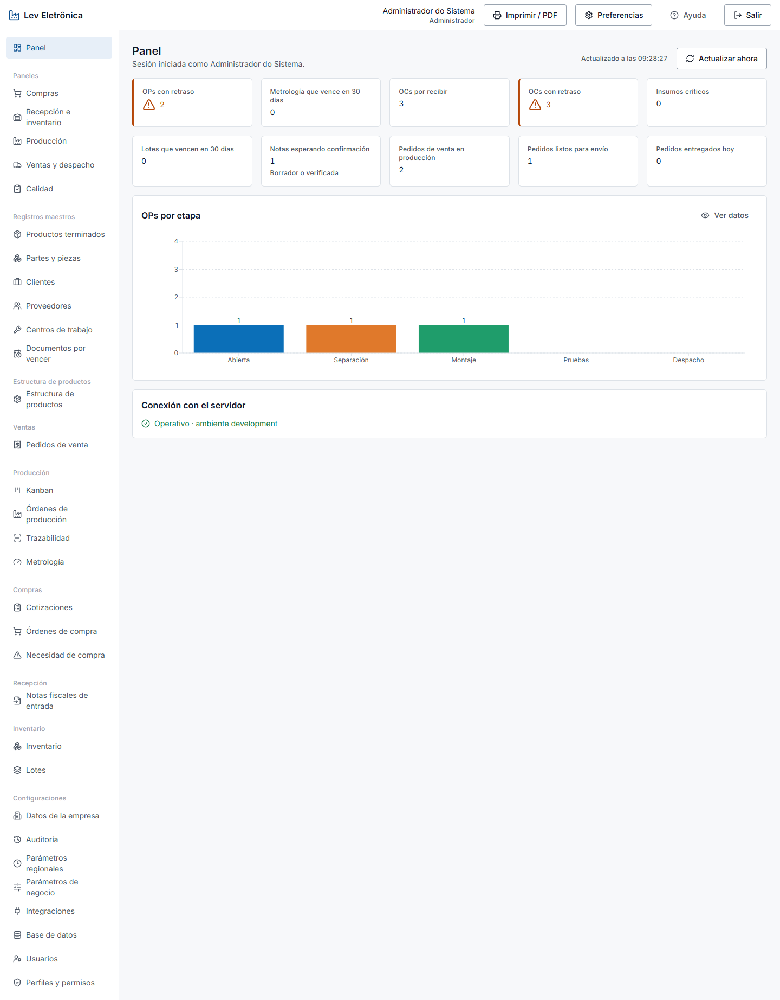

Cada persona ve solo las tarjetas de los módulos que puede consultar:

- **Producción**: OP con retraso, metrología que vence en 30 días y el gráfico
  **OPs por etapa** (esperando liberación y en cada etapa del Kanban).
- **Compras**: órdenes de compra por recibir y con retraso.
- **Inventario**: insumos en nivel crítico y lotes que vencen en 30 días.
- **Recepción**: notas fiscales esperando confirmación (borrador o
  verificada).
- **Ventas**: pedidos en producción, listos para envío y entregados hoy.

Las tarjetas con problema (retraso, vencimiento, crítico) aparecen con un
ícono de alerta y el borde de color. Al hacer clic en la tarjeta se abre la
pantalla correspondiente. La tarjeta **Conexión con el servidor** avisa si la
API está fuera de servicio.

Los paneles completos de cada sector están en la sección
[29](#29-paneles-por-sector).

---

## 4. Proveedores

Pantalla de registro de quienes abastecen las partes y piezas usadas en la
producción.

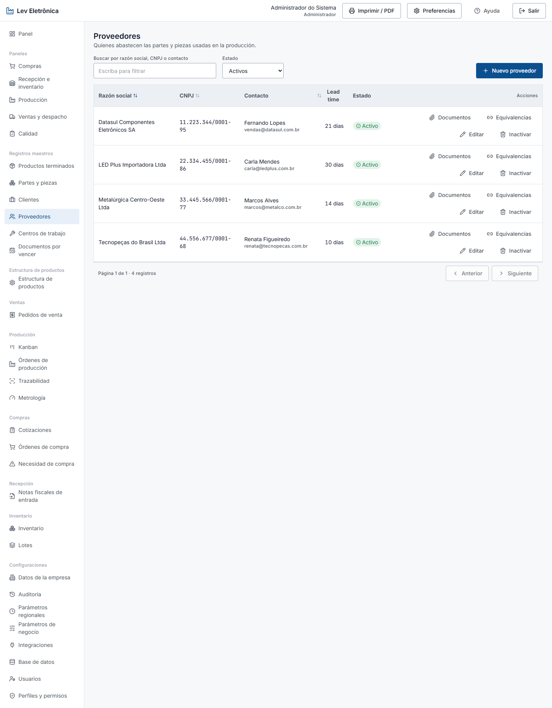

### 4.1 Buscar, filtrar y ordenar

- El campo **Buscar por razón social, CNPJ o contacto** filtra la lista a
  medida que usted escribe (no es necesario presionar Enter).
- El selector **Estado** alterna entre Activos (predeterminado), Inactivos y
  Todos.
- Haga clic en el encabezado de **Razón social**, **CNPJ** o **Lead time**
  para ordenar la lista por esa columna; haga clic de nuevo para invertir el
  orden.

### 4.2 Registrar un proveedor

Haga clic en **Nuevo proveedor**.

Los campos marcados con `*` son obligatorios: **Razón social**, **CNPJ** y
**Lead time promedio**. El CNPJ puede escribirse con o sin puntuación: el
sistema acepta ambos formatos y siempre lo muestra con puntuación en la lista.
Los demás campos (contacto, dirección, condición de pago) son opcionales.

Si el CNPJ ya pertenece a otro proveedor registrado (aunque esté inactivo), el
sistema rechaza el registro y explica el motivo en la parte superior del
formulario, sin cerrar la ventana: corrija el CNPJ e intente de nuevo.

### 4.3 Editar y reactivar

Haga clic en **Editar** en la fila del proveedor.

El formulario se abre completado con los datos actuales. Al editar (solo al
editar, no al registrar uno nuevo) aparece también el campo **Estado**, que es
la única forma de reactivar un proveedor que fue inactivado antes: cambie el
estado a "Activo" y guarde.

### 4.4 Inactivar

Haga clic en **Inactivar** en la fila del proveedor. El sistema pregunta antes
de actuar:

Inactivar **preserva el historial**: el registro no se borra, solo desaparece
de la lista de proveedores activos y de las listas de selección usadas en
otras pantallas (por ejemplo, el "Proveedor predeterminado" de una pieza). Para
ver proveedores inactivos, cambie el filtro Estado a "Inactivos" o "Todos".

---

## 5. Partes y piezas

Pantalla de registro de componentes comprados y consumidos en el montaje.

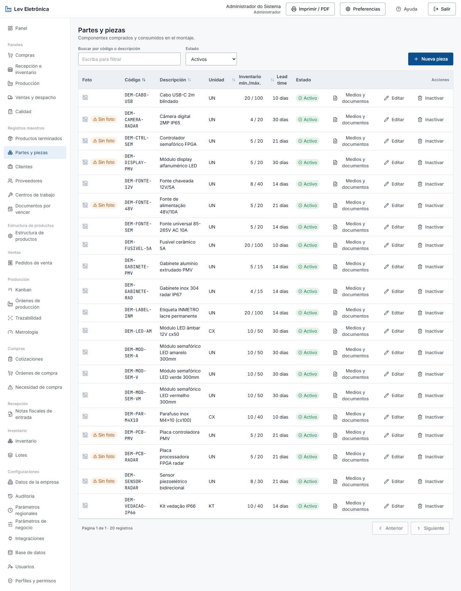

Funciona como la pantalla de Proveedores (búsqueda, filtro de estado,
ordenamiento por columna, editar e inactivar/reactivar; vea la sección
[4](#4-proveedores) para el paso a paso). Lo que cambia es el formulario de
registro:

- **Código**, **Unidad** y **Descripción** son obligatorios.
- **Inventario mínimo** e **Inventario máximo** definen el rango de reposición
  que usa el módulo de Inventario (sección [10](#10-inventario-y-recepción))
  para decidir cuándo reponer.
- **Lead time de compra** es el plazo esperado, en días, entre pedir y recibir
  la pieza del proveedor.
- **Proveedor predeterminado** es opcional: solo lista proveedores activos, y
  lo usa la pantalla de [Necesidad de compra](#11-necesidad-de-compra-e-informes)
  para agrupar las sugerencias de compra.

---

## 6. Productos terminados

Pantalla de registro de lo que se vende al cliente.

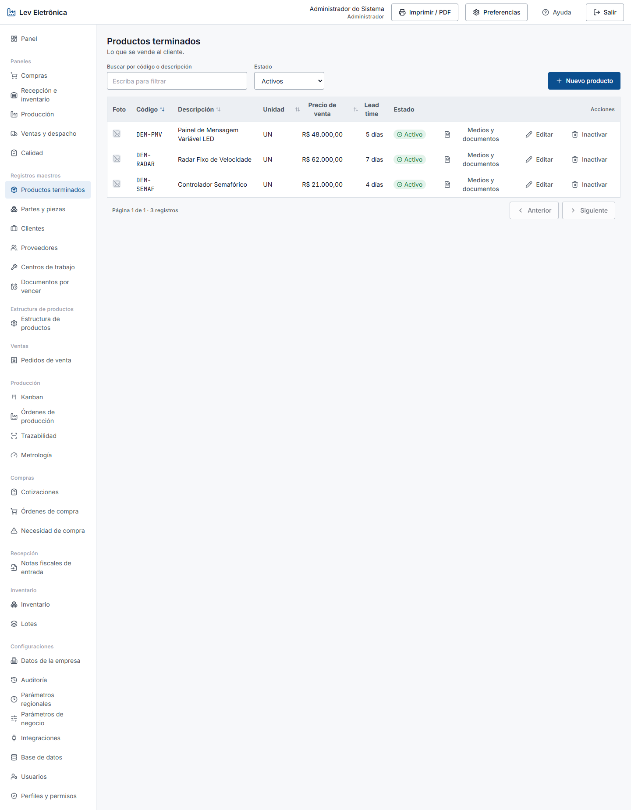

También sigue el mismo patrón de búsqueda, filtro, ordenamiento, editar e
inactivar/reactivar de la sección [4](#4-proveedores). El formulario de
registro:

- **Código**, **Unidad**, **Descripción** y **Precio de venta** son
  obligatorios.
- **Lead time de producción** es el plazo esperado, en días, para producir una
  unidad; es una información que el módulo de producción (Sprint 6) usará para
  planificar órdenes.

---

## 7. Estructura de productos (BOM)

Pantalla que define de qué está hecho cada producto terminado: la lista de
partes/piezas y la cantidad de cada una necesaria para armar **1 unidad**. Es
la "receta" que el módulo de producción (Sprint 6) seguirá para calcular el
consumo de insumos de una orden de producción.

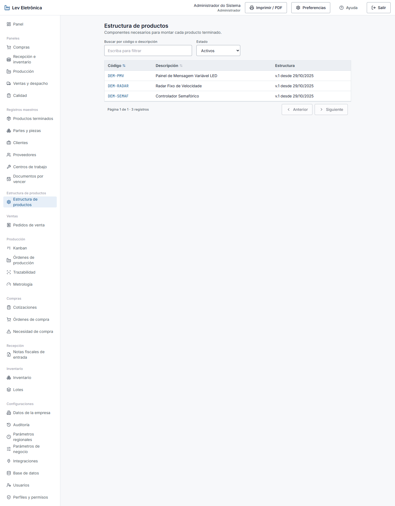

La lista muestra todos los productos terminados; la columna **Estructura**
indica "Sin estructura activa" para quienes todavía no tienen una BOM
registrada, o la versión **vigente** y la fecha de inicio de la vigencia de
quienes ya la tienen (por ejemplo, "v.2 desde 01/09/2026").

### 7.1 Crear la primera versión

Haga clic en el código de un producto sin estructura para abrir el detalle, y
en **Crear estructura**. **Vigencia a partir de** (ya completada con la fecha
de hoy) y al menos **un ítem** (pieza y cantidad) son obligatorios. Use
**Agregar ítem** para incluir más piezas. Al guardar, usted vuelve al detalle
del producto, que ya muestra la versión recién creada.

### 7.2 Nueva versión

Una estructura de producto **nunca se edita ni se borra**: el RF1.3 exige
preservar lo que cada orden de producción pasada realmente usó. Para cambiar
la composición, use **Nueva versión**, en el detalle del producto.

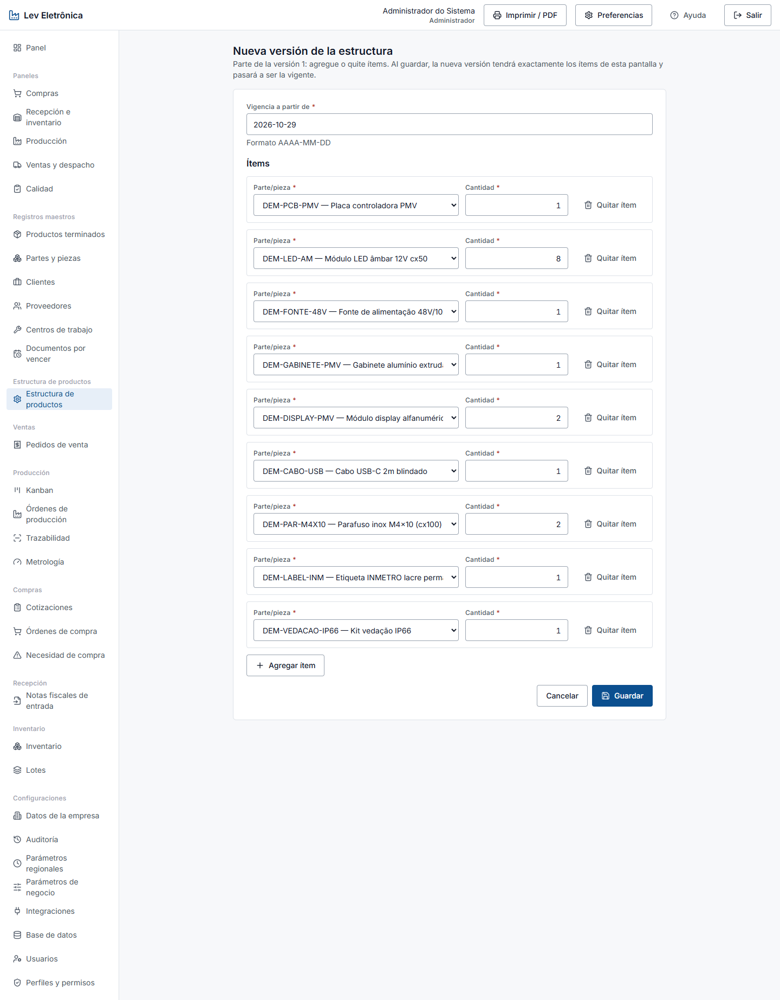

El botón abre una pantalla que **replica la estructura de la versión que se
está mostrando**, con todos los ítems ya completados. En esa pantalla usted:

- **cambia** la pieza o ajusta la cantidad de un ítem;
- **quita** un ítem con **Quitar ítem**;
- **agrega** piezas con **Agregar ítem**.

Al confirmar con **Guardar**, la nueva versión se compone de **todos los
ítems que estén en la pantalla**, ni más ni menos. Recibe el número siguiente
(v.3, por ejemplo) y pasa a ser la **vigente**; la versión que regía hasta
entonces se cierra (recibe fecha de fin de vigencia) y sigue guardada. La nueva
vigencia puede comenzar en cualquier fecha; si es anterior a la de la versión
cerrada, el fin de esta se ajusta para que no sea menor que su inicio.

### 7.3 Ver todas las versiones y definir la vigente

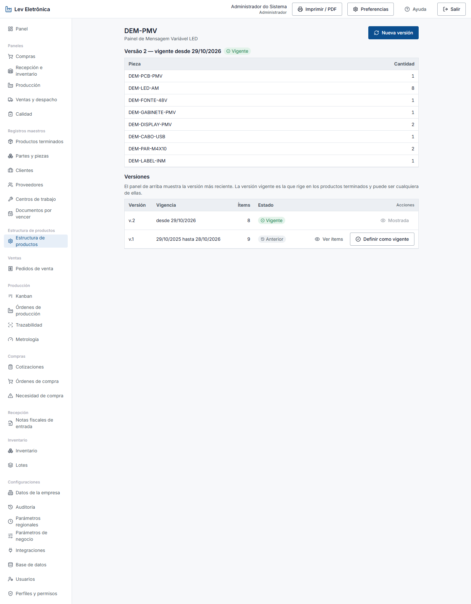

El panel del detalle muestra siempre la **versión más reciente**. Justo
debajo, la lista **Versiones** trae todas ellas, con vigencia, cantidad de
ítems y el estado: **Vigente** (la que rige hoy) o **Anterior**.

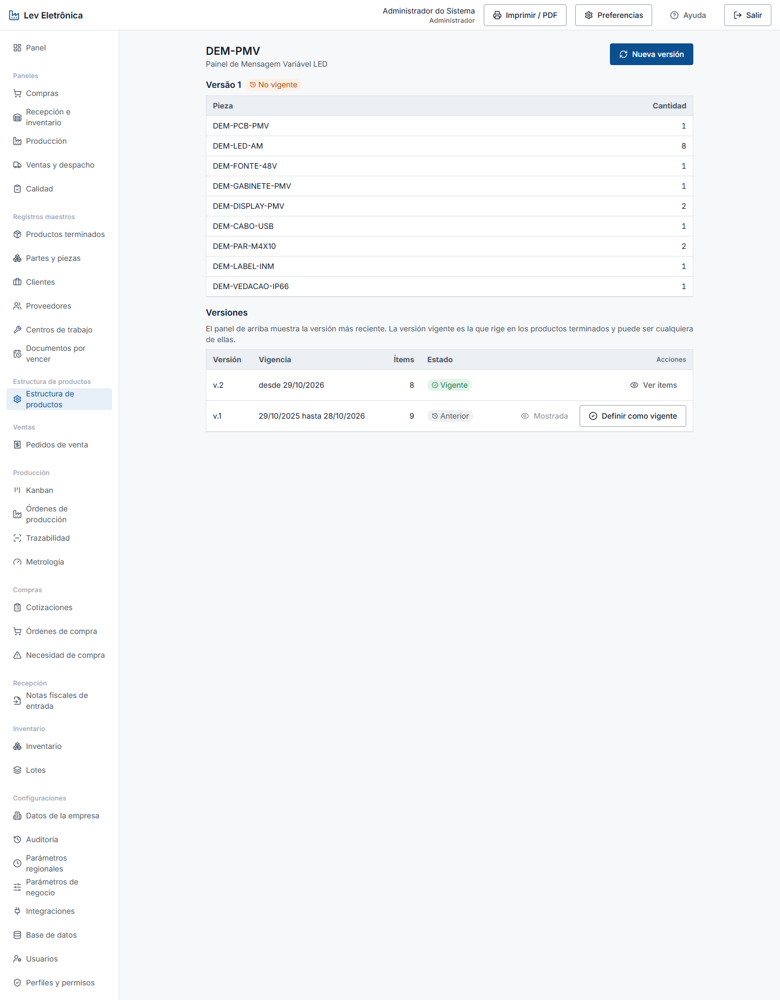

- **Ver ítems** muestra en el panel los ítems de la versión elegida. Si no es
  la vigente, el panel muestra la etiqueta **No vigente**.
- **Definir como vigente** (para quienes pueden agregar estructuras) convierte
  la versión elegida en la vigente, **sea cual sea**, incluso una más antigua,
  para deshacer un cambio. La vigente anterior se cierra hoy y la elegida
  vuelve a regir sin fecha de fin.
- **Nueva versión** parte de la versión mostrada en el panel.

La versión **vigente** es la que aparece en **Productos terminados** y la que
usan las órdenes de producción. Solo existe **una vigente por producto a la
vez**.

---

## 8. Cotizaciones

Pantalla de solicitud de precio a un proveedor, antes de cualquier compromiso
de compra.

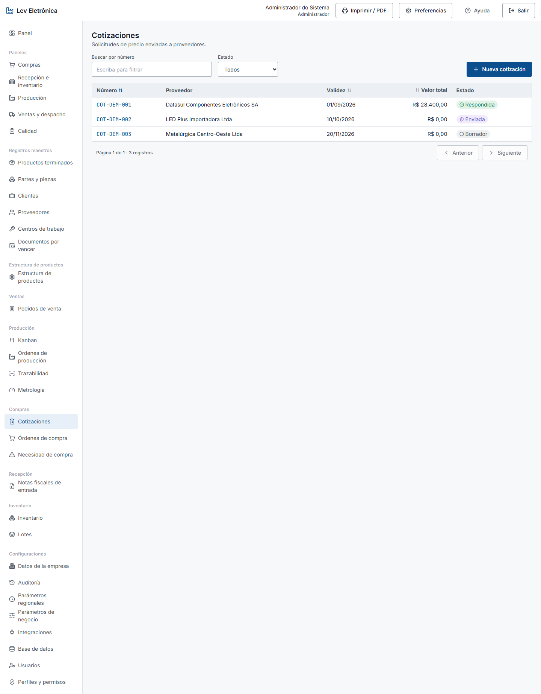

### 8.1 Buscar, filtrar y ordenar

Sigue el mismo patrón de las pantallas de registro (sección
[4.1](#41-buscar-filtrar-y-ordenar)), cambiando "Estado" por el estado de la
cotización: Borrador, Enviada, Respondida o Cancelada.

### 8.2 Registrar una cotización

Haga clic en **Nueva cotización**. A diferencia de los registros, esta
pantalla abre una página completa, no una ventana: una cotización tiene una
lista de ítems que no cabe bien en un espacio pequeño.

**Número**, **Proveedor**, **Validez** y al menos **un ítem** (pieza, cantidad
y precio unitario) son obligatorios. Use **Agregar ítem** para incluir más
piezas; el total se recalcula con cada cambio. Al guardar, usted va a la
pantalla de detalle de la cotización recién creada.

Una cotización también puede llegar ya parcialmente completada, desde la
pantalla de [Necesidad de compra](#11-necesidad-de-compra-e-informes): en ese
caso, el proveedor y los ítems (pieza y cantidad sugerida) ya vienen listos, y
falta solo el precio negociado.

### 8.3 El ciclo de vida de una cotización

La cotización nace en **Borrador** y sigue una ruta de tres etapas, mostrada en
la pantalla de detalle:

- **Creada**: siempre completada, es el momento del registro.
- **Enviada**: haga clic en la etapa para confirmar que la cotización fue
  remitida al proveedor. Cambia el estado a Enviada.
- **Respondida**: haga clic en la etapa para registrar el precio que respondió
  el proveedor, ítem por ítem, y la fecha de la respuesta. El valor total se
  recalcula con los precios negociados.

Con la cotización **Respondida**, aparece el botón **Convertir en orden de
compra**: ingrese el número de la nueva OC, la fecha de entrega prevista y la
condición de pago, y el sistema crea una orden de compra con el proveedor, las
piezas y los **precios ya negociados**, sin volver a escribir todo. Vea la
sección [9](#9-órdenes-de-compra).

**Cancelar cotización** está disponible en cualquier punto antes de la
cancelación; preserva el historial y reemplaza la ruta por un aviso: una
cotización cancelada no vuelve a ningún estado anterior.

---

## 9. Órdenes de compra

Pantalla de la orden de compra propiamente dicha: el compromiso formal con el
proveedor.

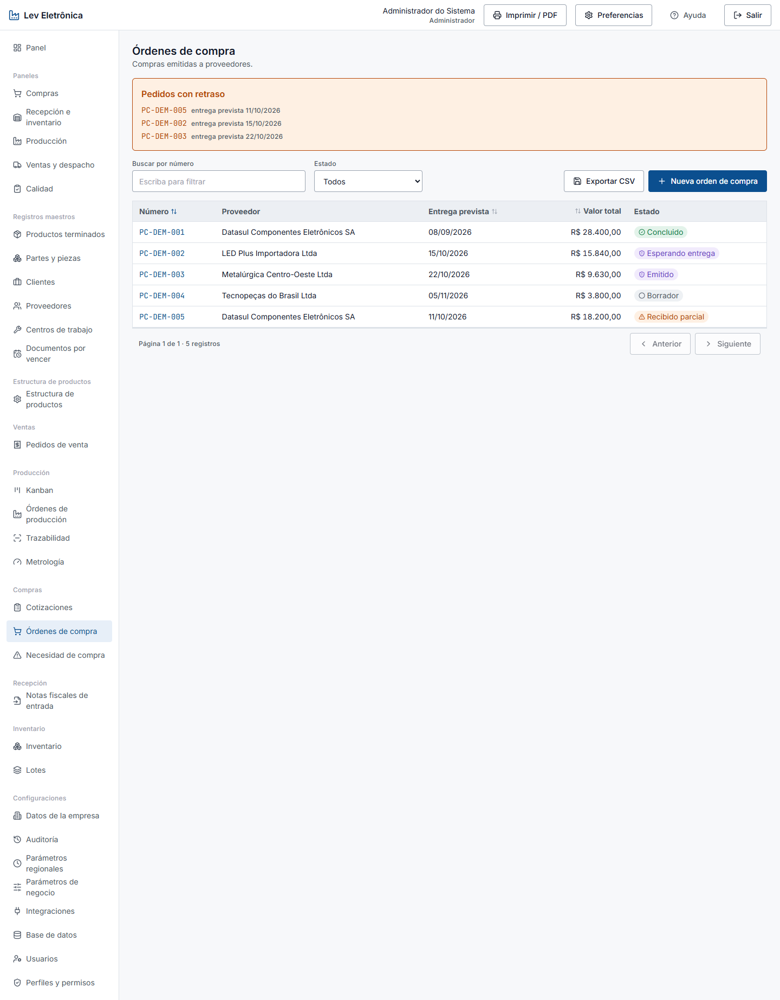

Sigue el mismo patrón de búsqueda, filtro por estado y ordenamiento de la
pantalla de Cotizaciones. Cuando existe alguna orden con la entrega vencida,
un bloque **Pedidos con retraso** aparece en la parte superior de la lista (es
el mismo indicador del Panel; vea la sección [3](#3-panel)). El botón
**Exportar CSV** descarga la lista completa de órdenes, sin filtro; vea la
sección [11](#11-necesidad-de-compra-e-informes).

### 9.1 Registrar una orden de compra

Haga clic en **Nueva orden de compra**.

Al igual que la cotización, es una página completa con una lista de ítems.
**Número**, **Proveedor**, **Entrega prevista** y al menos un ítem son
obligatorios; **Condición de pago** es opcional. Una orden también puede nacer
de una cotización respondida, mediante el botón "Convertir en orden de compra"
de la sección [8.3](#83-el-ciclo-de-vida-de-una-cotización); en ese caso, la
orden ya sale vinculada a la cotización de origen.

### 9.2 El ciclo de vida de una orden de compra

La ruta aquí tiene tres etapas: **Creado** (siempre completada), **Emitido**
(haga clic para confirmar el envío al proveedor) y **Concluido**; esta última
se puede accionar en cuanto la orden se emite y es donde se registra la
recepción de la mercadería (sección
[10.3](#103-recibir-mercadería-de-una-orden-de-compra)). Si la orden vino de
una cotización, un enlace **Ver cotización de origen** aparece debajo del
número.

**Cancelar pedido** está disponible mientras la orden no esté Concluida ni ya
Cancelada; preserva el historial.

---

## 10. Inventario y recepción

Pantalla que muestra el saldo de cada parte/pieza en almacén y permite
corregir ese saldo manualmente. Es también el destino de la recepción de
mercadería: cada orden de compra emitida da entrada al inventario a medida
que el proveedor entrega.

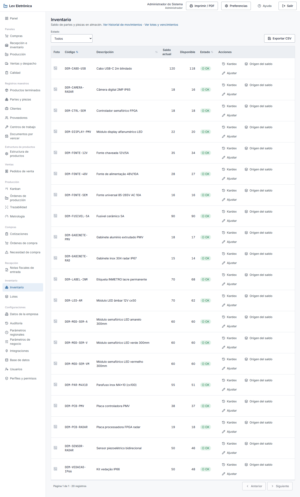

El botón **Exportar CSV** descarga el saldo completo, sin filtro; vea la
sección [11](#11-necesidad-de-compra-e-informes).

### 10.1 Consultar el saldo

- El selector **Estado** filtra por OK, Crítico o Bloqueado (el valor
  predeterminado muestra todos).
- Haga clic en el encabezado de **Código** o **Saldo actual** para ordenar por
  esa columna; haga clic de nuevo para invertir el orden.
- **Disponible** es el saldo que ya descuenta lo que esté reservado para una
  orden de producción; la reserva por OP solo llega con el módulo de
  producción (Sprint 6), así que hoy es siempre igual al Saldo actual.
- **Estado** resume el saldo en una etiqueta: **Crítico** cuando el saldo está
  en o por debajo del inventario mínimo registrado en la pieza (sección
  [5](#5-partes-y-piezas)), **OK** cuando está por encima, o **Bloqueado**. Una
  pieza recién registrada nace con saldo cero y por eso siempre comienza en
  Crítico, aunque el inventario mínimo registrado sea cero (vea la sección
  [31](#31-preguntas-frecuentes)).

### 10.2 Ajustar el saldo manualmente

Haga clic en **Ajustar** en la fila de la pieza.

**Cantidad** y **Motivo** son obligatorios; **Observaciones** es opcional. Use
un número positivo para registrar una entrada (por ejemplo, un conteo de
inventario que encontró más piezas de las que el sistema registraba) y un
número negativo para registrar una salida (pérdida, avería, consumo no
rastreado). El sistema rechaza un ajuste negativo mayor que el saldo
disponible: el mensaje de error aparece en la parte superior del formulario y
el modal sigue abierto para corregir. Todo ajuste queda registrado en el
historial de movimientos de inventario, con el motivo informado.

### 10.3 Recibir mercadería de una orden de compra

A partir de la versión 1.2 la mercadería ingresa al inventario **por la nota
fiscal del proveedor**, y ya no por un registro directo en la orden. En el
detalle de una orden **Esperando entrega** o **Recibido parcial**, el botón
**Registrar nota fiscal** (y la etapa **Concluido** de la ruta) abre una nota
nueva ya vinculada a la orden; el paso a paso está en la sección
[26](#26-recepción-por-nota-fiscal). El detalle de la orden lista las notas
registradas contra ella.

Cuando el proveedor no va a entregar el resto, **Cerrar con saldo pendiente**
cierra la orden (exige el permiso de cerrar y un motivo de 10 a 255
caracteres); el motivo y quién la cerró aparecen en el detalle.

### 10.4 Kardex y origen del saldo

En cada fila del inventario:

- **Kardex** abre el extracto de la pieza: cada entrada y salida con fecha,
  motivo, cantidad, saldo posterior, lote y el documento que la originó (nota
  fiscal, orden de producción, pedido de venta), con enlace a él.
- **Origen del saldo** muestra qué notas fiscales cubren el saldo actual y,
  para piezas con lote, los lotes con saldo.

El costo unitario solo aparece para quienes tienen el permiso de ver costos.

---

## 11. Necesidad de compra e informes

Pantalla que cruza el inventario mínimo de cada pieza con el saldo actual y
sugiere lo que se necesita comprar: la base de la planificación de compras,
antes de que exista Orden de Producción (la fórmula completa, que también
considera OP pendientes, solo entra con el módulo de Producción).

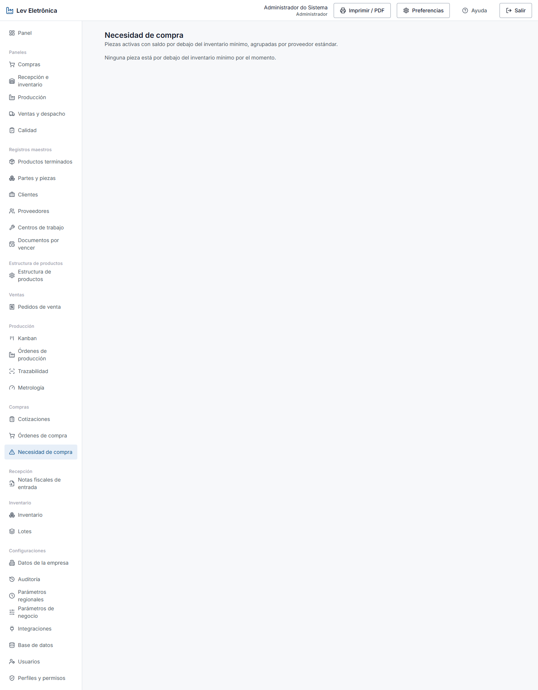

- Solo aparecen piezas **activas** con saldo **por debajo** del inventario
  mínimo registrado (sección [5](#5-partes-y-piezas)).
- **Necesidad** es la cantidad sugerida: inventario mínimo menos el saldo
  actual.
- La lista se agrupa por el **proveedor predeterminado** de cada pieza. Las
  piezas sin proveedor predeterminado aparecen aparte, sin la opción de
  generar cotización: registre primero un proveedor predeterminado en la pieza
  (sección [5](#5-partes-y-piezas)).

### 11.1 Generar una cotización a partir de la necesidad

Haga clic en **Generar cotización** en el grupo de un proveedor.

El sistema abre el formulario de [Nueva cotización](#82-registrar-una-cotización)
ya con el proveedor seleccionado y un ítem por pieza, con la cantidad
sugerida; faltan solo **Número**, **Validez** y el **precio unitario** de cada
ítem (el precio es exactamente lo que la cotización existe para descubrir, por
lo que nunca viene completado). Si algún ítem no se puede precompletar (por
ejemplo, un proveedor que fue inactivado entre la carga de la lista y el
clic), aparece un aviso que pide verificar el formulario antes de guardar.

### 11.2 Exportar informes en CSV

Las pantallas de [Inventario](#10-inventario-y-recepción) y de
[Órdenes de compra](#9-órdenes-de-compra) tienen un botón **Exportar CSV** que
descarga la lista completa (sin filtro, sin paginación) en un archivo listo
para abrir en Excel. Por ahora solo CSV; el PDF podrá venir después, si se
solicita.

---

## 12. Apariencia y preferencias

Haga clic en **Preferencias** en el encabezado, junto a su nombre, para
ajustar cómo se ve el sistema en su pantalla. La preferencia se guarda en su
cuenta: vale en cualquier computadora que use para ingresar, no solo en la
estación actual.

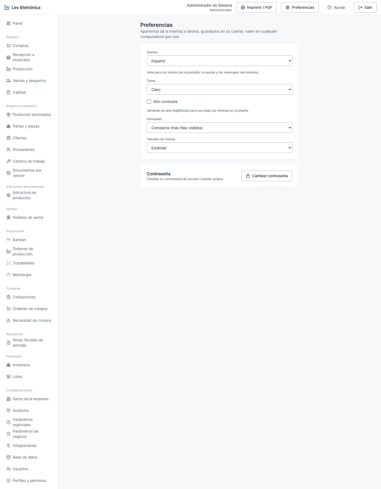

- **Idioma**: Português (Brasil) o Español. La elección vale para todo: los
  textos de las pantallas, los menús, la **Ayuda** de cada pantalla y los
  mensajes de error y de validación que devuelve el sistema. Al cambiar, toda
  la pantalla cambia al instante y la elección queda guardada en su cuenta,
  valiendo en cualquier computadora. En la primera visita a una computadora, la
  pantalla de ingreso sigue el idioma del navegador (español si el navegador
  está en español, de lo contrario portugués); después del inicio de sesión,
  rige el idioma de su cuenta. Las fechas, los números y la moneda siguen los
  **Parámetros regionales** de la empresa (sección 15): el idioma cambia los
  textos, no los formatos.

  

- **Tema**: Claro, Oscuro o Automático (sigue el sistema operativo y cambia
  solo si la computadora alterna entre claro y oscuro, por ejemplo al
  anochecer).

  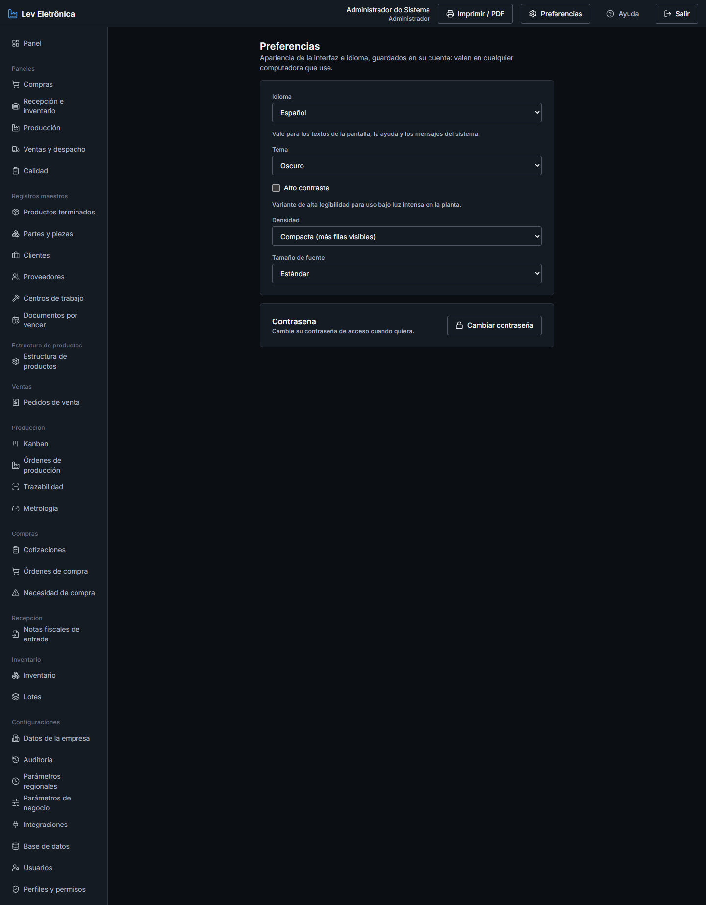

- **Alto contraste**: variante de alta legibilidad para uso bajo luz intensa
  en la planta de producción.

  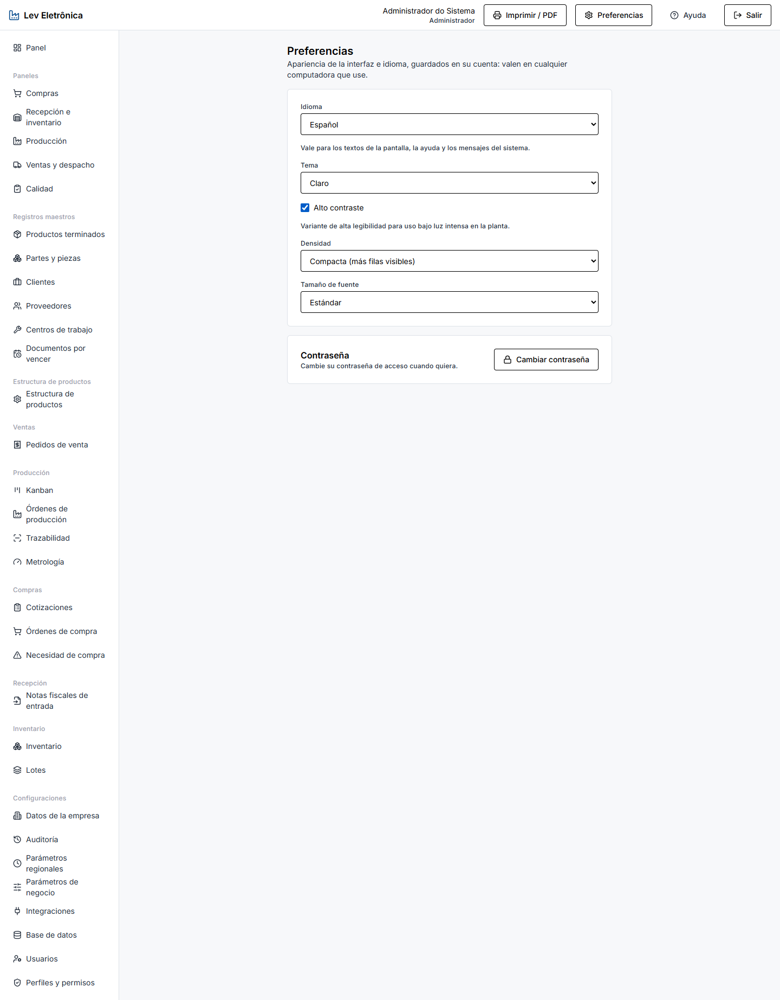

- **Densidad**: Compacta muestra más filas por pantalla (predeterminado, ideal
  para pantallas de gestión); Cómoda usa filas más altas, mejor para uso en
  tableta.
- **Tamaño de fuente**: Estándar, Grande o Extra grande, para quienes prefieren
  texto más grande.

  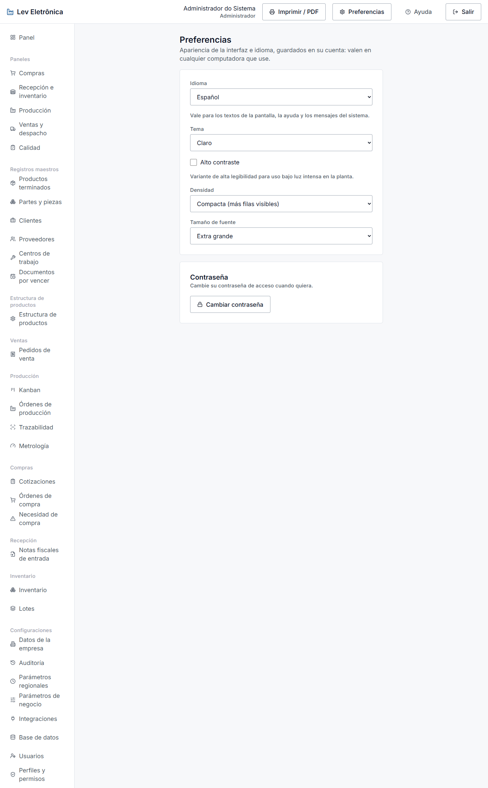

Cada cambio se aplica al instante, incluso antes de confirmar; si el guardado
falla, el sistema vuelve al valor anterior y avisa por qué.

---

## 13. Datos de la empresa

Haga clic en **Datos de la empresa**, en la sección "Configuraciones" de la
navegación lateral (solo aparece para el perfil Administrador), para registrar
la identificación, la dirección, el contacto y el logotipo de la empresa.
Estos datos aparecen en el encabezado y en la pantalla de inicio de sesión de
todos los que usan el sistema, incluso antes de ingresar, ya que el nombre y
el logotipo deben aparecer en la pantalla de inicio de sesión.

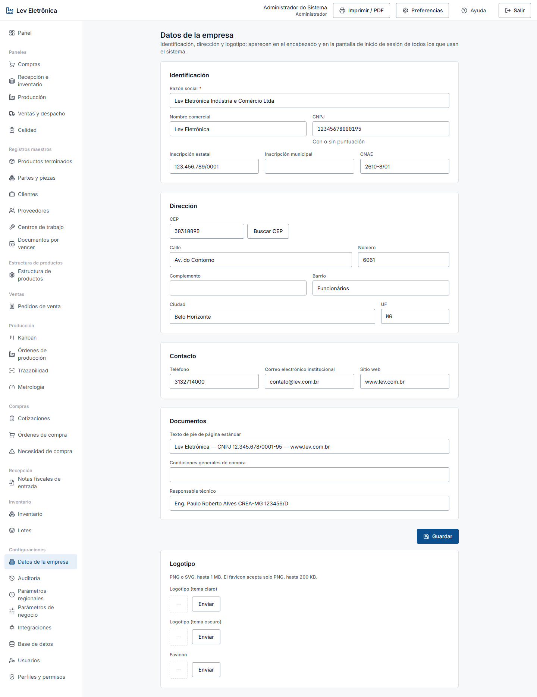

- **Identificación**: solo la Razón social es obligatoria. El CNPJ es
  opcional, pero cuando se informa debe tener un dígito verificador válido.
- **Dirección**: ingrese el CEP y haga clic en **Buscar CEP** para completar
  automáticamente calle, barrio, ciudad y UF; si la consulta falla (por
  ejemplo, sin conexión), complételos manualmente.
- **Contacto**: teléfono, correo electrónico institucional y sitio web, todos
  opcionales.
- **Documentos**: texto de pie de página estándar, condiciones generales de
  compra y responsable técnico; se usan en documentos impresos cuando esos
  modelos existan.
- **Logotipo**: envíe una variante para el tema claro y otra para el tema
  oscuro (PNG o SVG, hasta 1 MB), y un favicon (solo PNG, hasta 200 KB). Cada
  logotipo puede cambiarse o quitarse en cualquier momento; el cambio aparece
  en el encabezado de inmediato, sin necesidad de recargar la página.

Quien no es Administrador no ve el enlace "Datos de la empresa" en la
navegación y no puede guardar cambios aquí; la pantalla muestra "Acceso
restringido a administradores" a quien intente abrirla directamente por la
URL.

---

## 14. Auditoría

Haga clic en **Auditoría**, en la sección "Configuraciones" de la navegación
lateral (solo aparece para el perfil Administrador), para consultar el
registro de cambios del sistema: quién cambió qué, cuándo y desde dónde.

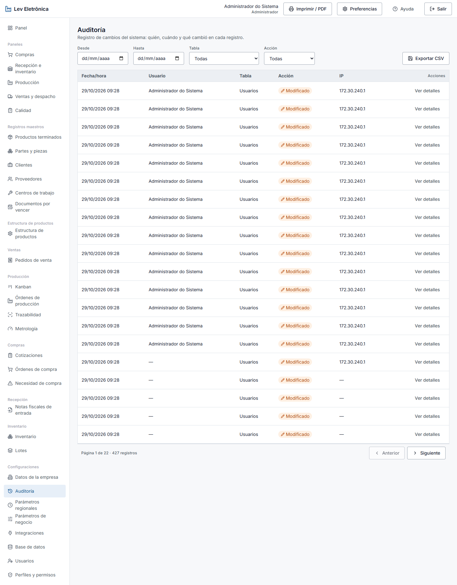

- **Filtros**: período (Desde/Hasta), Tabla y Acción (Incluido, Modificado,
  Eliminado). Combine cuantos quiera; la lista se actualiza sola con cada
  cambio.
- **Ver detalles** abre lo que cambió campo por campo, no el registro en bruto:
  el valor anterior aparece tachado y el nuevo resaltado; para una
  modificación ("Modificado") ambos aparecen lado a lado; para una inclusión
  solo existe el valor nuevo, y para una eliminación solo el valor anterior.

- **Exportar CSV** descarga exactamente los registros que muestran los filtros
  aplicados en la pantalla.
- **Usuario** e **IP** quedan en blanco (—) en las filas grabadas antes de que
  existiera esta funcionalidad, o en acciones sin una sesión de usuario
  asociada (por ejemplo, una rutina interna del sistema).

Quien no es Administrador no ve el enlace "Auditoría" en la navegación y recibe
"Acceso restringido a administradores" al intentar abrir la pantalla
directamente por la URL.

---

## 15. Parámetros regionales

Haga clic en **Parámetros regionales**, en la sección "Configuraciones" de la
navegación lateral (solo aparece para el perfil Administrador), para elegir
cómo aparecen las fechas y las horas en todas las pantallas del sistema.

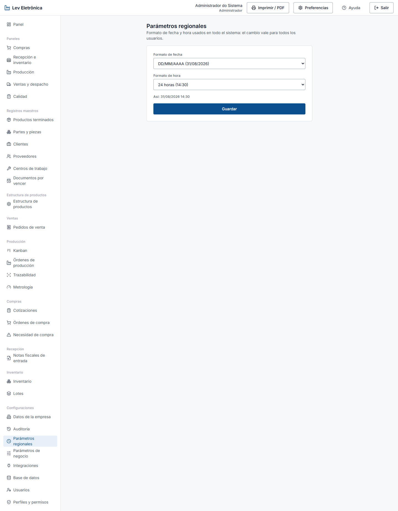

- **Formato de fecha**: DD/MM/AAAA (predeterminado), DD-MM-AAAA o AAAA-MM-DD.
- **Formato de hora**: 24 horas (predeterminado) o 12 horas (AM/PM).
- La línea **"Así:"** muestra el efecto de la elección antes de guardar.
- Al **Guardar**, el cambio vale para todos los usuarios, no solo para quien
  editó. Quien tiene el sistema abierto pasa a ver el nuevo formato al cambiar
  de pantalla; quien ingrese después ya recibe el formato nuevo.

Quien no es Administrador no ve el enlace "Parámetros regionales" en la
navegación y recibe "Acceso restringido a administradores" al intentar abrir
la pantalla directamente por la URL, pero todas las pantallas siguen el formato
elegido por el Administrador.

---

## 16. Base de datos y seguridad

Haga clic en **Base de datos**, en la sección "Configuraciones" de la
navegación lateral (solo aparece para el perfil Administrador), para ver un
diagnóstico de la base de datos del sistema. La pantalla es de **solo
lectura**: nada en ella modifica la base, y el usuario, la contraseña y la
cadena de conexión nunca se muestran.

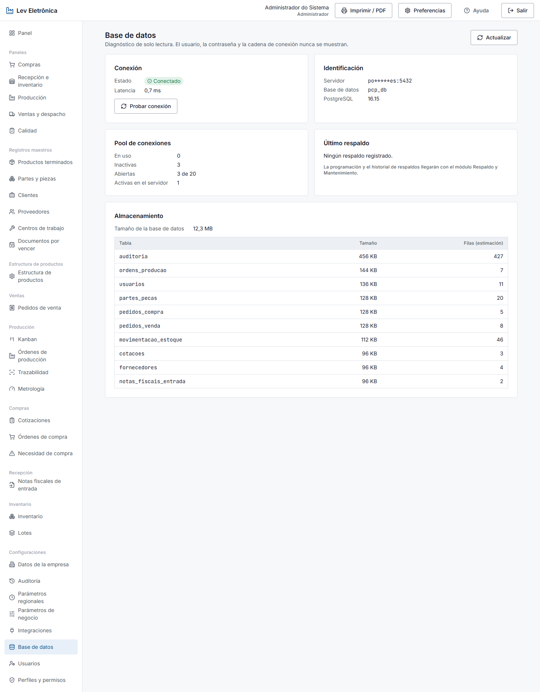

- **Conexión**: estado y tiempo de respuesta. **Probar conexión** hace una
  consulta mínima y muestra el tiempo al instante.
- **Identificación**: servidor (con el nombre parcialmente oculto), nombre de
  la base y versión de PostgreSQL.
- **Pool de conexiones**: cuántas conexiones está usando el sistema ahora,
  cuántas están inactivas y el máximo permitido. Muchas conexiones "en uso" por
  mucho tiempo, o una latencia alta, indican carga o un problema de red: avise
  al responsable de la infraestructura.
- **Almacenamiento**: tamaño total y las 10 tablas más grandes. El conteo de
  filas es una estimación del propio PostgreSQL; "—" significa que todavía no
  calculó la estimación de esa tabla.
- **Último respaldo**: queda como "Ningún respaldo registrado" hasta que exista
  el módulo de Respaldo y Mantenimiento.
- **Actualizar** repite el diagnóstico.

**Protecciones automáticas** (no hay nada que configurar en la pantalla):

- Después de **5 intentos de inicio de sesión con contraseña incorrecta** desde
  la misma computadora en un minuto, la pantalla de inicio de sesión muestra
  "Demasiados intentos de inicio de sesión. Espere un minuto e intente de
  nuevo." Los inicios de sesión con la contraseña correcta no cuentan para ese
  límite.
- Independientemente de la computadora, **5 contraseñas incorrectas seguidas
  para la misma cuenta** la bloquean por 15 minutos (luego 30 y 60). Para
  liberarla antes, restablezca la contraseña de la persona en **Usuarios**
  (sección [20](#20-usuarios)).
- El uso muy intenso del sistema por un mismo usuario en una misma computadora
  (decenas de acciones por segundo) se frena temporalmente con el mensaje
  "Demasiadas solicitudes en poco tiempo".

---

## 17. Parámetros de negocio

Haga clic en **Parámetros de negocio**, en la sección "Configuraciones" de la
navegación lateral (solo aparece para el perfil Administrador), para ajustar
reglas de inventario, recepción y compras. Las reglas valen para todos los
usuarios.

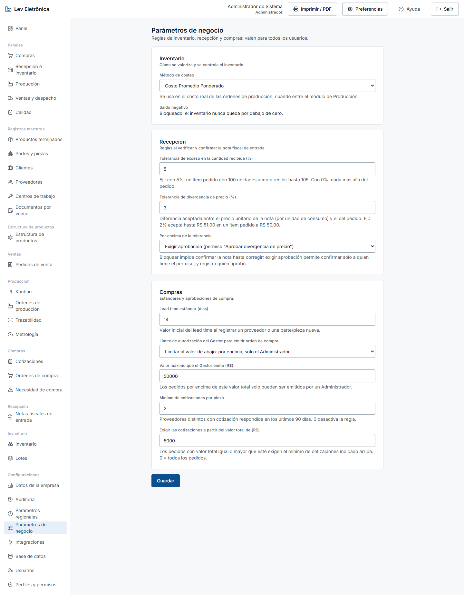

**Inventario**

- **Método de costeo** (Costo Promedio Ponderado, PEPS o Último Precio de
  Compra): queda guardado ahora y pasa a usarse en el costo real de las
  órdenes de producción, cuando entre el módulo de Producción.
- **Saldo negativo**: siempre bloqueado; el inventario nunca queda por debajo
  de cero.

**Recepción**

- **Tolerancia de exceso en la cantidad recibida (%)**: cuánto más de lo
  pedido puede recibirse en cada ítem, sumando todas las notas fiscales de la
  orden. Con 5 %, un ítem pedido con 100 unidades acepta hasta 105; por encima
  de eso, la verificación de la nota indica un bloqueo. Con 0 % (predeterminado),
  nada más allá de lo pedido.
- **Tolerancia de divergencia de precio (%)** y **acción**: cuánto puede
  alejarse el precio de la nota del precio de la orden. Por encima de eso, la
  verificación de la nota **bloquea** o **exige aprobación** de quien tiene el
  permiso de aprobar divergencias (sección
  [26.3](#263-verificar-y-confirmar)).

**Compras**

- **Lead time estándar (días)**: valor que ya viene completado al registrar un
  proveedor o una parte/pieza **nueva**. No modifica los registros existentes.
- **Límite de autorización del Gestor**: con un límite definido, las órdenes de
  compra con valor total superior a él solo pueden ser emitidas por un
  Administrador. El Gestor ve el mensaje "el valor de la orden está por
  encima del límite de autorización del Gestor" al intentar emitir.
- **Mínimo de cotizaciones por pieza** y **valor a partir del cual exigir**: a
  partir de ese valor total, cada pieza de la orden debe tener una cotización
  **respondida** de un número mínimo de **proveedores diferentes**, emitida en
  los últimos 90 días, para que la orden pueda emitirse (varias cotizaciones
  del mismo proveedor cuentan como una). El mensaje de rechazo lista las piezas
  que faltan, por ejemplo "RES-10K (1 de 3)". Con 0 (predeterminado), la regla
  queda desactivada.

---

## 18. Integraciones

Haga clic en **Integraciones**, en la sección "Configuraciones" de la
navegación lateral (solo aparece para el perfil Administrador), para
configurar los servicios externos que usa el sistema. Hoy: el **servidor de
correo electrónico (SMTP)**.

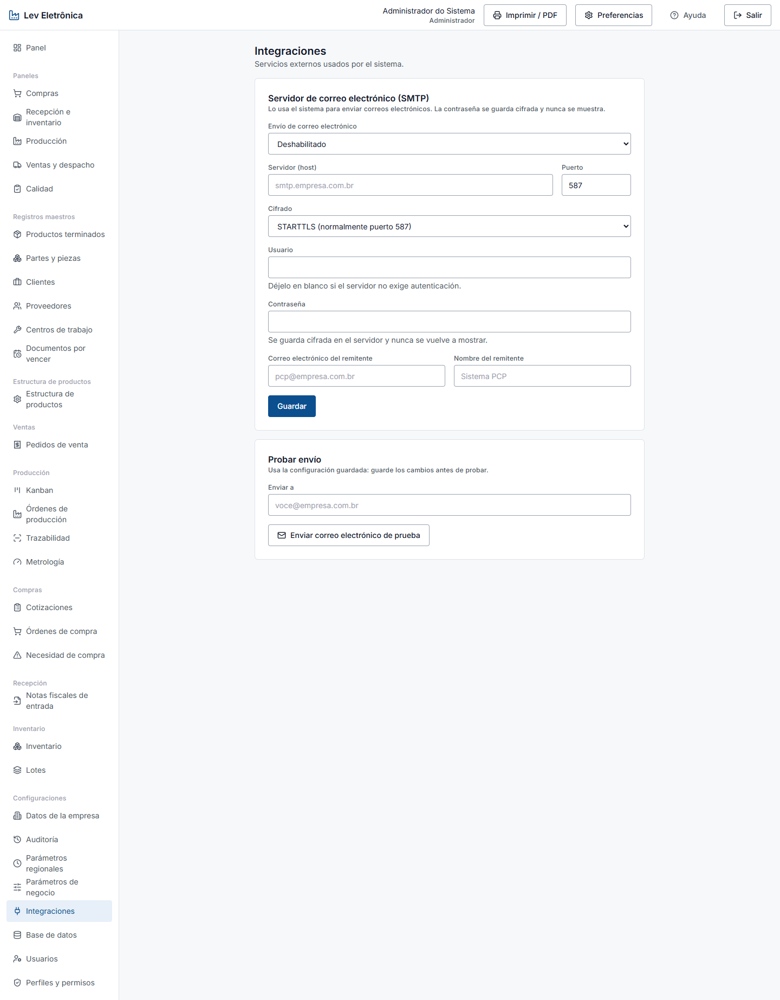

- **Envío de correo electrónico**: "Habilitado" exige que el servidor y el
  correo electrónico del remitente estén completados. Deshabilitado, se puede
  guardar la configuración y terminarla después.
- **Servidor (host)**, **Puerto** y **Cifrado**: los informa el sector de TI o
  el proveedor de correo. Lo habitual es STARTTLS en el puerto 587 o TLS/SSL en
  el 465. "Ninguno" solo sirve para un servidor interno sin usuario y
  contraseña.
- **Usuario** y **Contraseña**: la contraseña se guarda **cifrada** y nunca
  vuelve a aparecer en la pantalla. Con una contraseña guardada, deje el campo
  en blanco para mantenerla, escriba otra para cambiarla, o use **Eliminar
  contraseña guardada**. Por seguridad, al cambiar **servidor, puerto o
  usuario** hay que escribir la contraseña de nuevo: la contraseña guardada
  solo vale para el servidor en el que fue registrada.
- Con cifrado **Ninguno**, no se aceptan usuario ni contraseña.
- **Probar envío**: manda un correo de prueba a la dirección informada,
  usando la configuración **guardada**. Guarde antes de probar. Si falla, la
  pantalla muestra la respuesta del servidor de correo (ej.: "el servidor no
  ofrece STARTTLS -- elija otro cifrado").

> Para guardar la contraseña, el servidor del sistema necesita la clave maestra
> de secretos (`CHAVE_MESTRA_SEGREDOS`) configurada por el equipo de
> infraestructura. Sin ella, la pantalla avisa al guardar, y solo funcionan
> servidores sin autenticación.

---

## 19. Perfiles y permisos

Cada usuario tiene un **perfil**, y el perfil dice qué puede hacer en cada
módulo: el menú, los botones y las pantallas muestran solo lo que el perfil
permite (y el servidor rechaza el resto, incluso por una URL escrita). Haga
clic en **Perfiles y permisos**, en la sección "Configuraciones", para ver y
ajustar los perfiles; la pantalla solo aparece para quien tiene el permiso
"Perfiles y permisos" (al inicio, solo el Administrador).

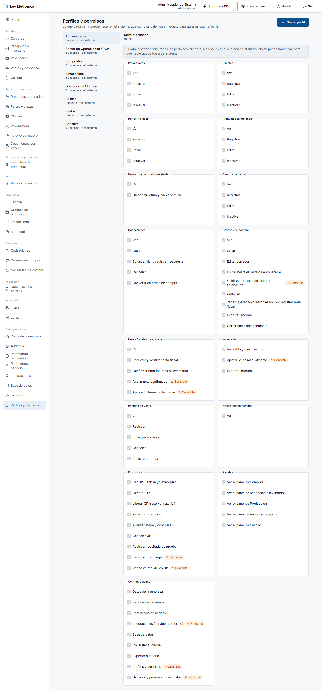

**Perfiles que ya vienen con el sistema** (matriz inicial, a validar con el
Gestor de Operaciones):

| Perfil | Qué puede hacer, al inicio |
|---|---|
| Administrador | Todo, siempre (no puede modificarse). |
| Gestor de Operaciones / PCP | Todos los módulos operativos, incluido el ajuste de inventario y la auditoría; emite órdenes de compra hasta el límite de autorización. Sin integraciones, base de datos ni perfiles. |
| Comprador | Proveedores, cotizaciones y órdenes de compra (hasta el límite de autorización); consulta piezas, productos e inventario. |
| Almacenista | Recepción de órdenes e inventario (incluido el ajuste y la exportación); consulta proveedores, piezas, productos y órdenes. |
| Operador de Montaje | Consulta productos, piezas, estructura (BOM) e inventario. |
| Calidad | Consulta productos, piezas, estructura, proveedores e inventario. |
| Ventas | Consulta productos, piezas, estructura e inventario. |
| Consulta | Ve todo lo operativo y exporta informes; no modifica nada. |

**Ajustar un perfil**: elija el perfil a la izquierda, marque o desmarque los
permisos de cada módulo y haga clic en **Guardar**. El cambio vale al instante
para quienes usan el perfil. Los permisos marcados como **Sensible** (ajustar
inventario, emitir por encima del límite de autorización, integraciones,
perfiles) piden cuidado redoblado.

**Nuevo perfil**: dé un código (ej.: `COMPRADOR_JUNIOR`) y un nombre, y
opcionalmente copie los permisos de un perfil existente para comenzar. Los
perfiles del sistema no pueden eliminarse; los creados por usted, solo cuando
ningún usuario los usa.

**Reglas de seguridad**: nadie edita su propio perfil, y solo es posible
conceder permisos que su propio perfil tiene. Todo cambio de perfil queda en la
**Auditoría** (filtre por "Perfiles de acceso" o "Permisos de los perfiles").

---

## 20. Usuarios

Haga clic en **Usuarios**, en la sección "Configuraciones", para registrar a
quienes acceden al sistema, bloquear o dar de baja un acceso, entregar una
nueva contraseña y dar excepciones de permiso a una persona. La pantalla solo
aparece para quien tiene el permiso "Usuarios y permisos individuales" (al
inicio, solo el Administrador). Todo lo que se hace aquí vale **al instante**,
incluso para quien tiene el sistema abierto, y queda registrado en la
**Auditoría**.

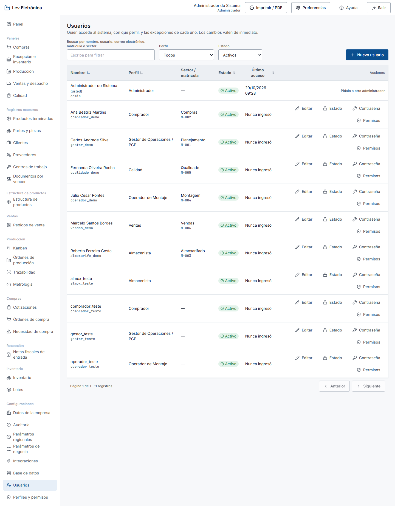

La lista muestra nombre y usuario, perfil, sector y matrícula, estado y último
acceso. Busque por nombre, usuario, correo electrónico, matrícula o sector, y
filtre por perfil y estado (al inicio, solo los **activos**). La etiqueta
**Contraseña temporal** indica quién todavía no creó su propia contraseña.

**Nuevo usuario**: complete el usuario (no cambia después; letras minúsculas,
números, punto, guion o guion bajo), nombre, correo electrónico y perfil;
matrícula, teléfono, sector y fecha de ingreso son opcionales. El sistema ya
sugiere una **contraseña temporal**: entréguesela a la persona. En el primer
acceso, antes de cualquier otra pantalla, la persona crea su propia
contraseña:

**Acciones de cada fila:**

- **Editar**: datos del registro y perfil.
- **Estado**: *Bloqueado* (suspensión temporal) o *Inactivo* (baja, con la
  fecha). La persona pierde el acceso de inmediato; si tiene el sistema
  abierto, vuelve a la pantalla de ingreso con el aviso. *Activo* devuelve el
  acceso. Un usuario nunca se elimina: su historial se preserva.
- **Contraseña**: define una nueva contraseña temporal (para quien olvidó la
  suya). La contraseña anterior deja de valer, y la persona crea una nueva en
  el próximo acceso.
- **Permisos**: concede o retira un permiso **solo para esta persona**, por
  encima del perfil; por ejemplo, para cubrir las vacaciones de un colega.
  Cada excepción exige una justificación (al menos 10 caracteres), que aparece
  en la lista y en la Auditoría. **Deshacer** vuelve a lo que define el
  perfil.

**Reglas de seguridad** (para que esta pantalla no se convierta en un atajo
para obtener más acceso):

- Nadie modifica su propio registro aquí: su fila muestra "Pídalo a otro
  administrador".
- Solo es posible asignar un perfil, o conceder un permiso, que usted mismo
  tiene; y solo es posible modificar a quien no tiene permisos más allá de los
  suyos.
- Solo un Administrador modifica a otro Administrador, y el sistema nunca
  queda sin un Administrador activo.
- Si dos personas modifican al mismo usuario al mismo tiempo, la segunda recibe
  un aviso para recargar la pantalla y verificar antes de guardar de nuevo.

**Cambiar la propia contraseña**: en **Preferencias**, haga clic en **Cambiar
contraseña**.

---

## 21. Clientes

Haga clic en **Clientes**, en la sección "Registros maestros", para registrar a
quienes compran los paneles: organismos públicos, concesionarias, integradores
y otros. El registro sigue el mismo funcionamiento de Proveedores (búsqueda,
estado, ordenamiento, inactivar en lugar de eliminar), con un filtro más por
**tipo**.

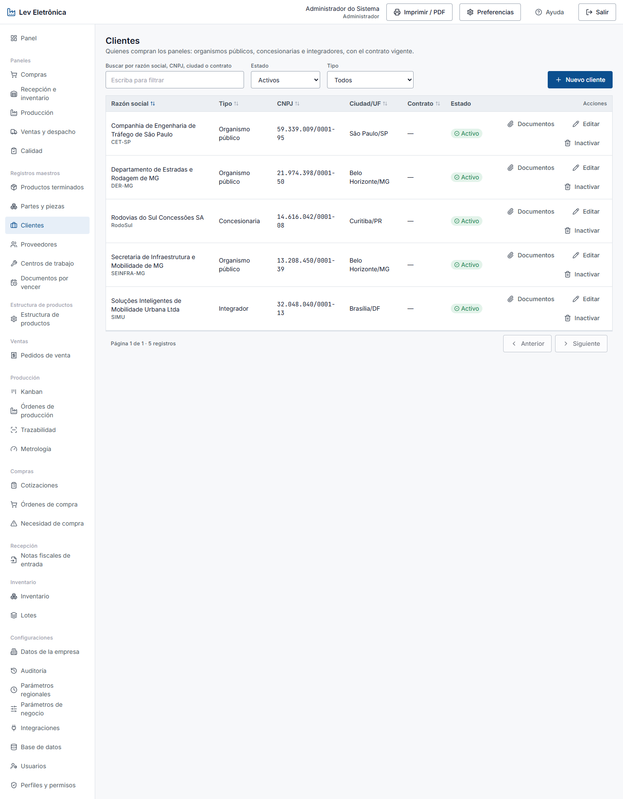

- **Obligatorios**: tipo, razón social y CNPJ (validado; el mismo CNPJ no puede
  registrarse dos veces).
- **Contacto y dirección**: nombre, correo electrónico y teléfono del contacto,
  dirección, ciudad y UF; todos opcionales.
- **Contrato**: número del contrato (o del acta) y vigencia. Cuando el fin de la
  vigencia ya pasó, la lista muestra la etiqueta **Contrato vencido**; es solo
  un aviso, el cliente sigue siendo utilizable.
- Al inicio, solo el Gestor de Operaciones y Ventas registran y editan
  clientes; el perfil Consulta solo ve.

---

## 22. Centros de trabajo

Haga clic en **Centros de trabajo**, en la sección "Registros maestros", para
registrar los bancos de trabajo y puestos donde ocurre cada etapa de la
producción. Los usarán las Órdenes de Producción y el Kanban (próxima fase).

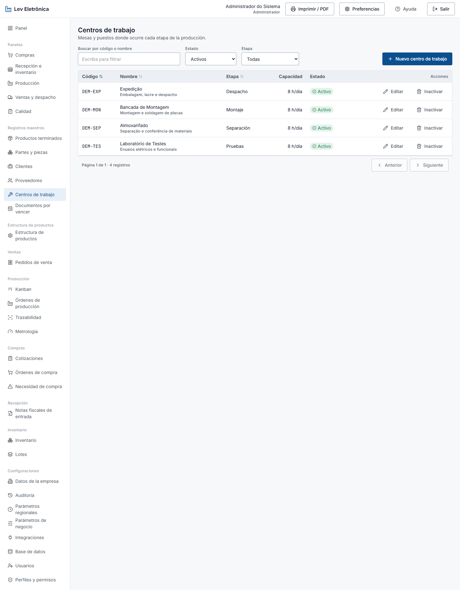

- **Código**: de 2 a 20 caracteres (letras, números, guion o guion bajo),
  siempre en mayúsculas; no cambia después de creado.
- **Etapa**: Separación, Montaje, Pruebas o Despacho, las etapas fijas del
  flujo de producción. La lista puede filtrarse y ordenarse por la etapa, en el
  orden del flujo.
- **Capacidad (horas/día)**: opcional, de más de 0 hasta 24.
- Al inicio, el Gestor de Operaciones registra y edita; Operador, Calidad,
  Ventas y Consulta solo ven.

---

## 23. Pedidos de venta

Haga clic en **Pedidos de venta**, en la sección "Ventas". Cada pedido registra
lo que un cliente compró y cuándo se prometió; **cada ítem se convierte en una
orden de producción (OP)**.

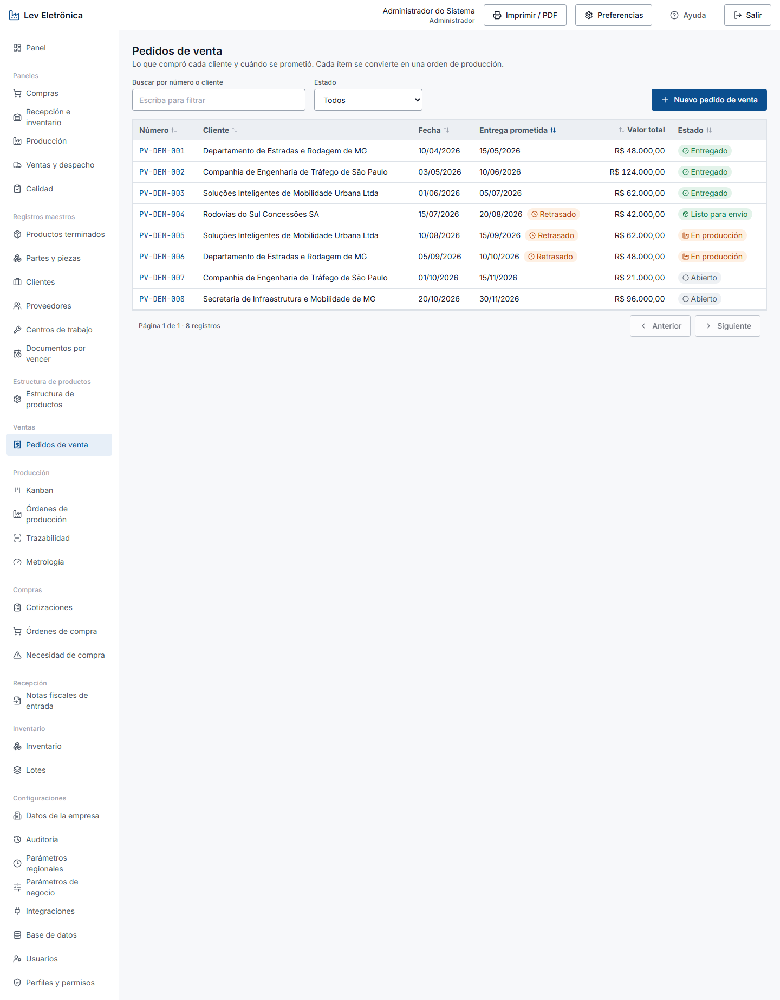

- **Nuevo pedido de venta**: número del pedido, cliente (solo clientes
  activos), fecha del pedido, entrega prometida (posterior a la fecha del
  pedido) y los ítems: producto terminado, cantidad y precio (ya viene el
  precio de venta del producto).
- **Estado**: *Abierto* → *En producción* (al generar la primera OP) → *Listo
  para envío* (cuando todas las OP se concluyen) → *Entregado*. La lista
  señala el pedido con la entrega prometida vencida.
- En el detalle del pedido, **Generar OP** crea la orden de producción de cada
  ítem. El producto debe tener una estructura (BOM) activa.
- **Editar** solo mientras el pedido está Abierto y sin OP en curso.
  **Cancelar** solo sin OP liberada (cancele primero las OP).
- **Registrar entrega** (pedido Listo para envío) da de baja el producto
  terminado del inventario y marca las unidades como despachadas.

---

## 24. Producción: Kanban y órdenes de producción

Haga clic en **Kanban**, en la sección "Producción", para ver las OP liberadas
en cuatro columnas: **Separación, Montaje, Pruebas y Despacho**, siempre en
ese orden. El tablero se actualiza solo cada 30 segundos y muestra quién está
trabajando en cada OP ahora.

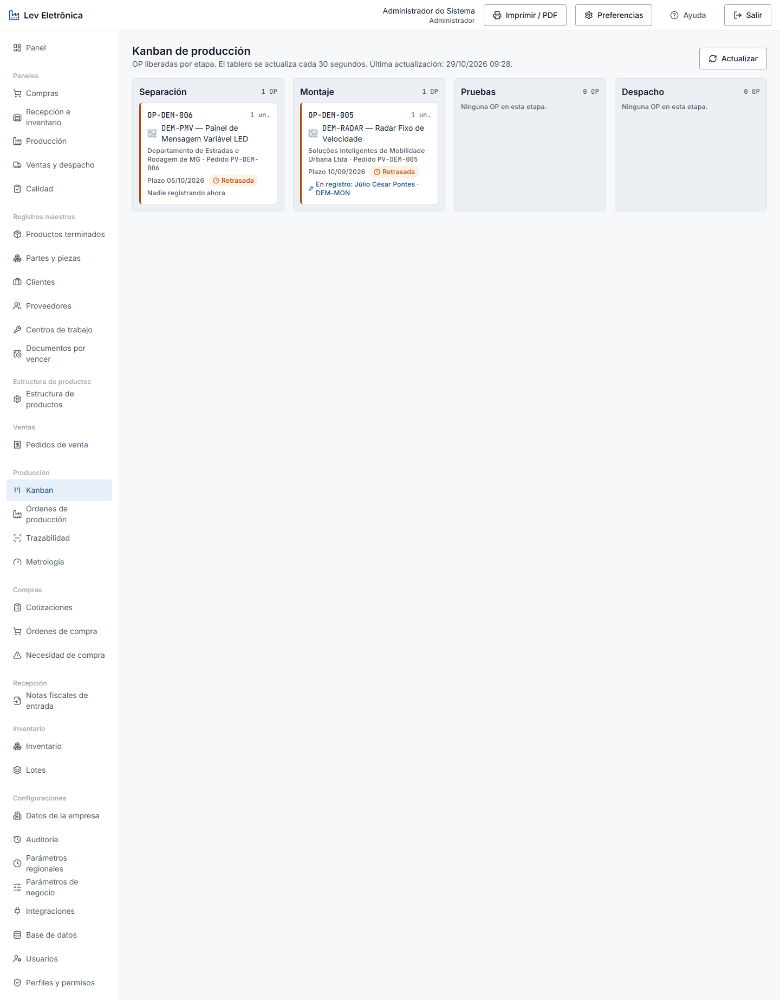

Haga clic en una OP (en el Kanban o en **Órdenes de producción**) para abrir el
detalle:

1. **Liberar OP**: reserva todo el material de la BOM. Es todo o nada: si falta
   alguna pieza, no se reserva nada y el sistema lista lo que falta
   (necesario x disponible). Al liberar, cada unidad recibe un **número de
   serie** (ej.: `RAD-200-2026-00001`) y la OP entra en Separación.
2. **Iniciar registro**: elija el centro de trabajo de la etapa actual. El
   operador es siempre quien tiene la sesión abierta. **Finalizar registro**
   anota la duración (solo quien lo inició lo finaliza; el Gestor puede
   destrabar un registro olvidado).
3. **Avanzar etapa**: exige al menos un registro finalizado en la etapa.
   - Al salir de **Separación**, el material reservado sale del inventario.
   - En **Pruebas**, registre **Aprobar** o **Reprobar** (con el motivo) para
     cada unidad. Solo avanza con todas aprobadas.
   - Si el producto **exige metrología** (radares, Inmetro), registre también
     la metrología de cada unidad (aprobación de modelo, precinto,
     verificación y validez). Una verificación vencida no libera la etapa.
   - En **Despacho**, **Concluir OP** coloca las unidades en el inventario de
     producto terminado.
4. **Cancelar OP**: solo antes del consumo del material (OP Abierta o aún en
   Separación); la reserva vuelve al inventario.

**Costo real** (solo para quienes tienen el permiso "Ver costo real de las
OP"): material presupuestado (BOM × costo promedio en la liberación) frente al
realizado (material consumido + horas registradas × costo/hora del centro de
trabajo), total y costo por unidad. El costo promedio de cada pieza se
actualiza con cada recepción de orden de compra. Los avisos señalan una pieza
sin costo de compra o un centro sin costo por hora.

El registro de **Productos terminados** ganó la opción **Exige metrología
(Inmetro)**; el de **Centros de trabajo**, el **Costo por hora (R$)**.

---

## 25. Trazabilidad y metrología

**Trazabilidad**: escriba (o escanee) el número de serie para abrir la **ficha
as-built** de la unidad: OP, pedido y cliente, componentes de la BOM usada,
cada registro (etapa, operador, centro, horarios), resultado de la prueba y
metrología. El **código QR** de la ficha puede imprimirse y pegarse en el
equipo: leído con el celular, abre la ficha.

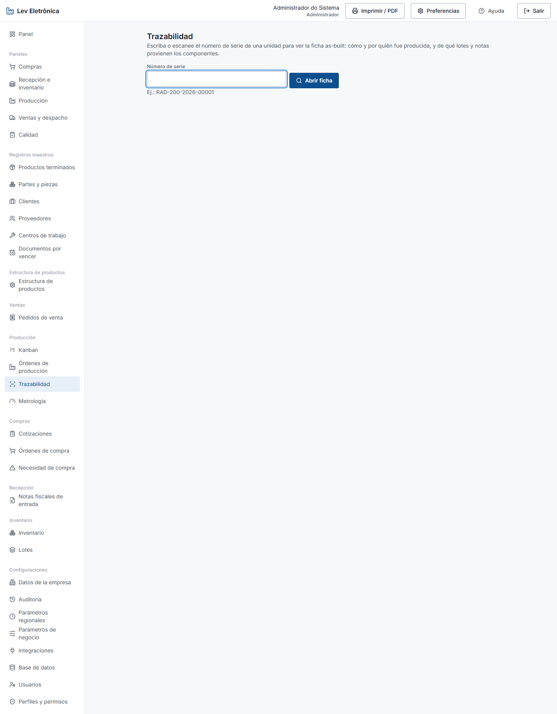

**Metrología**: lista las verificaciones metrológicas vencidas o que vencen en
los próximos 30, 60 o 90 días, con el precinto y el cliente, para programar la
reverificación.

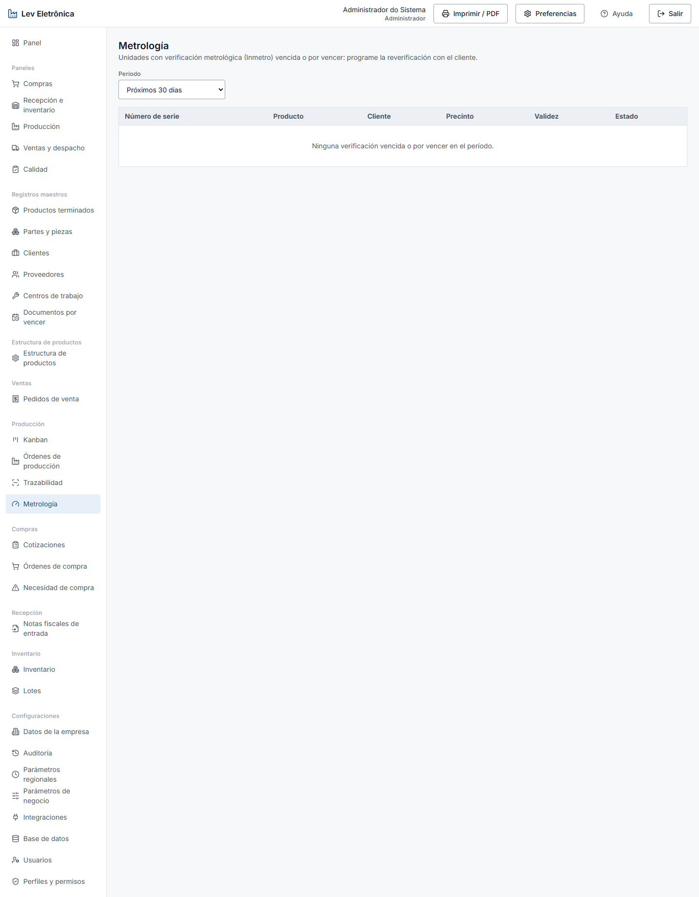

> El lote y la serie de los componentes todavía no aparecen en la ficha: pasan
> a capturarse en la recepción fiscal (próxima fase).

---

## 26. Recepción por nota fiscal

Menú **Recepción → Notas fiscales de entrada**. La nota pasa por tres
estados:

- **Borrador**: editable, nada ingresa al inventario;
- **Verificada**: sin bloqueos, lista para confirmar;
- **Confirmada**: el inventario, el costo promedio y el saldo de la orden de
  compra fueron actualizados.

Una nota confirmada puede ser **revertida** con motivo (si el material aún no
fue reservado ni consumido). Un borrador puede ser **cancelado**.

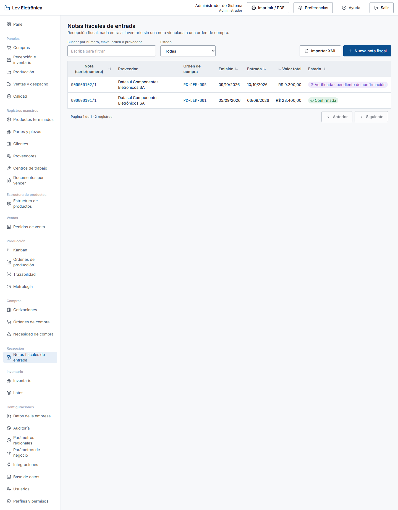

### 26.1 Importar el XML de la NF-e

El camino más rápido. Haga clic en **Importar XML**, elija la orden de compra
que la nota atiende y el archivo XML (modelo 55, hasta 2 MB) y haga clic en
**Leer XML**. La vista previa muestra emisor, serie/número, clave y totales, y
cada ítem:

- **reconocido** (verde): el código del proveedor ya tiene vínculo con una
  pieza (el *de-para*, o equivalencia), con el factor de conversión (ej.: 1
  caja = 100 unidades);
- **no reconocido** (naranja): elija la pieza y el factor y haga clic en
  **Vincular y memorizar**; la próxima vez el ítem vendrá reconocido.

Con todos los ítems reconocidos, **Crear borrador** guarda la nota ya con el
XML adjunto. El CFOP de salida del proveedor (5xxx/6xxx) se convierte
automáticamente en el de entrada (1xxx/2xxx). Los vínculos del proveedor
quedan en **Proveedores → Equivalencias** (acción en la fila del proveedor).

### 26.2 Registrar manualmente

**Nueva nota fiscal** abre el formulario vacío: encabezado (orden, modelo,
serie, número, clave de acceso de 44 dígitos, CFOP, fechas), valores
(productos, flete, seguro, descuento, IPI, ICMS-ST) y los ítems. Los ítems
vienen de la orden; un ítem fuera de la orden solo entra como
**bonificación**, con justificación (su costo de entrada es cero).

Para cada ítem informe la **cantidad recibida (contada)**, que puede diferir
de la nota, y, según la pieza:

- **lote y vencimiento**: uno o más lotes cuya suma es la cantidad recibida,
  con fabricación, vencimiento y certificado opcional;
- **número de serie**: escanee o escriba cada serie (Enter agrega), pegue una
  lista o genere un rango; el contador muestra "N de M".

### 26.3 Verificar y confirmar

**Verificar** guarda y verifica la nota. Las pendientes aparecen agrupadas:

- **Bloqueos** impiden seguir. Ejemplos: clave o CNPJ que no coinciden, CFOP
  fuera de la lista, suma de los ítems distinta del total, series faltantes o
  fuera de formato, vencimiento por debajo del mínimo, orden cerrada.
- **Aprobación**: divergencia de precio por encima de la tolerancia, cuando los
  parámetros de negocio indican pedir aprobación en lugar de bloquear (sección
  [17](#17-parámetros-de-negocio)). Solo confirma quien tiene el permiso de
  aprobar divergencias.
- Los **Avisos** no impiden nada.

**Confirmar nota** da la entrada al inventario, prorratea flete, seguro, IPI y
ST (menos el descuento) en el costo de cada ítem y actualiza la orden de
compra. Si alguien modifica la nota mientras usted verifica, la acción se
rechaza y la nota se recarga: verifique de nuevo.

Los **Adjuntos y fotos de la recepción** guardan el DANFE, certificados y
fotos de la mercadería, del precinto o de averías. Una vez confirmada, la nota
no pierde los adjuntos.

---

## 27. Lotes, series y trazabilidad de componentes

El menú **Inventario → Lotes** lista los lotes con proveedor, vencimiento y
saldo, con filtros por vencimiento.

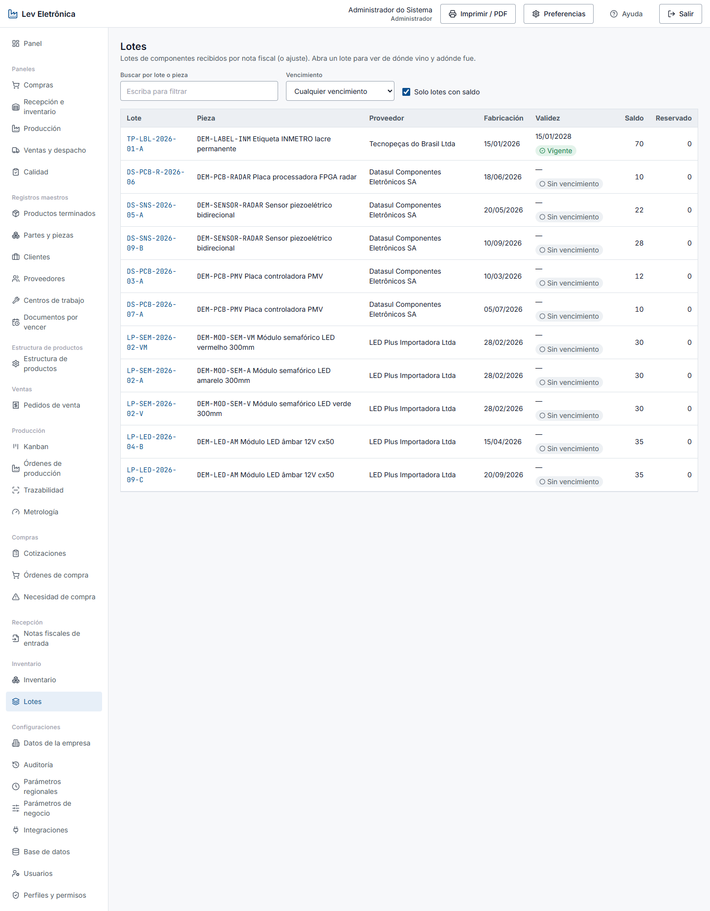

Al hacer clic en el lote se abre el rastreo **del lote al campo**: las notas
que lo trajeron, las órdenes de producción que lo consumieron y las unidades
producidas con él, con pedido de venta y cliente.

En la producción:

- la liberación de la OP reserva los lotes por el **vencimiento más próximo**
  (FEFO);
- un lote vencido no cuenta como disponible;
- las series de componente se reservan y, al concluir, se instalan en las
  unidades.

La ficha *as-built* (sección [25](#25-trazabilidad-y-metrología)) muestra los
componentes con serie y los lotes consumidos, con la nota y el proveedor de
origen.

Un ajuste manual de inventario de una pieza con lote o serie pide el lote (y el
vencimiento, si la pieza controla vencimiento) o las series.

---

## 28. Documentos y adjuntos

Los archivos se guardan en el propio sistema y solo se abren por enlaces
temporales (5 minutos) para quienes tienen permiso.

### 28.1 Medios de productos y piezas

En **Partes y piezas** y **Productos terminados**, **Medios y documentos**
reúne:

- la **foto principal** (aparece como miniatura en la separación, en el
  inventario y en la recepción) y una galería de hasta 10 fotos;
- los **documentos técnicos** en PDF por categoría (hoja de datos, dibujo,
  esquema eléctrico, manual, certificado, informe, instrucción, ficha de
  seguridad), con versión, emisión y validez. Una versión nueva reemplaza a la
  vigente y guarda el historial.

### 28.2 Documentos de los registros

Las OP, órdenes de compra, pedidos de venta, proveedores y clientes tienen una
sección **Documentos** (en proveedores y clientes, la acción **Documentos** en
la fila). Cada documento tiene una categoría de la lista del registro.
Ejemplos: informe de prueba en la OP, propuesta en la orden de compra, acta de
aceptación en el pedido de venta, certificado de calidad en el proveedor,
contrato en el cliente.

- **Registro cerrado** (OP concluida o cancelada, orden de compra concluida o
  cancelada, pedido de venta entregado o cancelado): todavía acepta documentos
  nuevos, pero ninguno puede eliminarse; quedan como constancia.
- Los **informes de prueba e informes de inspección** de la OP aparecen en la
  ficha *as-built* de cada unidad.

### 28.3 Documentos por vencer

El menú **Registros maestros → Documentos por vencer** lista los documentos
vigentes vencidos o que vencen en el plazo elegido. Entran documentos de
productos, piezas, proveedores y clientes, cada uno solo para quien puede ver
ese registro.

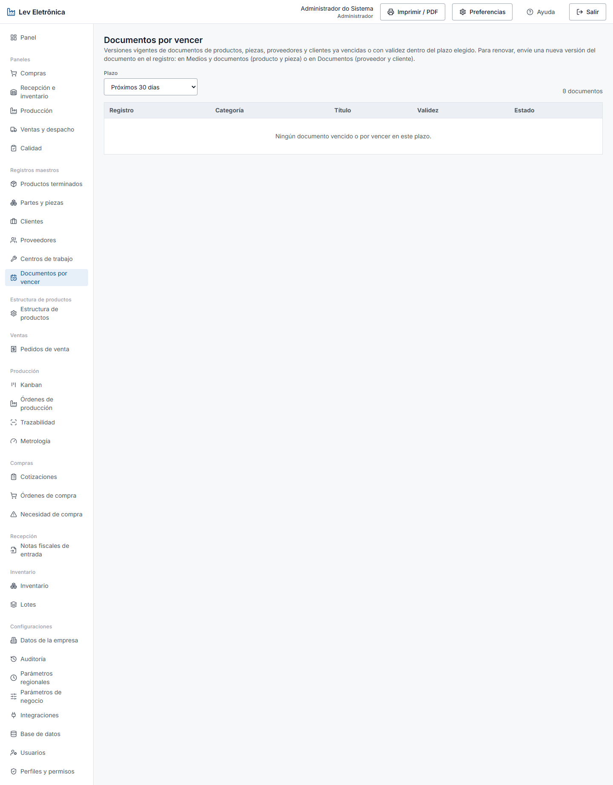

---

## 29. Paneles por sector

Menú **Paneles**: un panel de indicadores y gráficos para cada sector. Cada
panel tiene su permiso (sección [19](#19-perfiles-y-permisos)), y el menú solo
muestra los que la persona puede ver. Para liberar un panel a una persona sin
cambiar su perfil, conceda el permiso individual en **Usuarios** (sección
[20](#20-usuarios)).

| Panel | Perfiles con acceso por defecto |
|---|---|
| Compras | Gestor, Comprador, Consulta |
| Recepción e inventario | Gestor, Comprador, Almacenista, Consulta |
| Producción | Gestor, Operador, Calidad, Consulta |
| Ventas y despacho | Gestor, Ventas, Consulta |
| Calidad | Gestor, Calidad, Consulta |

### 29.1 Controles

En la parte superior de cada panel:

- **Período**: últimos 30, 90, 180 o 365 días. Vale para los indicadores de
  flujo (comprado, entregado, concluido, probado, lead time). Los de "ahora"
  (abiertos, con retraso, críticos, por vencer) no dependen del período. Los
  gráficos mensuales muestran siempre al menos 6 meses.
- **Actualización automática**: desactivada, 30 s, 1, 2, 5 o 10 minutos
  (predeterminado: 1 minuto). "Actualizado a las …" muestra la última
  lectura.
- **Modo TV**: pantalla completa, sin menú, con letra más grande, para dejar el
  panel en un televisor de la planta. Mientras esté activado y la pantalla
  visible, la sesión no se cierra por inactividad. **Esc** o **Salir del modo
  TV** vuelven a lo normal.

El período, la actualización y el modo TV quedan en la dirección de la página
(por ejemplo `/paineis/producao?dias=90&atualizar=60&tv=1`). Guarde esa
dirección como favorito en el televisor para que siempre se abra de la misma
manera.

En todo gráfico, **Ver datos** muestra la misma información en una tabla, para
verificar números y para lectores de pantalla.

Los gráficos usan una **paleta de colores** para distinguir las categorías: en
un gráfico de una sola serie (por ejemplo, OPs por etapa), cada barra tiene su
color; cuando hay varias series, el color identifica la serie y la leyenda la
explica. Los colores son de categoría, no de estado: verde y rojo en los
gráficos no significan "bueno" o "malo". La paleta tiene versión para el tema
oscuro.

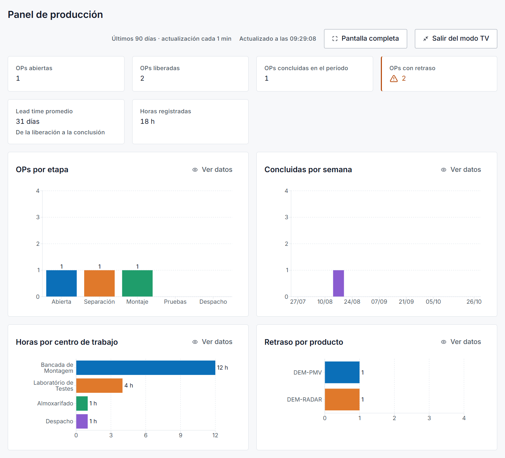

### 29.2 Compras

Órdenes abiertas (cantidad y valor), con retraso, lead time real promedio (de
la orden a la última nota fiscal) y porcentaje recibido a tiempo; gráficos de
órdenes por estado, comprado por mes, retrasos y lead time por proveedor.

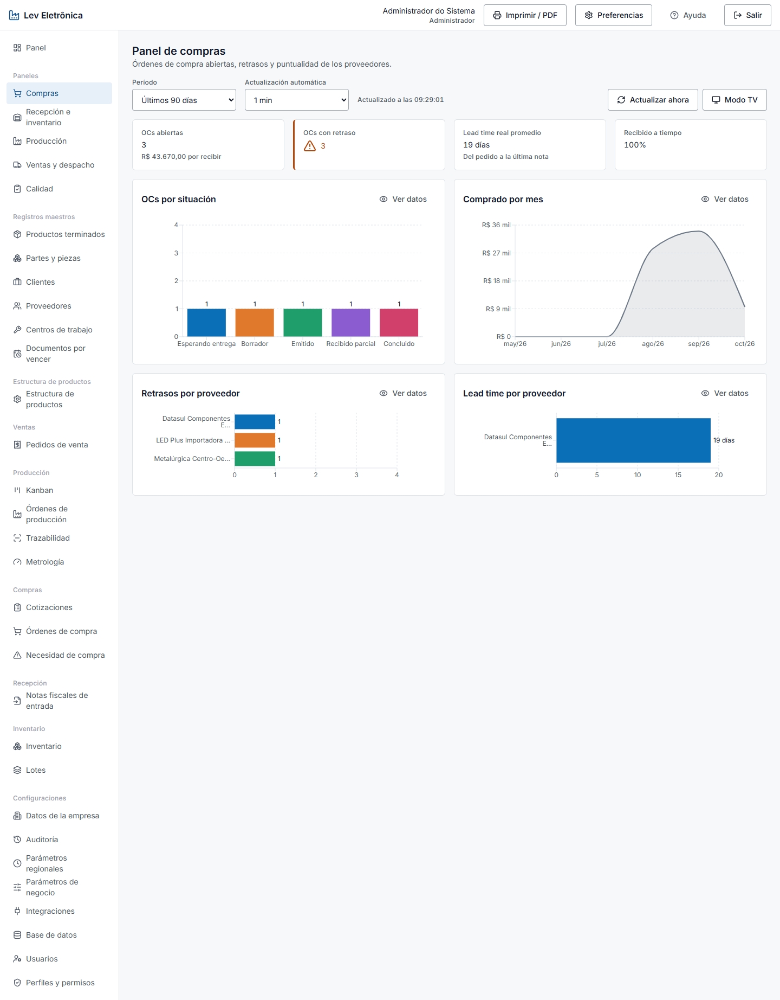

### 29.3 Recepción e inventario

Valor en inventario al costo promedio (solo para quien puede ver costos),
ítems críticos, notas esperando confirmación y lotes vencidos y por vencer;
gráficos de entradas por mes, notas por estado, lotes por rango de
vencimiento y los ítems de mayor valor en inventario.

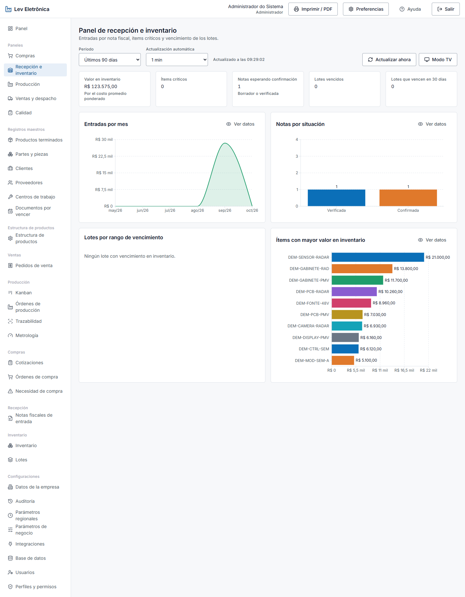

### 29.4 Producción

OP abiertas, liberadas, concluidas en el período y con retraso, lead time
promedio (de la liberación a la conclusión, en días calendario) y horas
registradas; gráficos de OPs por etapa, concluidas por semana, horas por
centro de trabajo y retrasos por producto.

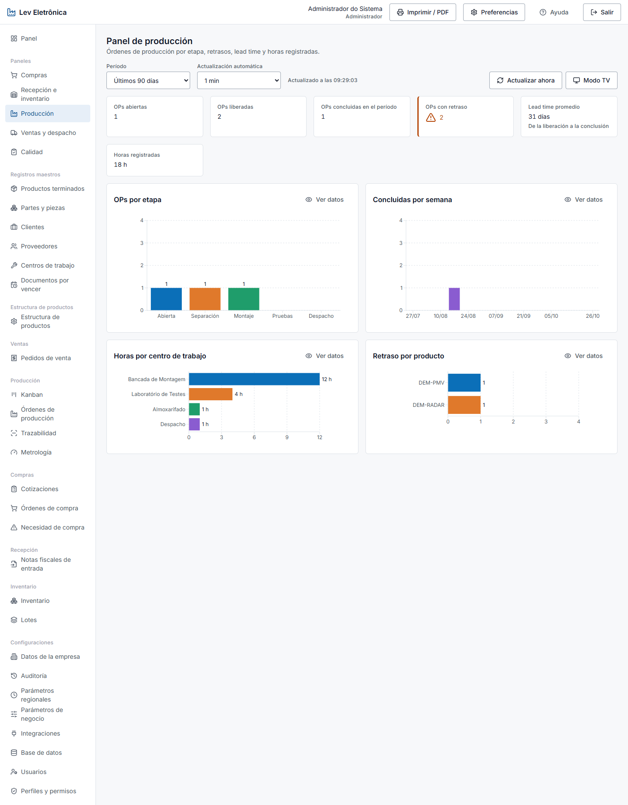

### 29.5 Ventas y despacho

Cartera (valor de los pedidos aún no entregados), pedidos con retraso, valor
entregado en el período y entregas a tiempo (OTD); gráficos de pedidos por
estado, entregado por mes, OTD por mes y principales clientes.

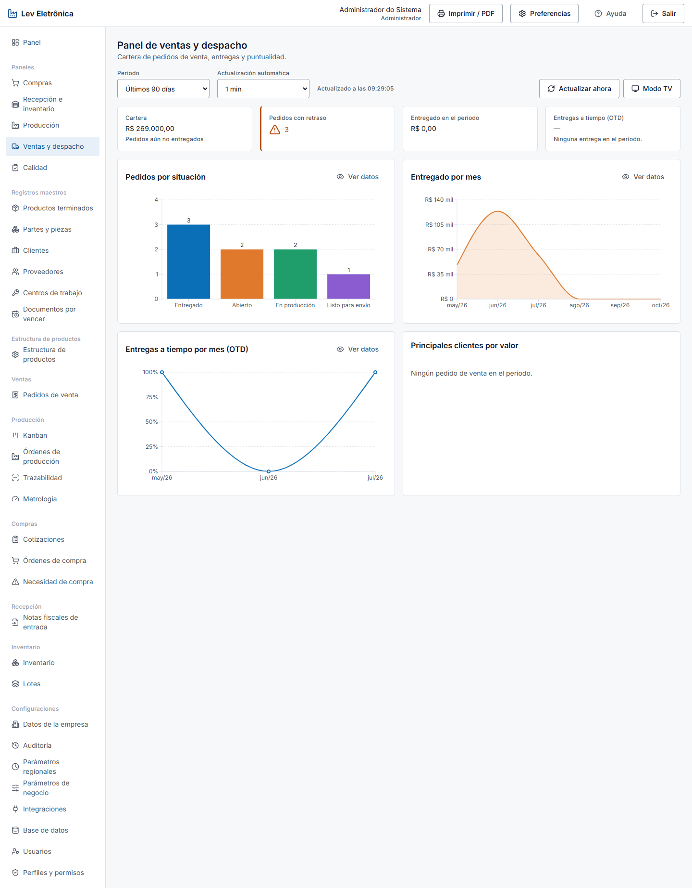

### 29.6 Calidad

Unidades probadas, aprobadas y reprobadas, tasa de aprobación y metrología
vencida y por vencer; gráficos de aprobación por semana, reprobaciones por
producto y metrología por rango de vencimiento.

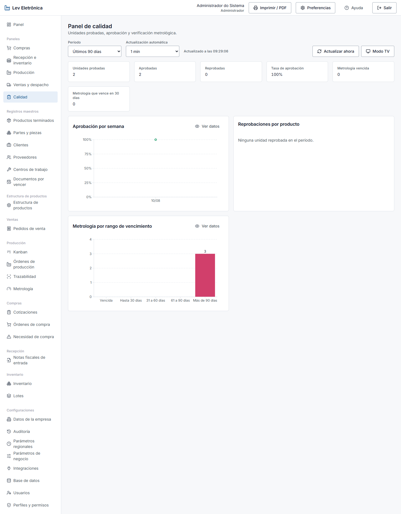

---

## 30. Ayuda contextual

Toda pantalla del sistema, incluido el inicio de sesión, tiene un botón
**Ayuda** en el encabezado. Abre una ventana con un recordatorio rápido de lo
que se puede hacer en **esa pantalla específicamente**; no es el manual
completo, es la sugerencia del momento.

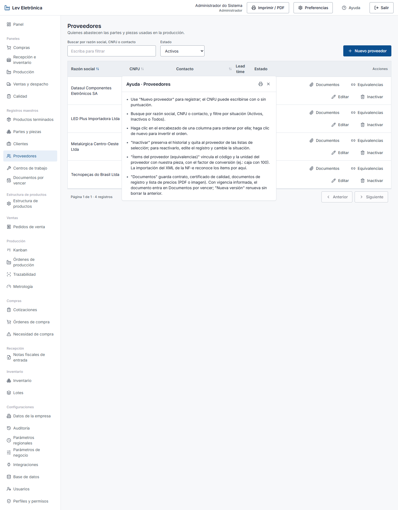

Use la Ayuda cuando tenga una duda puntual durante la operación; vuelva a este
manual cuando necesite el paso a paso completo o contexto sobre cómo se
relacionan las pantallas.

---

## 31. Preguntas frecuentes

**Inactivé un registro por error. ¿Cómo lo deshago?**
Cambie el filtro Estado a "Inactivos" o "Todos", haga clic en Editar en el
registro y cambie el Estado de nuevo a "Activo".

**Registré un proveedor y no desaparece de la pantalla de Proveedores, pero sí
de la lista de "Proveedor predeterminado" al registrar una pieza. ¿Por qué?**
Probablemente fue inactivado. Los proveedores inactivos siguen en la pantalla
de Proveedores (filtre por "Inactivos" o "Todos" para verlos), pero ya no
aparecen como opción para nuevos vínculos, como el proveedor predeterminado de
una pieza.

**¿Por qué el sistema rechazó el CNPJ que escribí?**
Dos causas comunes: el CNPJ no es válido (el dígito verificador no coincide), o
ya existe un proveedor registrado con ese CNPJ, aunque esté inactivo. El
mensaje en la parte superior del formulario dice cuál de los dos casos es.

**La lista está vacía pero sé que existen registros.**
Verifique el filtro Estado: el valor predeterminado es "Activos". Si el
registro que busca fue inactivado, cambie el filtro a "Inactivos" o "Todos".

**El sistema me devolvió solo al inicio de sesión.**
La sesión expira después de un tiempo de inactividad, por seguridad. Ingrese de
nuevo: no se pierde ningún dato.

**No puedo editar una cotización o una orden de compra después de enviada.**
Por ahora no hay edición libre después del Borrador: el flujo pasa por
"Registrar respuesta" (cotización) o sigue hasta la emisión (orden). Si los
datos están equivocados, cancele y registre de nuevo.

**Convertí una cotización en orden de compra, pero el precio no es el que
esperaba.**
El precio de la orden es siempre el precio **negociado en la cotización** (lo
que se registró en "Registrar respuesta"), nunca un valor nuevo escrito en la
conversión; esto evita que la orden salga con un precio distinto del acordado
con el proveedor.

**Registré una pieza hace un momento y ya aparece en estado Crítico en la
pantalla de Inventario. ¿Es un error?**
No. Toda pieza nace con saldo cero, porque todavía no hubo ninguna entrada. La
regla de clasificación (sección [10.1](#101-consultar-el-saldo)) considera
crítico todo saldo **menor o igual** al inventario mínimo registrado, y esto
vale incluso cuando el mínimo es cero (cero es menor o igual a cero). Registre
un ajuste de entrada (sección
[10.2](#102-ajustar-el-saldo-manualmente)) o reciba una orden de compra
(sección [10.3](#103-recibir-mercadería-de-una-orden-de-compra)) para que la
pieza salga de ese estado.

**¿Por qué no se puede editar una estructura de producto existente?**
Por diseño (RF1.3): una BOM no puede eliminarse ni editarse, solo
**versionarse**. Esto preserva exactamente lo que consumió cada orden de
producción pasada: si fuera posible editar la versión 1 después de que ya se
usó para producir, el historial de producción mentiría sobre lo que realmente
se armó. Para cambiar la composición, use "Nueva versión" (sección
[7.2](#72-nueva-versión)); para volver a una composición antigua, defínala como
vigente (sección
[7.3](#73-ver-todas-las-versiones-y-definir-la-vigente)).

**Una pieza que sé que está crítica no aparece en Necesidad de compra.**
Dos causas posibles: el saldo es **exactamente igual** al inventario mínimo
(la pantalla de Inventario lo considera Crítico, pero la necesidad de compra
exige un saldo **por debajo** del mínimo, ya que sugerir comprar cero unidades
no ayudaría); o la pieza fue inactivada (la necesidad de compra solo considera
piezas activas).

**Una fila de la Auditoría muestra Usuario e IP en blanco (—). ¿Es un error?**
Solo si la fecha es reciente. Antes de la corrección que acompaña a esta
funcionalidad, el sistema no registraba usuario ni IP en ninguna modificación:
las filas grabadas antes de eso quedan permanentemente en blanco en esos dos
campos. Por lo demás, un blanco también es normal en acciones sin una sesión de
usuario asociada (por ejemplo, una rutina interna del sistema).

---

**Última actualización**: Agosto de 2026 · Fase 4 (auditoría).
